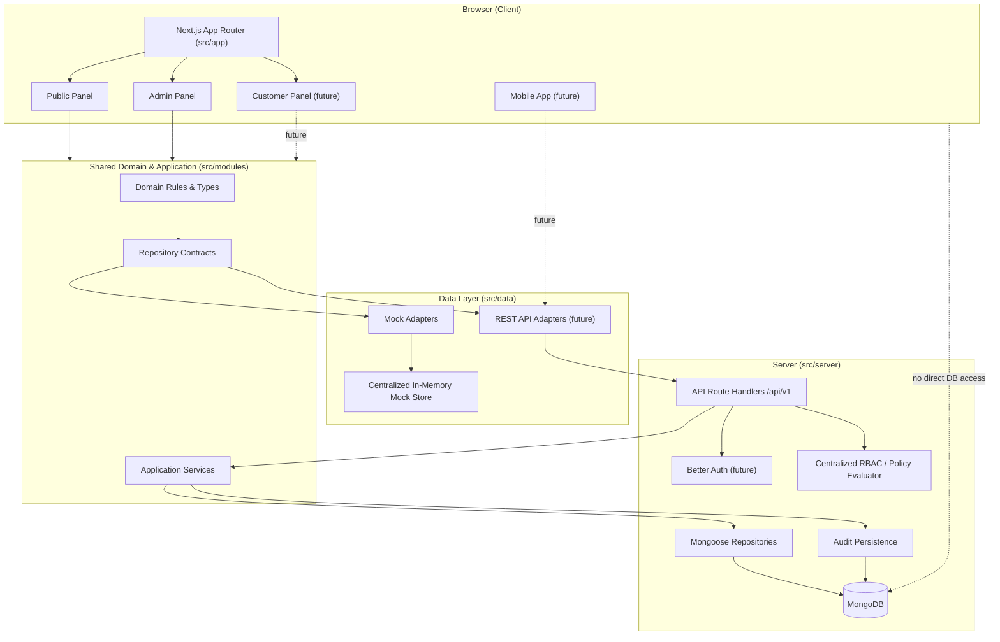
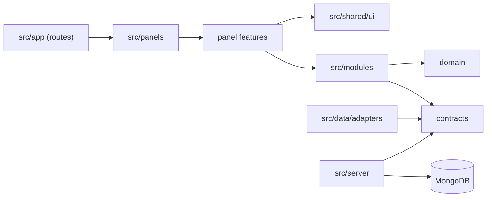

# AFHomes Platform — Technical Architecture

> Authoritative technical architecture for AI coding agents and contributors.
> Read `docs/project.md` first for product scope and approved business decisions.
> This document defines **where code belongs, how modules interact, and which boundaries must not be crossed**.
> It is a target architecture, not a requirement to create every directory immediately.

---

## 1. Architecture Overview

AFHomes Platform is a **panel-based, feature-based modular monolith** delivered as a single Next.js application in a single repository.

- One Next.js application (App Router)
- One repository
- Three logically independent presentation panels: Admin, Public, future Customer
- Centralized domain modules shared across panels
- Typed repository contracts with replaceable mock/API adapters
- Centralized authorization policies
- Server-only database infrastructure
- Versioned REST API under `/api/v1`

The architecture optimizes for the seven-day MVP while preserving clear boundaries for future Customer Portal, mobile clients, and backend integration.

### 1.1 Core Decisions

| Decision | Value |
|---|---|
| Repository strategy | Single repository |
| Application strategy | Single Next.js application |
| Router | Next.js App Router |
| Frontend | React + TypeScript |
| Styling | Tailwind CSS + CSS Modules where needed |
| UI foundation | shadcn/ui |
| Validation | Zod |
| Client async state | TanStack Query |
| Initial data source | Centralized in-memory mock store |
| Mock persistence | In-memory only; reset on full browser refresh |
| API strategy | Versioned REST `/api/v1` |
| Database | MongoDB |
| ODM | Mongoose |
| Authentication | Better Auth (subject to compatibility verification) |
| Authorization | Centralized RBAC and policy evaluation |
| Development method | Frontend-first, mock-data-driven |
| Testing (initial) | Manual UI testing; automated before production |
| MVP target | Seven calendar days |
| Initial environment | Local development |
| Hosting | Not selected |
| Future mobile client | React Native + Expo (future direction; same repository; not implemented in MVP) |

### 1.2 What This Is Not

- Not microservices
- Not separate frontend/backend applications
- Not a monorepo workspace framework
- Not a full public marketing website (deferred)
- Not a Customer Portal implementation (deferred, documented only)
- Not a mobile application during the MVP (future, documented only)

---

## 2. Architectural Principles

1. **Separation of concerns** — routing, presentation, domain, data access, and infrastructure are distinct.
2. **Clear module boundaries** — each module owns its domain and exposes a controlled interface.
3. **Centralized business rules** — domain invariants live in `src/modules`, not in UI components.
4. **Reusable UI components** — panel-scoped first; cross-panel sharing is intentional.
5. **Shared validation contracts** — Zod schemas reused across client and server where practical.
6. **Repository-based data access** — components depend on contracts, not storage.
7. **Secure-by-default authorization** — server-side enforcement; UI visibility is not authorization.
8. **Consistent error handling** — uniform error shapes and status codes.
9. **Traceable state changes** — audit events for sensitive operations.
10. **Minimal unnecessary complexity** — no abstraction without a concrete need.
11. **Maintainability and extensibility** — modular monolith with stable seams.
12. **API readiness** — REST contracts support future mobile and customer clients.

---

## 3. System Context

### 3.1 Actors

- **Public Visitor** — unauthenticated; public accreditation search and login entry.
- **Authenticated Staff** — role-based access to Admin Panel.
- **Finance** — verification and activation approval.
- **Customer** — future Customer Portal (deferred).
- **Mobile Client (future)** — React Native application reusing the shared REST API.
- **External Systems** — MongoDB, Better Auth (future), hosting (future).

### 3.2 Trust Boundaries

- Browser is untrusted.
- All authorization, validation, and persistence are server-side in production.
- Mock services are development-only and never authoritative in production.
- Database credentials and privileged operations never reach Client Components.

---

## 4. High-Level Architecture Diagram



**Mock development path:** Panel → shared modules → repository contract → mock adapter → in-memory mock store.

**Real backend path:** Panel → shared modules → repository contract → API adapter → `/api/v1` route handler → application service → policy check → Mongoose repository → MongoDB.

The browser never communicates directly with MongoDB.

---

## 5. Layer Responsibilities

| # | Layer | Location | Responsibility | May Depend On |
|---|---|---|---|---|
| 1 | Routing and composition | `src/app/` | Route definitions, layouts, thin page composition | Panels, shared |
| 2 | Panel presentation | `src/panels/*` | Panel-specific UI, hooks, styling, navigation | Features, shared, modules (contracts) |
| 3 | Frontend features | `src/panels/*/features/*` | Page composition, components, hooks, styles | Shared UI, modules |
| 4 | Application services | `src/modules/*/application/` | Use cases, workflow orchestration | Domain, contracts, policies |
| 5 | Domain rules and validation | `src/modules/*/domain/`, `schemas/` | Types, invariants, Zod schemas | Nothing platform-specific |
| 6 | Repository contracts | `src/modules/*/contracts/` | Interfaces, typed operation boundaries | Domain types |
| 7 | Data adapters | `src/data/adapters/*` | Mock/API implementations of contracts | Contracts, mock store / HTTP |
| 8 | Backend infrastructure | `src/server/*` | DB connection, auth, repositories, security | Mongoose, Better Auth |
| 9 | Database and integrations | MongoDB | Persistence | — |

### 5.1 Dependency Direction

Dependencies point inward: presentation depends on application/domain; infrastructure depends on contracts. Domain depends on nothing platform-specific.



Prohibited: `modules` importing panel UI; `shared` importing feature code; client components importing server-only modules; API handlers importing presentation components.

---

## 6. Detailed Project Folder Structure

Approved baseline (target structure; not every directory must exist immediately):

```text
afhomes-platform/
├── docs/
│   ├── project.md
│   ├── business-rules/
│   └── development/
│       └── architecture.md
├── public/
│   └── assets/{logos,images,icons,fonts}
├── src/
│   ├── app/
│   │   ├── (public)/
│   │   ├── (auth)/
│   │   ├── (admin)/admin/...
│   │   ├── api/{auth,v1}
│   │   ├── layout.tsx
│   │   └── globals.css
│   ├── panels/
│   │   ├── admin/{layouts,components,features,hooks,providers,config,styles}
│   │   ├── public/{layouts,components,sections,pages,features,hooks,providers,config,styles}
│   │   └── customer/{...}   (future, documented only)
│   ├── modules/
│   │   └── {auth,roles,customers,vip-products,vip-cards,finance,sale-team,genealogy,accreditation,audit}
│   ├── data/
│   │   ├── mock/{seed,store.ts,demo-accounts.ts}
│   │   └── adapters/{mock,api}
│   ├── server/
│   │   └── {db,auth,repositories,security}
│   ├── shared/{ui,hooks,types,utils,constants}
│   └── config/environment.ts
├── tests/{unit,integration,e2e}
├── scripts/
├── AGENTS.md
├── README.md
├── package.json
├── tsconfig.json
└── next.config.ts
```

### 6.1 Folder Ownership Rules

- `src/app/` owns routing and thin composition only.
- `src/panels/` owns panel-specific presentation.
- `src/modules/` owns shared domain and application logic.
- `src/data/` owns mock data and frontend-facing data adapters.
- `src/server/` owns server-only infrastructure.
- `src/shared/` owns genuinely cross-panel utilities and primitives.
- `src/config/` owns cross-application configuration.
- `tests/` holds test infrastructure as introduced.

Do not create empty directories merely to match this diagram. Each directory must have a clear ownership purpose. If existing code uses a different structure, document the approved target and identify differences without refactoring.

### 6.2 Future Repository Evolution (documented only)

The future mobile application and shared packages layout is documented in Section 31 (Future Mobile Application and Repository Evolution).

Do not create `mobile/`, `packages/`, workspace configuration, or mobile application files during the MVP.

---

## 7. Panel Organization

Three logically independent presentation panels. Each owns its layouts, components, features, hooks, providers, config, styling, and design tokens.

### 7.1 Admin Panel — MVP

Location: `src/panels/admin/`

Serves authenticated operational users (Super Admin, Admin, HR, Finance, VD, SSM, SM, IST, OST, Staff). Roles share the Admin Panel shell with different navigation, permissions, and record visibility.

Responsibilities: Dashboard, Roles and permissions, Customers, VIP products, Issued VIP cards, Finance verification and activation, IST/OST management, Sales genealogy, Customer search, Audit logs.

### 7.2 Public Panel — Limited MVP

Location: `src/panels/public/`

Own layouts, navbar/footer, reusable UI, sections, pages, features, hooks, config, styling, tokens. MVP scope: minimal public interface, public IST/OST accreditation verification, login navigation. Future sections (Hero, About, Benefits, Contact) may be defined but are not approved for implementation as a full marketing site during MVP.

### 7.3 Customer Panel — Future Phase (documented only)

Location: `src/panels/customer/`

**Approved decision:** Reserve as a future third panel following the same organizational conventions. Future routes `/customer/*`. Reuse shared domain services for customer identity, VIP cards, authentication. Enforce customer-specific authorization preventing access to other customers' records.

**Critical restriction:** Document structure only. Do not implement or scaffold the Customer Portal during the MVP.

---

## 8. Admin Panel Architecture

- Route group `(admin)` with layout `src/app/(admin)/admin/layout.tsx` composing `src/panels/admin/layouts/`.
- Permission-based navigation driven by centralized policy evaluation against the mock/real identity.
- Data-intensive UI: tables, filters, forms, dialogs, pagination.
- Features under `src/panels/admin/features/*` (dashboard, roles, customers, vip-products, vip-cards, finance, sale-team, genealogy, customer-search, audit-logs).
- Admin-specific design tokens (`.admin-theme`).

---

## 9. Public Panel Architecture

- Route group `(public)` with its own layout, navbar, footer.
- Minimal scope: branding, accreditation search, login entry.
- Accreditation search feature under `src/panels/public/features/accreditation-search/`.
- Public design tokens (`.public-theme`).
- No name-based discovery; exact AA number only.

---

## 10. Future Customer Panel Architecture

Documented only. Same conventions as Admin/Public. Customer-specific authorization. Deferred implementation. Reuse shared domain services. No scaffolding during MVP.

---

## 11. Feature Folder Conventions

A panel feature separates page composition, UI components, hooks, and styles:

```text
src/panels/admin/features/customers/
├── pages/
│   ├── CustomersPage.tsx
│   └── CustomerDetailsPage.tsx
├── components/
│   ├── CustomerTable.tsx
│   ├── CustomerForm.tsx
│   ├── CustomerFilters.tsx
│   └── CustomerDetailsCard.tsx
├── hooks/
│   ├── useCustomers.ts
│   └── useCustomerForm.ts
├── styles/
│   ├── CustomersPage.module.css
│   └── CustomerForm.module.css
└── index.ts
```

This is a representative example, not a mandatory file list. Avoid unnecessary folders for trivial features.

- **Pages** compose feature components and coordinate page-level presentation.
- **Components** render UI and collect interactions.
- **Hooks** manage UI state, form behavior, and TanStack Query interactions.
- **Styles** hold feature-specific CSS Modules where Tailwind is insufficient.
- **Index files** expose a controlled public API when useful. Avoid large barrel files that accidentally import server-only code or unrelated features.

---

## 12. Shared Domain Module Conventions

Business logic must not be duplicated between panels. Each module under `src/modules/<name>/`:

```text
src/modules/customers/
├── domain/
│   ├── customer.types.ts
│   └── customer.rules.ts
├── application/
│   └── customer.service.ts
├── contracts/
│   └── customer.repository.ts
├── schemas/
│   └── customer.schema.ts
└── index.ts
```

- **Domain layer:** types, business invariants, pure business rules, state-transition constraints. Must not depend on React, Next.js route handlers, browser storage, or database drivers.
- **Application layer:** use cases, workflow orchestration, repository interactions, policy enforcement integration, business operation results. Depends on interfaces, not database implementations.
- **Contracts layer:** repository interfaces, typed operation contracts, shared service boundaries. Must support replacing mock with real backend implementations.
- **Schema layer:** Zod input validation, data contracts, consistent validation error structures. Reused where appropriate; backend validation never relies exclusively on browser validation.

Modules: auth, roles, customers, vip-products, vip-cards, finance, sale-team, genealogy, accreditation, audit.

---

## 13. UI Design System and Styling Rules

### 13.1 Independent Panel Design Systems

Each panel has its own design identity:

- **Admin:** data-intensive workflows, tables, forms, dashboards, filters, dialogs, operational navigation.
- **Public:** branding, content sections, responsive landing pages, public search, accessible interactions, future animation/storytelling.
- **Customer (future):** membership info, profile, VIP card presentation, self-service, future benefits/transactions.

### 13.2 Panel-Scoped Styling

Each panel defines its own colors, typography, spacing, radii, shadows, component variants, responsive conventions, animation tokens via scoped CSS variables: `.admin-theme`, `.public-theme`, `.customer-theme`. Avoid global overrides causing cross-panel conflicts. `src/app/globals.css` contains only truly global styles, Tailwind setup, and minimal resets.

### 13.3 Reusable UI Components

Each panel may own presentation-specific UI components (Button, Card, Table, Input, Select, Dialog, Badge, Tabs, Pagination, Dropdown, Skeleton, Tooltip). Shared primitives under `src/shared/ui/` only when cross-panel sharing is intentional. Do not force identical visual components where design systems differ.

### 13.4 shadcn/ui Conventions

shadcn/ui is the preferred component foundation. Generated primitives are owned, wrapped, styled, and reused with discipline. Avoid uncontrolled duplication of the same base primitive across panels. Recommended: shared minimally styled primitives where appropriate; panel-specific wrappers/variants for distinct designs; feature-specific components for domain-specific UI.

### 13.5 Styling Conventions

Use Tailwind for standard layout/utility styling; CSS variables for design tokens; CSS Modules for complex feature-specific styles; component variants for repeated patterns. Avoid large global CSS, unscoped selectors, inline style duplication, random hardcoded colors, competing token definitions, unnecessary CSS files for trivial components.

---

## 14. Routing and Code-Splitting Rules

### 14.1 App Router

`src/app/` contains route definitions and composition only. Feature implementations live in panel feature directories. Example: `src/app/(admin)/admin/customers/page.tsx` composes `src/panels/admin/features/customers/pages/CustomersPage.tsx`. Route groups organize layouts without changing URL paths. Document intended public, login, admin URL conventions; avoid overlapping routes.

### 14.2 Server and Client Components

Use Server Components by default where appropriate. Use `"use client"` only for components requiring browser-side interactivity, hooks, or client state. Do not mark entire layouts or feature trees as Client Components unnecessarily.

### 14.3 Code Splitting

Require route-level code splitting; lazy loading for heavy interactive features; dynamic imports where justified; panel isolation; avoidance of broad cross-panel imports; server-only module boundaries; controlled dependency direction. Potential lazy-loaded features: genealogy visualization, advanced data tables, large interactive forms, future heavy charts. No code-splitting abstractions without a measurable reason.

### 14.4 Import Rules

- Panel features may import shared domain contracts and client-safe services.
- Shared domain modules must not import panel UI.
- Public Panel must not import Admin-only components.
- Client Components must not import server-only modules.
- API handlers must not depend on presentation components.
- Cross-feature access should use public module interfaces where practical.

---

## 15. Dependency and Import Boundaries

| From | May Import | Must Not Import |
|---|---|---|
| `src/app/*` | panels, shared | modules internals, server |
| `src/panels/*` | shared, modules (contracts/services), data adapters | other panels' internals, server |
| `src/modules/*` | own domain/contracts, shared types/utils | panels, app, server, data |
| `src/data/*` | modules contracts, mock store | panels, app, server |
| `src/server/*` | modules contracts, mongoose, auth libs | panels, app, client-only |
| `src/shared/*` | nothing domain-specific | modules, panels, server |

Avoid circular dependencies. Keep Next.js routes thin.

---

## 16. Centralized Mock Data Architecture

**Approved decision:** One centralized in-memory mock data store during frontend development. All mock records derived from consistent synthetic seed data.

Supports: CRUD, search, filtering, relationships, simulated async responses, mock role-based access, Finance verification, VIP card activation, audit events, demo account switching.

### 16.1 Reset Behavior

**Approved decision:** Reset to original seed data on every full browser refresh.

- Do not use localStorage for mock business data.
- Do not use IndexedDB for mock business data.
- No persistent mock databases.

The browser-scoped mock store initializes from seed data on module load. A module-level variable is not shared across browser and server execution environments; design accordingly (client-only store).

> Note: This supersedes the earlier "optional localStorage persistence" mention in `docs/project.md`. Reconciliation of that document is required (see Section 32).

### 16.2 Mock Identity and Role Switching

Development-only mock identity mechanism supporting Super Administrator, Administrator, HR, Finance, VD, SSM, SM, IST, OST, and other authorized staff. Selected identity determines simulated permissions and data visibility. Changing demo identity must invalidate or clear permission-sensitive cached data. Not production authentication; not an unrestricted production capability.

### 16.3 Mock Data Relationships

Consistent relationships among Users, Roles, Customers, VIP products, Contract versions, Issued VIP cards, Finance verification records, Sales-team members, Genealogy relationships, Accreditations, Audit events. All seed records synthetic; no real customer information.

---

## 17. Mock Repository and Adapter Design

Each domain module defines its own repository interface (`contracts/`). Mock adapters implement those contracts (`src/data/adapters/mock/`). Real backend integration preserves equivalent contracts where practical.

- Components never mutate seed arrays directly.
- No duplicate stores per feature.
- No independent copies of related entities.
- No direct mock-data imports inside presentation components.
- UI communicates through stable service/repository interfaces so replacing mock repositories does not require rewriting presentation components.

---

## 18. TanStack Query Conventions

Use TanStack Query for: asynchronous data queries, mutation handling, loading states, error states, cache invalidation, shared query-key conventions.

Use local React state for: dialog visibility, form presentation, temporary filters, UI-only interaction state.

Do not use TanStack Query as a replacement for the canonical mock store. Changing demo identity must invalidate permission-sensitive cached queries.

---

## 19. Demo Authentication and Role Switching

Mock authentication only during frontend development. Simulated sessions, role-based navigation, and permission simulation. Backend integration replaces with real Better Auth server-controlled sessions. Demo switching is development-only and must not be exposed as an unrestricted production capability.

---

## 20. REST API Architecture

**Approved decision:** Versioned REST API under `/api/v1`.

Conventions to document and follow:

- Resource-oriented endpoints
- HTTP methods (GET/POST/PUT/PATCH/DELETE)
- Request validation via Zod
- Consistent response envelopes
- Consistent error handling
- Authentication and authorization on every protected route
- Pagination, filtering, sorting, search
- Idempotency where required (e.g., Finance approval)
- API versioning (`/api/v1`)

No endpoints implemented during documentation. Route handlers stay thin: parse, authenticate, validate, authorize, delegate to application services, return consistent responses. No large business workflows inside handlers.

### 20.1 Public API Restrictions

Public accreditation verification uses exact official AA numbers only; only qualifying active accreditations returned; no public name-based discovery. IST results omit "Valid Until"; OST may display "Valid Until" where applicable. No private contact info, addresses, identification documents, or financial records. Document input normalization, rate limiting, and generic not-found behavior.

### 20.2 Mobile-Ready API Design

The existing `/api/v1` architecture must remain suitable for future authorized mobile clients:

- Client-independent REST contracts
- Consistent request and response formats
- Server-side validation
- Server-side RBAC
- Record-level authorization
- API versioning
- Secure authentication
- Consistent error handling
- Pagination and filtering
- Idempotency for sensitive operations
- HTTPS in deployed environments

Business rules remain backend-authoritative regardless of which client initiates an operation.

---

## 21. MongoDB and Mongoose Architecture

**Approved database:** MongoDB. **Approved ODM:** Mongoose.

Document and follow:

- Connection management (server-only, environment-based)
- Domain model mapping
- Schema validation
- Unique indexes (official identifiers)
- Relationship representation
- Transaction requirements
- Audit persistence
- Soft deletion / archival
- Official identifier uniqueness
- Indexing strategy
- Migration and data evolution principles

No actual schemas or migrations created during this task.

### 21.1 Transaction Support

Financial verification and card activation must remain consistent. Where MongoDB transactions are required, verify the chosen deployment supports them. Do not assume a standalone local MongoDB supports the same transaction behavior as a replica-set deployment. Document transaction prerequisites and development-environment implications.

---

## 22. Better Auth Integration Direction

**Approved direction:** Better Auth with MongoDB.

Before implementation, verify: Better Auth version, MongoDB adapter support, Next.js compatibility, runtime compatibility, session handling, required database collections, production security requirements. Do not invent compatibility guarantees. Authentication implementation remains server-controlled. Frontend may use simulated sessions only during mock development.

**Mobile compatibility (future):** Better Auth remains the approved web authentication direction. Future mobile authentication must be verified for compatibility with React Native, Expo, mobile session management, secure credential storage, native authentication flows, and the selected Better Auth version. Do not assume web cookie/session behavior works unchanged in mobile applications. Do not invent an approved mobile authentication implementation.

---

## 23. RBAC and Policy Enforcement

Centralized authorization policies. Required scopes: `own`, `team`, `all`.

Distinguish: authentication, role assignment, permission evaluation, record-level authorization, UI visibility. Hiding UI elements is not sufficient authorization. Production authorization enforced server-side. Protect Super Administrator role; prevent unauthorized privilege escalation; prevent removal of the last effective Super Administrator. Audit sensitive permission changes. Do not invent the detailed permission matrix.

Module-specific policies interact with the centralized policy evaluator through defined policy hooks; modules do not implement independent role/permission engines.

---

## 24. Business Module Ownership

| Module | Primary Ownership |
|---|---|
| Auth | Identity, sessions, authentication |
| Roles | Roles, permissions, role assignments |
| Customers | Customer identity, customer records, official IDs (RA No. format `YYYY-NNNN`, e.g. `2026-0001`) |
| VIP Products | Product definitions, tiers, contract versions |
| VIP Cards | Issued cards, card ownership, lifecycle |
| Finance | Verification decisions and activation approval workflow |
| Sale Team | VD, SSM, SM, IST, OST personnel |
| Genealogy | Upline/downline relationships |
| Accreditation | Official AA records, validity, status |
| Audit | Protected event history |

### 24.1 Avoiding Duplicate Business Logic

The architecture must prevent: Finance implementing its own VIP card lifecycle rules; multiple customer ID generators; multiple accreditation validation engines; duplicate genealogy relationship stores; separate role/permission engines per panel; UI components independently implementing authoritative business rules. Cross-module operations use controlled application-service boundaries.

### 24.2 Platform-Independent Modules

Shared domain modules must remain platform-independent: no browser-only or native-only APIs in domain/application layers. This preserves reuse by future mobile clients. See Section 31 for shared code strategy.

---

## 25. Finance Approval and Automatic Activation

**Latest approved decision:** Automatically activate a VIP card after successful Finance approval. This supersedes the earlier proposal for a separate manual activation step.

### 25.1 Intended Workflow

1. Authorized user issues a VIP card.
2. Card enters Pending Finance Verification.
3. Finance reviews applicable evidence.
4. Authorized Finance personnel approve or reject.
5. Successful approval automatically activates the card.
6. System records approval and activation history.
7. Rejected requests remain inactive.

### 25.2 Technical Requirements

Finance approval and activation form one consistent business operation. Backend ensures: Finance authorization, eligibility validation, correct card status transition, atomic state updates, idempotency, duplicate approval prevention, activation date recording, audit event recording, safe error handling.

Prohibited: activation without valid Finance approval; unauthorized status manipulation; duplicate activation; inconsistent approved/active states.

### 25.3 Mock Implementation

During frontend development, simulate the complete workflow through the centralized mock store, preserving the same intended business state transitions.

### 25.4 Unresolved Business Rules

Exact payment and settlement eligibility criteria remain subject to separate business-rule approval. Do not invent those criteria.

> Conflict note: `docs/project.md` (sections 6.4 and 6.11) describes issuance leaving the card Pending and approval preceding "authorized activation" as a distinct step. The newer decision (auto-activation on approval) supersedes. `docs/project.md` requires reconciliation; it is not modified by this document (see Section 32).

---

## 26. Security Boundaries

- Server-only secrets and environment validation.
- Input validation (Zod) on client and server; server is authoritative.
- Authentication checks on protected routes.
- Authorization checks (centralized policy) on every protected operation.
- Record-level permissions (`own`/`team`/`all`).
- Rate limiting (public search, API).
- Safe error messages (no internal details).
- Audit trails for sensitive operations.
- Sensitive-data protection (no PII in logs, no secrets in client).
- Production demo-mode restrictions (demo switching disabled).
- API security considerations (CORS, CSRF as applicable).

Never expose database credentials or privileged server operations to Client Components.

---

## 27. Error Handling and Audit Logging

### 27.1 Error Handling

Consistent patterns for: validation errors, authentication errors, authorization errors, missing records, duplicate records, invalid state transitions, database failures, Finance approval failures, unexpected server errors. No internal stack traces or sensitive info to end users. Uniform error shapes and status codes.

### 27.2 Audit and Observability

- Structured audit events: actor, action, target entity, timestamp, outcome, safe before/after metadata.
- Application error logging and diagnostic correlation identifiers where useful.
- Distinguish security/business audit records from ordinary application logs.
- Audit records are protected and never include passwords, tokens, or unnecessary sensitive data.

---

## 28. Manual-First Testing and Production Verification

**Approved decision:** Manual UI testing during the initial frontend phase.

During frontend development: manually review pages, test forms and CRUD, demo role switching, navigation, customer/VIP workflows, genealogy interactions, Finance approval and automatic activation, responsive layouts.

Automated testing is not required as the initial frontend development method, but automated verification must be introduced before production readiness. Critical later testing areas: authentication, authorization, role/permission enforcement, official identifier uniqueness, genealogy integrity, Finance verification, automatic VIP activation, audit integrity, API contracts, database integration.

Manual-only testing is not sufficient for production release.

---

## 29. Frontend-to-Backend Migration Strategy

- UI communicates through stable repository/service interfaces; replacing mock adapters with API adapters does not require rewriting presentation components.
- Phase 5 introduces REST APIs, MongoDB, Mongoose, Better Auth, server-side authorization, persistent audit records, real Finance approval and activation.
- Verify compatibility (Better Auth + MongoDB adapter + Next.js + runtime) before implementation.
- Mock data replaced incrementally; maintain consistent entity relationships and identifier formats for future historical import compatibility.
- Preserve soft archival and audit history across migration.

---

## 30. Future Extensibility

- Customer Portal as a third panel (documented only; no scaffolding during MVP).
- Mobile clients via versioned REST API and reusable business services.
- Additional Finance workflows, accounting, commissions, analytics, reporting (deferred).
- Service booking, stay-point redemption, QR redemption (deferred).
- Full CMS and marketing site (deferred).
- Historical data migration after MVP (design import compatibility now).
- Future mobile application in the same repository reusing shared backend services and business rules.

Module boundaries and API versioning are designed to accommodate these without major rewrites.

---

## 31. Future Mobile Application and Repository Evolution

### 31.1 Same Repository

The future AFHomes mobile application will be developed in the same Git repository: `afhomes-platform`. A separate repository is not required. The initial MVP remains a single Next.js application.

### 31.2 Proposed Mobile Technology

Preferred future mobile stack (future direction, not authorization to implement or install now):

- React Native
- Expo
- TypeScript
- Expo Router, subject to future technical evaluation

### 31.3 Proposed Future Folder Structure (illustrative only)

```text
afhomes-platform/
├── src/                        # Existing Next.js application
│   ├── app/
│   ├── panels/
│   ├── modules/
│   ├── data/
│   ├── server/
│   └── shared/
│
├── mobile/                     # Future React Native + Expo app
│   ├── app/
│   ├── components/
│   ├── features/
│   ├── hooks/
│   ├── services/
│   ├── styles/
│   └── assets/
│
├── packages/                   # Future shared packages
│   ├── contracts/
│   ├── business-rules/
│   └── api-client/
│
├── docs/
└── package.json
```

This represents future repository evolution only. Do not create `mobile/`, `packages/`, workspace configuration, or mobile application files. The existing Next.js source tree remains unchanged.

### 31.4 Shared Backend Architecture

Both the future mobile application and the existing web application communicate through the same authorized, versioned REST API:

```text
Next.js Web Application
           |
           | HTTPS
           v
      REST API /api/v1
           ^
           | HTTPS
           |
React Native Mobile Application
           |
           v
Shared Backend Business Services
           |
           v
         MongoDB
```

Both clients communicate with the same backend business services and authoritative database. The mobile application must never connect directly to MongoDB. The mobile app does not require a separate backend.

### 31.5 Shared Code Strategy

**May be shared:** TypeScript domain types, Zod validation schemas, platform-independent business rules, API contracts, API client utilities, permission identifiers, shared constants.

**Must remain platform-specific:** Web pages and layouts, React Native screens, navigation, UI components, styling, browser-specific functionality, native device functionality, platform-specific authentication/session storage.

Next.js components and shadcn/ui components must not be assumed to work directly in React Native.

### 31.6 Authentication Compatibility

Better Auth remains the approved authentication direction for the web platform. Future mobile authentication must be verified for compatibility with React Native, Expo, mobile session management, secure credential storage, native authentication flows, and the selected Better Auth version and supported integrations. Do not assume web cookie/session behavior works unchanged in mobile applications. Do not invent an approved mobile authentication implementation.

### 31.7 Mobile-Ready API Design

See Section 20.2.

### 31.8 Repository Evolution Strategy

Do not convert the project into a monorepo workspace during the current MVP. When mobile development begins, evaluate whether to introduce npm or pnpm workspaces, shared internal packages, separate build pipelines, and independent web/mobile deployment workflows. Turborepo or other orchestration tooling is optional and requires justification. Avoid premature restructuring. Using one repository does not require all applications to share one deployment artifact.

### 31.9 Future Customer Portal and Mobile

The future Customer Portal under `src/panels/customer/` remains a web interface. The future React Native application is a separate mobile client within the same repository. These are distinct presentation applications, but both should reuse shared backend services and business rules. Do not confuse the Customer Portal with the mobile application.

---

## 32. Architectural Risks and Unresolved Dependencies

### 32.1 Unresolved Dependencies

1. Better Auth and MongoDB version compatibility.
2. Exact role-permission matrix.
3. Detailed Finance payment verification and settlement eligibility.
4. Complete VIP contract clauses and benefit calculations.
5. Official identifier generation and future import mappings.
6. Accreditation active-status and expiry evaluation rules.
7. Final hosting provider and deployment approval.
8. MongoDB transaction support in chosen deployment (standalone vs replica set).
9. Future mobile authentication compatibility with Better Auth.

### 32.2 Risks

- Tight seven-day schedule; frontend timeboxing required.
- Mock-to-real migration risk if contracts drift.
- Authorization bypass risk if UI visibility mistaken for security.
- Data consistency risk in Finance activation without transactions.
- Scope creep from deferred features.
- Unverified Better Auth/MongoDB compatibility.
- Future mobile client may require authentication/session changes.
- Shared code drift between web and mobile if boundaries are not enforced.

### 32.3 Conflicts with `docs/project.md` Requiring Reconciliation

This document records newer approved decisions that differ from `docs/project.md`. `docs/project.md` is not modified here; reconciliation is required (project owner approval):

1. **Finance activation:** `docs/project.md` (6.4, 6.11, 16.4) implies a separate manual activation step after Finance approval. Architecture (Section 25) specifies automatic activation on successful Finance approval. Newer decision supersedes.
2. **Mock persistence:** `docs/project.md` (Stage 2) mentions "optional localStorage persistence". Architecture (Section 16.1) mandates in-memory only with refresh reset and prohibits localStorage for mock business data. Newer decision supersedes.
3. **Architecture label:** `docs/project.md` describes "Modular Monolith"; Architecture refines to "Panel-Based + Feature-Based Modular Monolith". Refinement, not contradiction.

No other conflicts identified. If additional conflicts are found, flag and request clarification rather than silently resolving.

---

## 33. Architecture Governance for AI Agents

### 33.1 Required Agent Rules

1. Read `docs/project.md` and `docs/development/architecture.md` before major implementation.
2. Follow panel ownership.
3. Follow feature ownership.
4. Reuse shared domain logic.
5. Do not create duplicate mock stores.
6. Do not place business logic inside UI components.
7. Do not place database access inside browser components.
8. Do not bypass authorization policies.
9. Do not duplicate reusable UI unnecessarily.
10. Keep panel styles isolated.
11. Avoid circular dependencies.
12. Keep Next.js routes thin.
13. Do not introduce unapproved architectural frameworks.
14. Do not implement future Customer Portal functionality during the MVP.
15. Do not expand Public Panel scope into a full marketing website without approval.
16. Do not change Finance approval/activation behavior without approval.
17. Do not invent missing business rules.
18. Report architectural conflicts before implementing changes.
19. Do not implement mobile features during the current MVP.
20. Do not create a mobile application directory yet.
21. Do not introduce monorepo tooling without approval.
22. Do not couple shared business logic to browser-only APIs.
23. Do not make the REST API dependent on Next.js page rendering.
24. Do not duplicate backend business rules in the mobile client.
25. Do not expose MongoDB directly to mobile clients.
26. Preserve backward compatibility of published API contracts where practical.
27. Treat future mobile authentication compatibility as a verification requirement.
28. Maintain clear boundaries between Web Customer Portal and Mobile Application.

### 33.2 Change Control

- Architecture changes require explicit project-owner approval.
- New dependencies require justification.
- New panels or cross-cutting frameworks require approval.
- Deviations from folder ownership must be documented and justified.

---

## Completion Report

- **File created/updated:** `docs/development/architecture.md`
- **Document sections:** 33 numbered sections covering overview, principles, system context, high-level diagram, layers, folder structure, panels, features, domain modules, styling, routing/code-splitting, import boundaries, mock data, repositories, TanStack Query, demo auth, REST API, MongoDB/Mongoose, Better Auth, RBAC, module ownership, Finance auto-activation, security, errors/audit, testing, migration, extensibility, future mobile application and repository evolution, risks/dependencies, governance.
- **Architecture decisions documented:** Panel-based feature-based modular monolith; single Next.js app/repo; three panels with Customer deferred; in-memory mock store resetting on refresh; TanStack Query for async; versioned REST `/api/v1`; MongoDB + Mongoose; Better Auth (verify compatibility); centralized RBAC with `own`/`team`/`all`; auto-activation on Finance approval; manual-first testing then automated; panel-scoped design systems; thin route handlers; server-only DB; future mobile app in same repo via shared REST API (not implemented in MVP).
- **Folder structure summary:** `src/app` (routing/composition), `src/panels` (admin/public/customer), `src/modules` (domain/application/contracts/schemas), `src/data` (mock store + adapters), `src/server` (db/auth/repositories/security), `src/shared`, `src/config`; `tests`, `scripts`.
- **Module ownership summary:** auth, roles, customers, vip-products, vip-cards, finance, sale-team, genealogy, accreditation, audit — each owns its domain; cross-module ops via application-service boundaries; no duplicate business logic.
- **Risks and unresolved dependencies:** Better Auth/MongoDB compatibility; role-permission matrix; Finance eligibility criteria; VIP contract clauses; identifier generation/import mappings; accreditation expiry rules; hosting; MongoDB transaction support in deployment.
- **Conflicts with `docs/project.md`:** Finance activation (auto vs separate step); mock persistence (in-memory-only vs optional localStorage); architecture label refinement. Reconciliation required; `docs/project.md` not modified.
- **Validation results:** All approved decisions represented; remains single Next.js modular monolith; panel/domain responsibilities separated; three-panel strategy documented; Customer Portal deferred; mobile strategy documented (future only); mock resets on refresh; TanStack Query positioned correctly; REST versioning documented; auto-activation documented; security/authorization boundaries documented; no contradictory folder ownership; no unapproved business rules invented. STOP — awaiting project-owner approval.