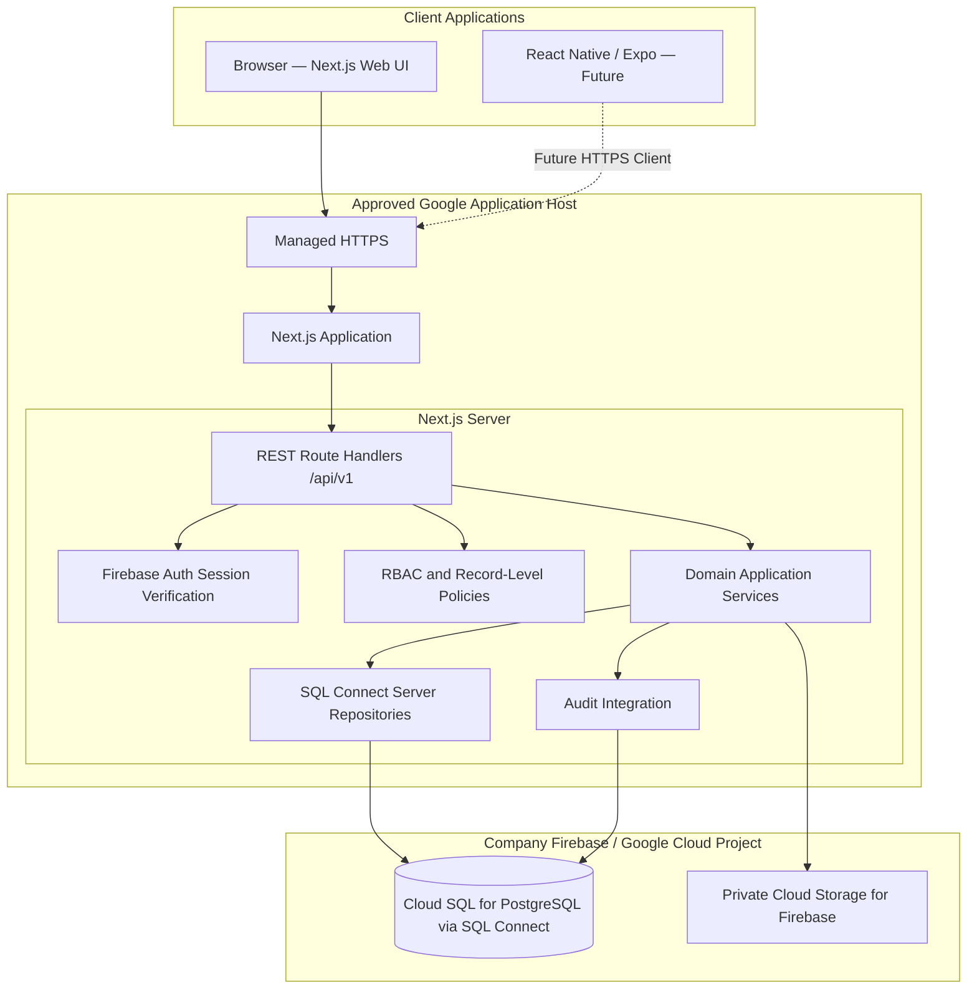

# AFHomes Platform — Technical Architecture

> Authoritative technical architecture for AI coding agents and contributors.
> Read `docs/project.md` first for product scope and approved business decisions.
> Business rules live under `docs/business-rules/` (01–14).
> This document defines **where code belongs, how modules interact, and which boundaries must not be crossed**.
> It is a target architecture, not a requirement to create every directory immediately.

---

## 1. Purpose and Authority

This document is the authoritative technical architecture for the AFHomes Platform. It reconciles the earlier 33-section architecture with the latest approved business rules and infrastructure decisions. Business rules (01–14) are authoritative for business behavior; this document is authoritative for technical design. Where a business rule conflicts with an older architecture statement, the business rule wins and the conflict is reported.

---

## 2. Approved Technical Decisions

| Category | Final target |
|---|---|
| Repository | Single `afhomes-platform` repository |
| Application | Single Next.js application (App Router) |
| Programming language | TypeScript |
| Frontend | React |
| Styling | Tailwind CSS 4 utilities plus namespaced regular CSS per feature |
| UI foundation | shadcn/ui on Base UI + Tailwind CSS 4 + namespaced custom CSS; TanStack Table; Lucide (Ant Design was removed in commit 22c9b4f; `AGENTS.md` section 8) |
| Validation | Zod (approved; not yet used in `src/`) |
| Client async state | TanStack Query |
| Development approach | Frontend-first with centralized mock data |
| Mock persistence | Browser-scoped, in-memory only; resets on full refresh |
| REST API | `/api/v1` |
| Backend | Next.js server runtime, route handlers and domain services |
| Database | PostgreSQL through Firebase SQL Connect |
| Server data access | Typed SQL Connect repositories via the Firebase Admin SDK |
| Authentication | Firebase Auth with server-verified sessions |
| Authorization | Centralized RBAC and record-level policies |
| Demo hosting | Vercel, after owner approval and plan eligibility review |
| Production hosting | Firebase App Hosting if verified in staging, Cloud Run as fallback |
| Transport | Managed HTTPS |
| Database hosting | Isolated staging and production Cloud SQL for PostgreSQL |
| Testing | Manual-first frontend development; automated before production |
| Customer Portal | Browser-memory prototype; production capability requires separate authorization |
| Mobile application | Future React Native + Expo client |
| Redemption | Authorized staff prototype; live use remains disabled |
| Services | Preserved, hidden and disabled |

---

## 3. Current Versus Target Architecture

- **Historical snapshot (HEAD 0512a31, 2026-11-12):** frontend prototype on typed in-memory mock data (Next.js, mock repositories, mock sign-in, Vitest tests); no API, database or deployment. The qualitative description remains true; the hash is not the current HEAD.
- **Approved target architecture:** as above.
- **Future implementation work:** all application development requires separate explicit authorization.

Do not present unimplemented components as deployed.

---

## 4. Architectural Principles

1. Separation of concerns.
2. Clear module boundaries.
3. Centralized business rules.
4. Reusable UI components.
5. Shared validation contracts.
6. Repository-based data access.
7. Secure-by-default authorization.
8. Consistent error handling.
9. Traceable state changes.
10. Minimal unnecessary complexity.
11. Maintainability and extensibility.
12. API readiness for future clients.
13. Modular monolith; no microservices without approval.

---

## 5. System Actors and Trust Boundaries

Actors: Public Visitor, Customer, Super Administrator, Administrator, HR/authorized staff, Finance, SVD, SSM, SM, OST, other approved internal roles, future mobile client, authorized external integrations.

Trust boundaries:

1. Browser clients are untrusted.
2. Authentication verified server-side.
3. Authorization enforced server-side.
4. Client input always validated.
5. Business state transitions authoritative on server.
6. Database and privileged Firebase credentials stay server-only.
7. Application secrets never reach Client Components.
8. Mock identities are never production authentication.
9. Public verification must not expose private records.
10. Financial and membership operations require authoritative state validation.

---

## 6. High-Level Architecture Diagram

Supporting diagrams (modular domain dependencies, frontend-to-backend request lifecycle, financial transaction consistency, production network topology, optional future mobile integration) follow the same boundaries.

---

## 7. Layer Responsibilities

| # | Layer | Location | Responsibility | May Depend On |
|---|---|---|---|---|
| 1 | Routing and composition | `src/app/` | Route definitions, layouts, thin page composition | Panels, shared |
| 2 | Panel presentation | `src/panels/*` | Panel-specific UI, hooks, styling, navigation | Features, shared, modules (contracts) |
| 3 | Frontend features | `src/panels/*/` (`pages/`, `components/`) | Page composition, components, hooks, styles | Shared UI, modules |
| 4 | Application services | `src/modules/*/` | Use cases, workflow orchestration | Domain, contracts, policies |
| 5 | Domain rules and validation | `src/modules/*/` (Zod schemas when adopted) | Types, invariants, Zod schemas | Nothing platform-specific |
| 6 | Repository contracts | `src/data/contracts/` | Interfaces, typed operation boundaries | Domain types |
| 7 | Data adapters | `src/data/mock/` (HTTP adapters later) | Mock/API implementations of contracts | Contracts, mock store / HTTP |
| 8 | Backend infrastructure | `src/server/*` (planned) | Service identity, authentication, repositories, security | Firebase Admin SDK, SQL Connect |
| 9 | Database and integrations | PostgreSQL through SQL Connect | Persistence | Private Firebase Storage for files |

### 7.1 Dependency Direction

Dependencies point inward. Prohibited: `modules` importing panel UI; `shared` importing feature code; client components importing server-only modules; API handlers importing presentation components.

---

## 8. Target Repository Structure

(See existing target layout.) Target organizational structure, not an instruction to immediately create every directory. Current modules under `src/modules/`: accounts, accreditation, audit, commissions, contracts, customers, finance, identity, igp, imports, membership, notifications, organization, promos, public-site, reconciliation, redemption, reports, sales, sales-network, settings, stay-points, vip. Services remains a documented future module boundary.

---

## 9. Panel Architecture

Three logically independent presentation panels: Admin (MVP), Public (limited MVP), Customer (future, documented only). Each owns layouts, components, features, hooks, providers, config, styling, design tokens. Customer Panel documented only; no scaffolding during MVP.

---

## 10. Frontend Technology and Design System

Next.js App Router, React, TypeScript, shadcn/ui on Base UI, Tailwind CSS 4, namespaced custom CSS, Zod (approved, not yet used in `src/`), TanStack Query (Ant Design was removed in commit 22c9b4f). Panel-scoped CSS variables sourced from `src/theme/tokens.css`. Shared shadcn/ui primitives under `src/shared/ui/` only when intentional. Server Components by default; `"use client"` only where needed.

---

## 11. Routing and Code Splitting

`src/app/` owns routing and thin composition only. Route groups organize layouts. Route-level code splitting; lazy loading for heavy features. Import rules per layer table.

---

## 12. Mock Data and Repository Adapters

Centralized in-memory mock store; resets on full browser refresh. No localStorage/IndexedDB for mock business data. Mock identity switching (dev only). Repository contracts stable; mock flow vs production flow as documented. Changing demo identity invalidates permission-sensitive caches.

---

## 13. Shared Domain Modules

Business logic must not be duplicated. Each module: domain, application, contracts, schemas. Domain depends on nothing platform-specific. Application depends on interfaces. Contracts support replacing mock with real backend.

---

## 14. Backend Services

Backend runs within the single Next.js application. Route handlers thin: parse, authenticate, validate, authorize, delegate, return standardized result. Domain services own business logic. Repository interfaces abstract persistence. Business ownership per module; no duplicate logic.

---

## 15. REST API Architecture

Prefix `/api/v1`. Conventions: resource-oriented endpoints, HTTP methods, Zod validation, consistent envelopes, auth/authz on protected routes, pagination/filtering/sorting/search, idempotency where required, versioning. Public API restrictions: exact AA number only, active results only, no name-based discovery, no public "Valid Until" for either class, and staff screens keep it, no private info.

---

## 16. Authentication

Use Firebase Auth for identity. The Next.js server verifies the session and enforces current account status and permissions. Verify sign-in, sign-out, secure cookies, CSRF protection, expiration, revocation, account changes, and audit events on the selected runtime. Keep simulated sessions confined to the mock prototype.

---

## 17. RBAC and Record-Level Authorization

Centralized authorization policies. Scopes `own`, `team`, `all`. Distinguish authentication, role assignment, permission evaluation, record-level authorization, UI visibility. Hiding UI is not authorization. Protect Super Administrator; prevent privilege escalation and removal of last effective Super Administrator; audit sensitive permission changes. Do not invent detailed permission matrix.

Genealogy authorization: SVD/SSM/SM/OST hierarchy; OST may attach directly to SVD/SSM/SM; no fabricated intermediate managers. Finance separation: Finance, the Administrator, or the Super Administrator approves receipts under doc 07. Commission approvals and payout confirmation follow doc 08. Public access: narrowly scoped, no private records.

---

## 18. PostgreSQL and Firebase SQL Connect

Use the SQL Connect Emulator locally. Use separate hosted Cloud SQL for PostgreSQL instances with SQL Connect in staging and production. Keep typed operations in server repositories. Review schema constraints, relationships, indexes, identifiers, and migrations. Confirm atomic writes under concurrency, audit consistency, history preservation, and approved import behavior in staging. See [database.md](database.md).

---

## 19. Business Data Ownership

Each module owns its domain. Cross-module operations via controlled application-service boundaries. No duplicate business logic (Finance must not implement VIP card lifecycle; multiple customer ID generators; etc.).

---

## 20. Financial Transactions and Idempotency

Finance owns payment verification, balances, reversals, refunds. Submitted payments are not verified. Contract balances depend on verified activity. Reservation payments not double-counted. Overdue tracking automatic from contractual schedules; no unauthorized penalties. Reversals/refunds Finance-controlled without separate Admin approval, with audit. Financial Hold on Active membership when verified payment reversed/refunded creating outstanding balance. Fully Paid distinct from Confirmed Sale and from Active Membership.

Idempotency: duplicate requests must not create duplicate financial outcomes. Unique transaction references. Race-condition prevention. Reconciliation.

---

## 21. VIP Membership and Stay Points Integration

Membership activation requires finalized contract + full settlement through approved receipts (Finance, Admin or Super Admin; doc 07 §5.2) + official activation event. Activation date is actual official activation (Asia/Manila); validity starts on the Card Claim Date (doc 06 §4.3). VIP Number format `YYMMDDNNNNNVTPMMS`, issued once when the signed Reservation Agreement is recorded (YYMMDD = recording date, monthly company-wide sequence; one number for the Reservation Agreement, Grant and card; activation never creates a number; doc 06). Stay Points: the signed Grant's Annual Welcome Gift (doc 09): fixed tranches per tier released on the Points Activation Date and its anniversaries only when the measurement period's Qualifying Spend reaches the tier minimum; fixed weekday/weekend split per tranche; no carry-over; Gold supplementary shares the pool; a refund lowers Qualifying Spend but never takes back a released tranche; ledger-controlled; no automatic negative balances; historical contract protection.

---

## 22. Sales Network and Commission Integration

Sales Network hierarchy SVD→SSM→SM→OST; OST may attach directly. Historical genealogy preserved; transfers do not retroactively reassign sales. Commission (doc 08): per-person DSC (closing seller) and DRI (referrer) rates per product, defaulting to the position standard and frozen on the sale at VIP Number issuance; amounts computed on the contract TCP; no per-sale pay to uplines (IST leaders earn BA, PA and PB allowances); VIP commission released when approved collection reaches 40%, paid at month-end; approval and payout by Finance, Admin or Super Admin; Paid only after confirmed disbursement; unpaid releases held and paid releases clawed back on sale events (OCT R32), with offsets only after the IST addendum is signed and OST clawbacks collected directly.

---

## 23. Feature Flags

The staff Redemption prototype is authorized (2026-11-17) with synthetic data and sample points-per-night values; live Redemption and customer submissions require separate authorization. Services remains disabled. Central feature configuration; server-side enforcement; client presentation behavior; environment config; secure defaults; testing; controlled activation; audit requirements. Hidden menu is not security. Future activation of live Redemption or Services requires separate authorization.

---

## 24. Files and Media

Use Cloud Storage for Firebase in production for documents and files. Store metadata and authorized parent-record links in PostgreSQL. Validate file type, size, access, private downloads, recovery, retention, and audit. Use the Storage Emulator locally and follow the [staging guide](../implementation/02-full-stack/02-staging/03-backend-api-and-file-storage.md) for the optional private sample bucket.

---

## 25. Background Jobs and Scheduled Work

Future requirements: accreditation expiry evaluation, installment overdue classification, membership expiry, annual points-cycle calculations, approved notifications, reconciliation, reporting maintenance, operational cleanup. Document ownership, secure execution, retries, idempotency, audit, scheduling, failure handling, duplicate prevention. Do not automatically introduce Redis/BullMQ/another DB/queue without justification and approval. Explain how single-application architecture can support initial background work and when a separate worker container might become necessary. Do not implement workers.

---

## 26. Reporting

Reports consume authoritative business data. Do not create independent inconsistent formulas. Cover Confirmed Sales reporting, Finance collections, outstanding balances, overdue payments, commission approvals, paid commissions, membership status, Stay Points, seller performance, historical genealogy, customer analytics, audit reporting. Preserve reporting-date concepts (Today, Past 7 Days, Past 28 Days, Past 6 Months, optional custom Start/End Date). Use appropriate authoritative business-event date per metric. Preserve Asia/Manila conventions. No double-counting across team reports.

---

## 27. Audit and Logging

Centralized audit requirements. Preserve actor attribution, action, entity, timestamp, previous/resulting state, business reason, related transaction, policy context, event correlation, security classification. Normal corrections preserve original event history. Separate business audit events from application diagnostic logs. Avoid storing passwords, tokens, unnecessary personal information. Retention, legal erasure, archival, tamper-evidence implementation details follow authorized governance policies. Do not invent permanent universal retention period.

---

## 28. Security

Cover authentication, sessions, RBAC, record-level authorization, sensitive business operations, server-side validation, CORS/CSRF, HTTPS/TLS, secure cookies, rate limiting, abuse prevention, public search protection, file upload security, secret management, data privacy, audit logs, least privilege, administrative protection, environment separation, backup security, incident response, security testing. Frontend permissions alone cannot protect sensitive records. Separation between public, staff, and privileged/financial operations.

---

## 29. Environment Separation

Logical separation of Local Development, Staging, Production. For each: application config, auth config, database selection, secrets, feature flags, mock-data policy, test data, logging, deployment controls. Never use real production customer data as ordinary frontend mock seeds. No demo account switching in production. No development-only API behavior in production.

---

## 30. Google Application Hosting

Deploy one Next.js runtime with its API and domain services. Vercel is for the owner-approved demo. Validate Firebase App Hosting on the selected Next.js and Node.js versions in staging. Use Cloud Run in the same Google project if the compatibility checks fail. Apply managed HTTPS, environment isolation, runtime identity, secrets, health checks, monitoring, and a rehearsed rollback. See [deployment.md](deployment.md).

---

## 31. SQL Connect and Cloud SQL Connectivity

Use a restricted server identity. Keep project ID, service ID, region, secrets, and storage isolated for each environment. SQL Connect and Cloud SQL use the same supported service location. Verify connectivity, timeouts, retry behavior, migration compatibility, transactions, monitoring, and recovery.

---

## 32. CI/CD and Release Management

Document target deployment process: source control, code review, static analysis, type checking, automated testing, container build, dependency security checks, environment-specific config, deployment authorization, DB compatibility validation, health checks, rollback, post-deployment verification. Do not claim CI/CD already exists. Do not automatically choose additional deployment infrastructure. Do not execute pipelines.

---

## 33. Monitoring and Operations

Monitor application health, API errors, auth failures, instance health, CPU and memory, database connectivity and query performance, application logs, business audits, job failures, availability, and alerts. Business audit history is separate from runtime diagnostics. Use authorized service and recovery expectations.

---

## 34. Backup, Recovery and Disaster Response

Use Cloud SQL backups with validated isolated restores, and separately verify application release and configuration recovery, private-file recovery, and secret recovery. An app rollback does not restore database writes. Retention and recovery objectives follow approved decisions.

---

## 35. Testing and Quality

Preserve approved development approach: manual-first frontend validation, automated verification before production. Do not describe seven days as binding deadline. Required testing areas: React components, Next.js routing, forms, role-aware navigation, mock repositories, API contracts, authentication, authorization, genealogy, customer identity, VIP identifier uniqueness, Finance verification, commission approval, membership activation, Stay Points, reporting, audit, DB integration, transaction atomicity, duplicate prevention, security, performance, accessibility, deployment, backup/restore. Manual-only testing insufficient for production release. Do not claim tests executed.

---

## 36. Future Customer Portal and Mobile Architecture

Customer Portal: future panel within Next.js app, route `/customer/*`, shared backend domain services, customer-specific identity and record visibility. Do not scaffold during initial phase unless authorized.

Mobile: future React Native + Expo + TypeScript, shared REST API, same Git repo. Future repo evolution may introduce `mobile/` and `packages/` but not now. Do not introduce Turborepo/workspace without approval. Code sharing: domain types, validation schemas, API contracts, platform-neutral rules, API client utilities potentially shared; platform-specific: Next.js pages, RN screens, navigation, styling, browser/native functionality, session storage. Do not assume Ant Design web components work unchanged in React Native.

---

## 37. Implementation Phase Alignment

Align with `docs/development/implementation.md` Phases 0–8. Phases are planning milestones, not automatic authorization. Architecture must not conflict with phases.

---

## 38. Resolve Outdated Architecture Statements

- Hosting and persistence → see the [Full-stack roadmap](../implementation/02-full-stack/README.md) and the [supersession note](../implementation/decisions-and-gaps.md#firebase-stack-transition).
- Localhost, staging, and production → isolate identity, database, configuration, and files per environment.
- Seven-day MVP → not a binding architecture requirement; preserve frontend-first staged delivery.
- Finance automatic activation → reconciled; respect full settlement and official activation requirements; do not auto-activate on arbitrary payment verification.
- Incomplete business modules → expanded module map includes all domains.
- Incomplete deployment → complete target deployment documentation.
- Mock persistence conflict → in-memory only, reset on refresh; no localStorage.
- Customer/Public website scope → distinguish target capability from current phase; do not permanently exclude approved public website/CMS.
- Firebase Auth compatibility → verify sessions and app permission checks on the chosen runtime.
- VD vs SVD terminology → use SVD per authoritative Sales Network docs.
- Current implementation claims → frontend prototype on mocks only; do not present the backend, database or infrastructure as present.

---

## 39. Architectural Invariants

Keep presentation separate from domain logic, keep SQL Connect access on the server, and enforce centralized permission and record checks. Preserve browser-scoped mocks, authoritative business states, identifiers, historical attribution, audit history, atomic processing, and approved feature boundaries. Use the [Full-stack roadmap](../implementation/02-full-stack/README.md) for the environment sequence and canonical business rules for behavior.

---

## 40. Technical Dependencies Requiring Verification

- Firebase Auth session handling and Next.js/Node.js runtime compatibility.
- SQL Connect atomicity, concurrency, and failure recovery on hosted PostgreSQL.
- Least-privilege identities, project isolation, service location, and quotas.
- App Hosting staging proof or verified Cloud Run fallback.
- Backup, recovery, private file access, region, and capacity review.
- ~~RA numbering scope uniqueness.~~ Decided: one VIP Number, monthly sequence (doc 06, R2).
- ~~Accreditation active-status/expiry evaluation rules.~~ Decided (doc 03, R3): an expired seller can still sell.
- Apply the working retention and privacy requirements in doc 12. Confirm applicable Legal and DPO requirements before production.

---

## 41. Documentation Consistency Validation

Compare the active architecture, frontend, database, backend, security, testing, implementation, and deployment guides with the Firebase environment roadmap. Preserve canonical business rules.

---

## 42. Final Repository Check

Historical snapshot at the time of writing: branch `develop`, working tree held untracked docs/workflow files, no application code yet, `git diff --check` passed, and changes were confined to `docs/development/`. The current repository now contains a frontend prototype.

---

## 43. Historical Completion Report

> This report records the earlier documentation review. Its infrastructure choices have been superseded by the Firebase roadmap.

### A. Repository Verification
- Repository: `afhomes-platform`; branch: `develop`; initial working tree untracked docs/workflow files preserved. Inspected docs/project.md, business-rules 01–14, existing dev docs. No app code at that time.

### B. Architecture Completion
`architecture.md` covers frontend through production deployment: purpose/authority, approved decisions, current vs target, principles, actors/trust boundaries, diagrams, layers, dependency direction, repository structure, routing, panels, frontend tech/design, server/client components, state, mock data, shared modules, backend services, REST API, auth, RBAC, MongoDB Atlas/Mongoose, business data ownership, financial transactions/idempotency, VIP membership/Stay Points, sales/commission integration, feature flags, files/media, background jobs, reporting, audit/logging, security, environment separation, DigitalOcean infra, Docker Compose, reverse proxy/HTTPS, Atlas connectivity, CI/CD, monitoring, backup/recovery, testing, implementation phases, future customer/mobile, invariants, dependencies, references/governance.

### C. Approved Technology Stack
Next.js, React, TypeScript, shadcn/ui on Base UI, Tailwind CSS 4, custom CSS, Zod, TanStack Query, MongoDB Atlas, Mongoose, Better Auth (direction, unverified), DigitalOcean Droplet, Docker Compose, HTTPS. Unverified compatibilities listed in Section 40.

### D. Major Architecture Corrections
- Hosting: DigitalOcean Droplet app + MongoDB Atlas DB (was "not selected").
- Database: Atlas managed cloud, not separate Droplet Mongo.
- Backend topology: single Next.js app, no separate backend.
- Module coverage: expanded to all approved domains.
- Finance/membership activation: reconciled; no blanket auto-activation on arbitrary payment verification.
- Mock persistence: in-memory only, reset on refresh.
- Production architecture: complete Docker/HTTPS/monitoring/backup/recovery.
- Implementation scope: phased, no auto-authorization.

### E. Development Documentation Alignment
Updated `architecture.md` comprehensively. Other 9 development documents (README, frontend, database, backend, security, testing, implementation, deployment and the role-module permission proposal) are aligned with decisions. Exactly 10 files remain in `docs/development/`.

### F. Business-Rule Alignment
Reviewed all 14 business-rule docs. Conflicts reconciled in architecture (finance activation, mock persistence, terminology SVD, hosting). Unresolved critical conflicts preserved as dependencies (contract price discrepancies, RA uniqueness, audit retention, etc.).

### G. Deployment Architecture
DigitalOcean Droplet, Docker Compose, HTTPS reverse proxy, MongoDB Atlas, secrets, monitoring, backups, recovery, release procedures documented.

### H. Technical Dependencies
Listed in Section 40.

### I. Validation
Architecture completeness: all required areas covered. Mermaid diagrams included. Cross-document consistency: aligned. Git diff --check: passed. Documentation scope: confined to docs/development.

### J. Execution Safety
- Application code modified: No.
- New application scaffolding created: No.
- Database modified: No.
- Atlas cluster configured: No.
- Migrations created or executed: No.
- Docker configuration modified: No.
- Infrastructure provisioned: No.
- Git commit: No.
- Git push: No.
- Git merge: No.
- Deployment: No.
- Redemption live use activated: No; staff prototype authorized 2026-11-17.
- Services activated: No.
- Historical production data migrated: No.

Historical note: this stop point applied before Phase 1 implementation. The frontend prototype now exists; backend, database and deployment still require authorization.

## Consistency update (2026-11-12)

Aligned with the business-rule documents as rewritten on 2026-11-12. No architecture decision changed.

1. Section 21: Spend-to-Earn replaced by the Annual Welcome Gift (doc 09); the activation-tied Card ID with an RA-derived sequence replaced by the VIP Number issued at Reservation Agreement recording (doc 06); Finance-only verification replaced by Finance, Admin or Super Admin approval (doc 07).
2. Section 22: Finance-assigned percentages and upline pay replaced by per-person frozen DSC/DRI rates, allowances and staged release (doc 08).
