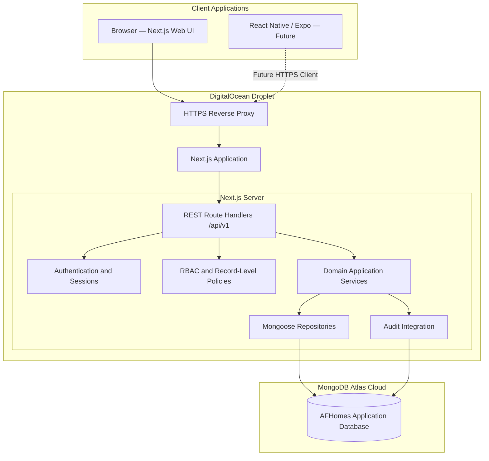

# AFHomes Platform — Technical Architecture

> Authoritative technical architecture for AI coding agents and contributors.
> Read `docs/project.md` first for product scope and approved business decisions.
> Business rules live under `docs/business-rules/` (01–13).
> This document defines **where code belongs, how modules interact, and which boundaries must not be crossed**.
> It is a target architecture, not a requirement to create every directory immediately.

---

## 1. Purpose and Authority

This document is the authoritative technical architecture for the AFHomes Platform. It reconciles the earlier 33-section architecture with the latest approved business rules and infrastructure decisions. Business rules (01–13) are authoritative for business behavior; this document is authoritative for technical design. Where a business rule conflicts with an older architecture statement, the business rule wins and the conflict is reported.

---

## 2. Approved Technical Decisions

| Category | Final target |
|---|---|
| Repository | Single `afhomes-platform` repository |
| Application | Single Next.js application (App Router) |
| Programming language | TypeScript |
| Frontend | React |
| Styling | Regular CSS stylesheets per layout, page, and feature |
| UI foundation | Ant Design 6 |
| Validation | Zod |
| Client async state | TanStack Query |
| Development approach | Frontend-first with centralized mock data |
| Mock persistence | Browser-scoped, in-memory only; resets on full refresh |
| REST API | `/api/v1` |
| Backend | Next.js server runtime, route handlers and domain services |
| Database | MongoDB Atlas Cloud |
| ODM | Mongoose |
| Authentication direction | Better Auth, subject to compatibility verification |
| Authorization | Centralized RBAC and record-level policies |
| Application hosting | DigitalOcean Droplet |
| Container orchestration | Docker Compose |
| Reverse proxy | HTTPS-enabled production reverse proxy |
| Database hosting | MongoDB Atlas (not the Droplet) |
| Testing | Manual-first frontend development; automated before production |
| Customer Portal | Future phase |
| Mobile application | Future React Native + Expo client |
| Redemption | Preserved, hidden and disabled |
| Services | Preserved, hidden and disabled |

---

## 3. Current Versus Target Architecture

- **Verified current implementation:** documentation-only repository; no application code, database, or deployment.
- **Approved target architecture:** as above.
- **Future implementation work:** all application development requires separate explicit authorization.

Do not present unimplemented components as deployed.

---

## 4. Architectural Principles

1. Separation of concerns.
2. Clear module boundaries.
3. Centralized business rules.
4. Reusable UI components.
5. Shared validation contracts.
6. Repository-based data access.
7. Secure-by-default authorization.
8. Consistent error handling.
9. Traceable state changes.
10. Minimal unnecessary complexity.
11. Maintainability and extensibility.
12. API readiness for future clients.
13. Modular monolith; no microservices without approval.

---

## 5. System Actors and Trust Boundaries

Actors: Public Visitor, Customer, Super Administrator, Administrator, HR/authorized staff, Finance, SVD, SSM, SM, OST, other approved internal roles, future mobile client, authorized external integrations.

Trust boundaries:

1. Browser clients are untrusted.
2. Authentication verified server-side.
3. Authorization enforced server-side.
4. Client input always validated.
5. Business state transitions authoritative on server.
6. MongoDB credentials server-only.
7. Application secrets never reach Client Components.
8. Mock identities are never production authentication.
9. Public verification must not expose private records.
10. Financial and membership operations require authoritative state validation.

---

## 6. High-Level Architecture Diagram

Supporting diagrams (modular domain dependencies, frontend-to-backend request lifecycle, financial transaction consistency, production network topology, optional future mobile integration) follow the same boundaries.

---

## 7. Layer Responsibilities

| # | Layer | Location | Responsibility | May Depend On |
|---|---|---|---|---|
| 1 | Routing and composition | `src/app/` | Route definitions, layouts, thin page composition | Panels, shared |
| 2 | Panel presentation | `src/panels/*` | Panel-specific UI, hooks, styling, navigation | Features, shared, modules (contracts) |
| 3 | Frontend features | `src/panels/*/features/*` | Page composition, components, hooks, styles | Shared UI, modules |
| 4 | Application services | `src/modules/*/application/` | Use cases, workflow orchestration | Domain, contracts, policies |
| 5 | Domain rules and validation | `src/modules/*/domain/`, `schemas/` | Types, invariants, Zod schemas | Nothing platform-specific |
| 6 | Repository contracts | `src/modules/*/contracts/` | Interfaces, typed operation boundaries | Domain types |
| 7 | Data adapters | `src/data/adapters/*` | Mock/API implementations of contracts | Contracts, mock store / HTTP |
| 8 | Backend infrastructure | `src/server/*` | DB connection, auth, repositories, security | Mongoose, Better Auth |
| 9 | Database and integrations | MongoDB Atlas | Persistence | — |

### 7.1 Dependency Direction

Dependencies point inward. Prohibited: `modules` importing panel UI; `shared` importing feature code; client components importing server-only modules; API handlers importing presentation components.

---

## 8. Target Repository Structure

(See existing target layout.) Target organizational structure, not an instruction to immediately create every directory. Modules must include organization, staff, roles, customers, vip-products, vip-contracts, vip-cards, sales, finance, commissions, sale-team, genealogy, accreditation, memberships, stay-points, reporting, redemption, services, audit.

---

## 9. Panel Architecture

Three logically independent presentation panels: Admin (MVP), Public (limited MVP), Customer (future, documented only). Each owns layouts, components, features, hooks, providers, config, styling, design tokens. Customer Panel documented only; no scaffolding during MVP.

---

## 10. Frontend Technology and Design System

Next.js App Router, React, TypeScript, Ant Design 6, namespaced regular CSS, Zod, TanStack Query. Panel-scoped themes (`.admin-theme`, `.public-theme`, `.customer-theme`). Shared primitives under `src/shared/ui/` only when intentional. Server Components by default; `"use client"` only where needed.

---

## 11. Routing and Code Splitting

`src/app/` owns routing and thin composition only. Route groups organize layouts. Route-level code splitting; lazy loading for heavy features. Import rules per layer table.

---

## 12. Mock Data and Repository Adapters

Centralized in-memory mock store; resets on full browser refresh. No localStorage/IndexedDB for mock business data. Mock identity switching (dev only). Repository contracts stable; mock flow vs production flow as documented. Changing demo identity invalidates permission-sensitive caches.

---

## 13. Shared Domain Modules

Business logic must not be duplicated. Each module: domain, application, contracts, schemas. Domain depends on nothing platform-specific. Application depends on interfaces. Contracts support replacing mock with real backend.

---

## 14. Backend Services

Backend runs within the single Next.js application. Route handlers thin: parse, authenticate, validate, authorize, delegate, return standardized result. Domain services own business logic. Repository interfaces abstract persistence. Business ownership per module; no duplicate logic.

---

## 15. REST API Architecture

Prefix `/api/v1`. Conventions: resource-oriented endpoints, HTTP methods, Zod validation, consistent envelopes, auth/authz on protected routes, pagination/filtering/sorting/search, idempotency where required, versioning. Public API restrictions: exact AA number only, active results only, no name-based discovery, IST omits "Valid Until", OST may show it, no private info.

---

## 16. Authentication

Better Auth intended direction, subject to compatibility verification with Next.js, MongoDB adapter, runtime. Server-controlled. Frontend may use simulated sessions only during mock development. Cover sign-in/out, sessions, credential protection, account status, approval, suspension/deactivation, login protections, secure cookies, CSRF, session expiration, audit events.

---

## 17. RBAC and Record-Level Authorization

Centralized authorization policies. Scopes `own`, `team`, `all`. Distinguish authentication, role assignment, permission evaluation, record-level authorization, UI visibility. Hiding UI is not authorization. Protect Super Administrator; prevent privilege escalation and removal of last effective Super Administrator; audit sensitive permission changes. Do not invent detailed permission matrix.

Genealogy authorization: SVD/SSM/SM/OST hierarchy; OST may attach directly to SVD/SSM/SM; no fabricated intermediate managers. Finance separation: only authorized Finance verifies payments; commission approvals/payouts Finance-controlled. Public access: narrowly scoped, no private records.

---

## 18. MongoDB Atlas and Mongoose

Database: MongoDB Atlas Cloud. ODM: Mongoose. Managed cloud service separate from Droplet. Document connection management, environment-based config, server-only access, domain model mapping, schema validation, unique indexes, relationships, transactions, audit persistence, soft deletion/archival, identifier uniqueness, indexing strategy, migration/evolution. Mongoose server-only. Atlas connectivity via TLS, network restrictions, least-privilege users. Compass is optional admin client, not hosting. No automatic migration from Supabase. Transaction support must be verified per tier.

---

## 19. Business Data Ownership

Each module owns its domain. Cross-module operations via controlled application-service boundaries. No duplicate business logic (Finance must not implement VIP card lifecycle; multiple customer ID generators; etc.).

---

## 20. Financial Transactions and Idempotency

Finance owns payment verification, balances, reversals, refunds. Submitted payments are not verified. Contract balances depend on verified activity. Reservation payments not double-counted. Overdue tracking automatic from contractual schedules; no unauthorized penalties. Reversals/refunds Finance-controlled without separate Admin approval, with audit. Financial Hold on Active membership when verified payment reversed/refunded creating outstanding balance. Fully Paid distinct from Confirmed Sale and from Active Membership.

Idempotency: duplicate requests must not create duplicate financial outcomes. Unique transaction references. Race-condition prevention. Reconciliation.

---

## 21. VIP Membership and Stay Points Integration

Membership activation requires finalized contract + full Finance-verified payment + official activation event. Activation date is actual official activation (Asia/Manila). VIP Card ID format `YYMMDDNNNNNVTPMMS` with RA-derived sequence (no independent generator). Stay Points: transaction-based Spend-to-Earn (₱1 eligible verified resort spending = 1 point), annual caps, minimum qualifying spend unlocks Pending points, 70/30 Weekday/Weekend allocation, separate buckets, Gold supplementary shares pool, refund-related Points Hold with Finance reconciliation, no automatic negative balances, historical contract protection.

---

## 22. Sales Network and Commission Integration

Sales Network hierarchy SVD→SSM→SM→OST; OST may attach directly. Historical genealogy preserved; transfers do not retroactively reassign sales. Commission: Finance manually assigns percentages based on finalized contract value; direct seller and eligible historical uplines; no automatic distribution; approval after Confirmed Sale; unpaid commissions auto-Hold when sale loses Confirmed status; manual resolution; no automatic clawbacks; manual payout with actual disbursement confirmation; Paid only after confirmation.

---

## 23. Feature Flags

Redemption and Services preserved but hidden/disabled. Central feature configuration; server-side enforcement; client presentation behavior; environment config; secure defaults; testing; controlled activation; audit requirements. Hidden menu is not security. Future activation requires separate authorization.

---

## 24. Files and Media

Secure storage abstraction for customer documents, contract files, payment evidence, accreditation files, staff photos, VIP documents, public media. Authorized upload, file validation, type/size restrictions, metadata, access control, private vs public assets, safe download, retention, backup, deletion policies, audit. Do not store all binary files in MongoDB documents. Recommend object storage compatible with DigitalOcean; do not falsely claim provider selected.

---

## 25. Background Jobs and Scheduled Work

Future requirements: accreditation expiry evaluation, installment overdue classification, membership expiry, annual points-cycle calculations, approved notifications, reconciliation, reporting maintenance, operational cleanup. Document ownership, secure execution, retries, idempotency, audit, scheduling, failure handling, duplicate prevention. Do not automatically introduce Redis/BullMQ/another DB/queue without justification and approval. Explain how single-application architecture can support initial background work and when a separate worker container might become necessary. Do not implement workers.

---

## 26. Reporting

Reports consume authoritative business data. Do not create independent inconsistent formulas. Cover Confirmed Sales reporting, Finance collections, outstanding balances, overdue payments, commission approvals, paid commissions, membership status, Stay Points, seller performance, historical genealogy, customer analytics, audit reporting. Preserve reporting-date concepts (Today, Past 7 Days, Past 28 Days, Past 6 Months, optional custom Start/End Date). Use appropriate authoritative business-event date per metric. Preserve Asia/Manila conventions. No double-counting across team reports.

---

## 27. Audit and Logging

Centralized audit requirements. Preserve actor attribution, action, entity, timestamp, previous/resulting state, business reason, related transaction, policy context, event correlation, security classification. Normal corrections preserve original event history. Separate business audit events from application diagnostic logs. Avoid storing passwords, tokens, unnecessary personal information. Retention, legal erasure, archival, tamper-evidence implementation details follow authorized governance policies. Do not invent permanent universal retention period.

---

## 28. Security

Cover authentication, sessions, RBAC, record-level authorization, sensitive business operations, server-side validation, CORS/CSRF, HTTPS/TLS, secure cookies, rate limiting, abuse prevention, public search protection, file upload security, secret management, data privacy, audit logs, least privilege, administrative protection, environment separation, backup security, incident response, security testing. Frontend permissions alone cannot protect sensitive records. Separation between public, staff, and privileged/financial operations.

---

## 29. Environment Separation

Logical separation of Local Development, Staging, Production. For each: application config, auth config, database selection, secrets, feature flags, mock-data policy, test data, logging, deployment controls. Never use real production customer data as ordinary frontend mock seeds. No demo account switching in production. No development-only API behavior in production.

---

## 30. DigitalOcean Infrastructure

Application hosting: DigitalOcean Droplet. Droplet hosts Next.js runtime, backend API, reverse proxy, container runtime, app config, health checks, app logging, background processing where appropriate. MongoDB hosted separately in Atlas. Docker Compose topology: app container, reverse proxy, optional worker if justified, networks, volumes, env injection, restart policy, health checks, safe deployment, rollback. Reverse proxy: HTTPS termination, domain routing, forwarding, security headers, request size limits, access logging, timeouts, certificate renewal, upstream health checks. Networking/security: firewall, restricted SSH, OS updates, non-root operations, container security, secret protection, monitoring, resource limits, Atlas connectivity, incident response. Do not recommend unrestricted DB exposure to public internet.

---

## 31. MongoDB Atlas Production Connectivity

Application connects to Atlas securely. Document Atlas project, cluster, app database, restricted DB identity, network restrictions, TLS, production connection string stored securely, connection pooling, connection health, transaction support, index deployment, monitoring, backups, recovery. Chosen Atlas tier must be verified before implementation. Do not claim all managed capabilities on every tier. DB deployment must support business-critical consistency.

---

## 32. CI/CD and Release Management

Document target deployment process: source control, code review, static analysis, type checking, automated testing, container build, dependency security checks, environment-specific config, deployment authorization, DB compatibility validation, health checks, rollback, post-deployment verification. Do not claim CI/CD already exists. Do not automatically choose additional deployment infrastructure. Do not execute pipelines.

---

## 33. Monitoring and Operations

Application health, API errors, auth failures, container health, CPU/memory, disk, DB connectivity, Atlas performance, slow queries, app logs, audit events, job failures, availability monitoring, alerting, operational troubleshooting. Explain conceptual ownership. Do not invent SLAs or staffing commitments.

---

## 34. Backup, Recovery and Disaster Response

Atlas backup capabilities, backup policy dependencies, restore procedures, recovery validation, app config recovery, container image rollback, file/media recovery, secret recovery procedures, incident handling, business continuity. Do not assume Droplet snapshots replace Atlas DB backups. Do not assume Atlas backups replace app config/media backups. Retention periods and recovery objectives require authorized decisions. Do not invent them.

---

## 35. Testing and Quality

Preserve approved development approach: manual-first frontend validation, automated verification before production. Do not describe seven days as binding deadline. Required testing areas: React components, Next.js routing, forms, role-aware navigation, mock repositories, API contracts, authentication, authorization, genealogy, customer identity, VIP identifier uniqueness, Finance verification, commission approval, membership activation, Stay Points, reporting, audit, DB integration, transaction atomicity, duplicate prevention, security, performance, accessibility, deployment, backup/restore. Manual-only testing insufficient for production release. Do not claim tests executed.

---

## 36. Future Customer Portal and Mobile Architecture

Customer Portal: future panel within Next.js app, route `/customer/*`, shared backend domain services, customer-specific identity and record visibility. Do not scaffold during initial phase unless authorized.

Mobile: future React Native + Expo + TypeScript, shared REST API, same Git repo. Future repo evolution may introduce `mobile/` and `packages/` but not now. Do not introduce Turborepo/workspace without approval. Code sharing: domain types, validation schemas, API contracts, platform-neutral rules, API client utilities potentially shared; platform-specific: Next.js pages, RN screens, navigation, styling, browser/native functionality, session storage. Do not assume Ant Design web components work unchanged in React Native.

---

## 37. Implementation Phase Alignment

Align with `docs/development/implementation.md` Phases 0–8. Phases are planning milestones, not automatic authorization. Architecture must not conflict with phases.

---

## 38. Resolve Outdated Architecture Statements

- Hosting not selected → DigitalOcean Droplet app + MongoDB Atlas DB.
- MongoDB deployment ambiguity → Atlas managed cloud DB; no separate production Mongo on Droplet by default.
- Seven-day MVP → not a binding architecture requirement; preserve frontend-first staged delivery.
- Finance automatic activation → reconciled; respect full settlement and official activation requirements; do not auto-activate on arbitrary payment verification.
- Incomplete business modules → expanded module map includes all domains.
- Incomplete deployment → complete target deployment documentation.
- Mock persistence conflict → in-memory only, reset on refresh; no localStorage.
- Customer/Public website scope → distinguish target capability from current phase; do not permanently exclude approved public website/CMS.
- Better Auth compatibility → intended direction subject to verification; do not claim verified.
- VD vs SVD terminology → use SVD per authoritative Sales Network docs.
- Current implementation claims → documentation-only repo; do not present modules/infra as present.

---

## 39. Architectural Invariants

(As listed in task: one repo, one Next.js app, panel/feature modular monolith, App Router, React/TS, Ant Design/regular CSS, Zod, TanStack Query, centralized mock data, mock reset on refresh, mock identity not production auth, `/api/v1`, thin handlers, domain logic outside presentation, server-only Mongoose/DB, MongoDB Atlas, DigitalOcean Droplet, Docker Compose, HTTPS reverse proxy, centralized auth, server-side RBAC, record-level visibility, historical genealogy preservation, Finance payment verification authority, manual Finance commission approvals, correct VIP membership activation eligibility, official VIP identifier uniqueness, correct Stay Points ledger lifecycle, audit history, no double processing, no automatic Supabase migration, Redemption disabled, Services disabled, future Customer Portal supported, future mobile can reuse REST API, no unauthorized microservice redesign, current business policies revisable through authorized decisions, historical signed contract terms protected, architecture doc does not authorize implementation, production readiness requires separate verification/approval.)

---

## 40. Technical Dependencies Requiring Verification

- Better Auth and selected MongoDB adapter.
- Next.js and selected Node.js runtime.
- MongoDB Atlas transaction prerequisites.
- DigitalOcean-to-Atlas connectivity.
- Selected reverse proxy integration.
- Deployment image/build compatibility.
- RA numbering scope uniqueness.
- Accreditation active-status/expiry evaluation rules.
- Formal audit retention policy.

---

## 41. Documentation Consistency Validation

Compare against frontend.md, database.md, backend.md, security.md, testing.md, implementation.md, deployment.md, README.md. Ensure same technology decisions. (See task examples.) If another dev doc contradicts finalized architecture, make smallest necessary correction. Do not create new docs. Do not modify business-rule files.

---

## 42. Final Repository Check

Branch: `develop`. Working tree: untracked docs/workflow files (preserved). No application code. `git diff --check` passed. Authorized changes confined to `docs/development/`.

---

## 43. Completion Report

### A. Repository Verification
- Repository: `afhomes-platform`; branch: `develop`; initial working tree untracked docs/workflow files preserved. Inspected docs/project.md, business-rules 01–13, existing dev docs. No app code.

### B. Architecture Completion
`architecture.md` covers frontend through production deployment: purpose/authority, approved decisions, current vs target, principles, actors/trust boundaries, diagrams, layers, dependency direction, repository structure, routing, panels, frontend tech/design, server/client components, state, mock data, shared modules, backend services, REST API, auth, RBAC, MongoDB Atlas/Mongoose, business data ownership, financial transactions/idempotency, VIP membership/Stay Points, sales/commission integration, feature flags, files/media, background jobs, reporting, audit/logging, security, environment separation, DigitalOcean infra, Docker Compose, reverse proxy/HTTPS, Atlas connectivity, CI/CD, monitoring, backup/recovery, testing, implementation phases, future customer/mobile, invariants, dependencies, references/governance.

### C. Approved Technology Stack
Next.js, React, TypeScript, Ant Design 6, regular CSS, Zod, TanStack Query, MongoDB Atlas, Mongoose, Better Auth (direction, unverified), DigitalOcean Droplet, Docker Compose, HTTPS. Unverified compatibilities listed in Section 40.

### D. Major Architecture Corrections
- Hosting: DigitalOcean Droplet app + MongoDB Atlas DB (was "not selected").
- Database: Atlas managed cloud, not separate Droplet Mongo.
- Backend topology: single Next.js app, no separate backend.
- Module coverage: expanded to all approved domains.
- Finance/membership activation: reconciled; no blanket auto-activation on arbitrary payment verification.
- Mock persistence: in-memory only, reset on refresh.
- Production architecture: complete Docker/HTTPS/monitoring/backup/recovery.
- Implementation scope: phased, no auto-authorization.

### E. Development Documentation Alignment
Updated `architecture.md` comprehensively. Other 8 dev docs (README, frontend, database, backend, security, testing, implementation, deployment) already aligned with decisions; minimal/no changes needed. Exactly 9 files remain in `docs/development/`.

### F. Business-Rule Alignment
Reviewed all 13 business-rule docs. Conflicts reconciled in architecture (finance activation, mock persistence, terminology SVD, hosting). Unresolved critical conflicts preserved as dependencies (contract price discrepancies, RA uniqueness, audit retention, etc.).

### G. Deployment Architecture
DigitalOcean Droplet, Docker Compose, HTTPS reverse proxy, MongoDB Atlas, secrets, monitoring, backups, recovery, release procedures documented.

### H. Technical Dependencies
Listed in Section 40.

### I. Validation
Architecture completeness: all required areas covered. Mermaid diagrams included. Cross-document consistency: aligned. Git diff --check: passed. Documentation scope: confined to docs/development.

### J. Execution Safety
- Application code modified: No.
- New application scaffolding created: No.
- Database modified: No.
- Atlas cluster configured: No.
- Migrations created or executed: No.
- Docker configuration modified: No.
- Infrastructure provisioned: No.
- Git commit: No.
- Git push: No.
- Git merge: No.
- Deployment: No.
- Redemption activated: No.
- Services activated: No.
- Historical production data migrated: No.

STOP — awaiting explicit project-owner authorization before starting Phase 1 implementation.