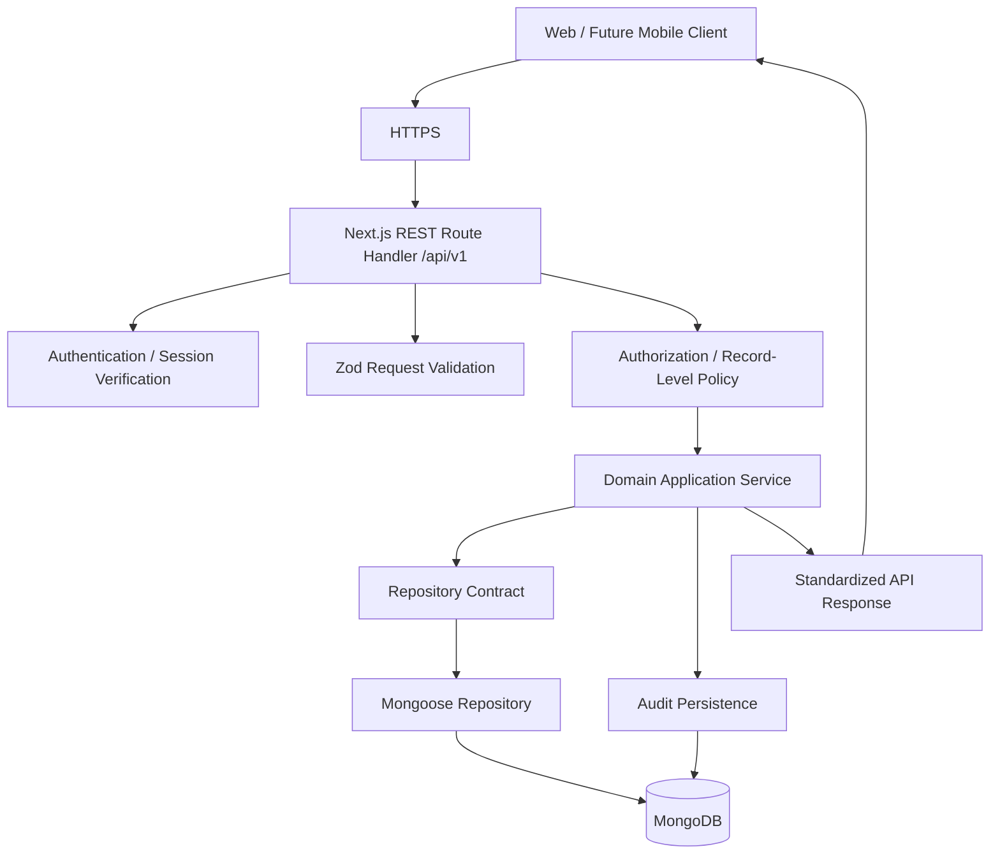

# AFHomes Platform — Backend Architecture

> Authoritative backend architecture for the AFHomes Platform.
> Read `docs/development/architecture.md` for system architecture, `docs/development/database.md` for database architecture, and `docs/business-rules/` (01–13) for authoritative business behavior.
> This document is documentation only; no backend code is implemented here.

---

## 1. Purpose and Scope

This document defines the complete backend architecture for the AFHomes Platform: a single Next.js modular monolith with REST `/api/v1`, centralized authentication and authorization, domain application services, typed repository contracts, Mongoose persistence against local MongoDB (dev) and MongoDB Atlas (staging/production), transaction safety, idempotency, audit integration, and deployment alignment.

---

## 2. Approved Backend Technology Stack

| Area | Technology or architecture |
|---|---|
| Application framework | Next.js (App Router) |
| Backend language | TypeScript |
| Backend runtime | Supported Node.js server runtime |
| Backend topology | Same Next.js application |
| API architecture | REST |
| API prefix | `/api/v1` |
| Validation | Zod |
| Authentication | Better Auth target direction, compatibility verification required |
| Authorization | Centralized RBAC and record-level policies |
| Business services | Domain-oriented application services |
| Persistence abstraction | Typed repository contracts |
| ODM | Mongoose |
| Local database | MongoDB on localhost |
| Cloud database | MongoDB Atlas |
| Application hosting | DigitalOcean Droplet |
| Deployment | Docker Compose |
| Transport security | HTTPS |
| Audit | Centralized, protected business audit history |

Next.js App Router is the approved backend framework and application architecture. Actual implementation and installed versions remain subject to repository verification. REST `/api/v1` is the approved API strategy. Zod is the selected request-validation approach. Mongoose is the selected ODM. Better Auth remains the intended authentication direction, subject to actual compatibility verification.

---

## 3. Current Versus Target Implementation

- **Verified current implementation:** documentation-only repository; no application code, database, or auth.
- **Approved target:** as above.
- **Future implementation work:** all backend development requires separate explicit authorization.

---

## 4. Backend Architectural Principles

1. Single Next.js modular monolith; no separate backend application.
2. Domain services platform-neutral (no React/browser deps).
3. Thin route handlers.
4. Centralized auth and authorization.
5. Repository contracts abstract persistence.
6. Server-side validation authoritative.
7. Business rules in domain services, not UI.
8. Financial transaction integrity.
9. Audit integration for state changes.
10. Minimal unnecessary complexity.

---

## 5. Single Next.js Modular Monolith

The same application contains web presentation, route handlers, authentication infrastructure, authorization policies, domain application services, repository contracts, server-side persistence adapters, background operations where appropriate, and audit integration. Business services must not depend on React components, page layouts, browser APIs, Next.js presentation hooks, Tailwind, or shadcn/ui. Domain rules platform-neutral. API entry points adapt HTTP requests to shared business services. This supports future React Native mobile clients consuming the same APIs. No microservices, no separate Express/NestJS, no independent backend repository, no one deployment per module. A separately scheduled worker process/container may be considered later if a real operational requirement justifies it, without turning the project into an unapproved distributed application design.

---

## 6. Backend Request Lifecycle

Validation, authentication and authorization ordering can vary appropriately by operation, but every protected operation must enforce the necessary checks before sensitive effects occur. The server's responsibility is returning only authorized records and fields. Do not imply that a single generic `team` scope automatically covers every module-specific privacy rule.

---

## 7. Target Backend Folder Organization

(See architecture.md target layout.) Target conceptual layout; do not create directories now. Only actual business APIs required by a separately authorized implementation phase should be created in the future. Disabled modules must not be exposed merely because their names appear in the target folder structure.

Folder ownership: `src/app/api/` thin HTTP route handlers; `src/modules/<domain>/domain/` pure domain rules/types/state constraints/invariants; `src/modules/<domain>/application/` business use cases and workflow orchestration; `src/modules/<domain>/contracts/` repository interfaces and typed service boundaries; `src/modules/<domain>/schemas/` Zod validation contracts; `src/server/db/` server-only MongoDB connection management and infra helpers; `src/server/repositories/` Mongoose-backed implementations of domain repository contracts; `src/server/auth/` Better Auth integration and server-side auth infra; `src/server/security/` cross-cutting authorization and security infra; `src/server/integrations/` approved external service integrations; `src/data/adapters/` client-facing mock and API adapters.

### 7.1 Dependency injection and composition

Domain services must not directly import concrete Mongoose repositories from arbitrary server implementation files. Use explicit composition and dependency injection where useful. The server composition layer can construct domain application service, authorized policy evaluator, repository implementation, audit integration, transaction/session context. Do not create an elaborate dependency injection framework without justified need. Keep imports consistent with architecture.md.

---

## 8. Domain Module Conventions

Representative module layout (example, not command to create files): domain (types, rules, states), application (use cases), contracts (repository interfaces), schemas (Zod), index.ts. Document domain entity ownership, application use cases, validation contracts, repository interfaces, controlled exports, business lifecycle rules, audit responsibility, cross-module dependencies. Avoid placing all backend business logic into a single generic service file. Avoid forcing every trivial operation into many empty abstractions.

---

## 9. REST API Architecture

Approved API prefix: `/api/v1`. Document HTTP method conventions, resource naming, pagination, filtering, search, sorting, Zod input validation, success/error responses, authentication, authorization, status codes, idempotency, API compatibility. Do not invent a huge endpoint catalog of supposedly approved production APIs. Use representative examples only.

### 9.1 Route handler rules

Thin handlers: accept HTTP request, resolve auth context, parse request, validate inputs, evaluate authorization, call application service, map result to API response, map failures to safe HTTP errors, record relevant diagnostic context. Do not put complex financial logic directly inside route handlers. Do not put DB transactions directly into UI components. Do not place privileged business operations inside unauthenticated/unguarded endpoints.

### 9.2 API design ownership

Define conceptual API namespaces aligned with modules. Do not claim specific resource paths approved/implemented unless supported by actual documentation. Use examples to illustrate route conventions without creating a falsely finalized exhaustive endpoint inventory.

---

## 10. API Request and Response Contracts

### 10.1 Request formats

JSON bodies, query parameters, route parameters, authentication/session context, required HTTP headers, idempotency keys where appropriate, file upload handling.

### 10.2 Successful responses

Define consistent response envelope or clearly explain selected response conventions. For example, a proposed convention may include data, pagination metadata, optional response metadata. Clearly label any new response-envelope format as a technical convention proposed for future implementation if not already approved.

### 10.3 Error responses

Stable error structure supporting machine-readable code, user-safe message, relevant validation details, request/correlation reference. Do not leak stack traces, DB connection strings, internal queries, private customer data, authentication tokens.

### 10.4 HTTP status behavior

Appropriate categories: successful request, created record, invalid input, unauthenticated, unauthorized, missing record, duplicate/conflict, invalid lifecycle transition, rate-limited request, server error, temporary dependency failure. Do not use HTTP 200 for every failure.

---

## 11. Zod Request Validation

Zod is the approved validation direction. Validation categories: path params, query params, JSON payloads, identifiers, date ranges, monetary amounts, status values, pagination limits, file metadata, search filters.

### 11.1 Shared validation

Share relevant validation contracts with frontend code where appropriate. Backend validation is authoritative.

### 11.2 Domain validation

Zod verifies data structure and input constraints. It does not replace permission evaluation, Finance authority, contract eligibility, membership activation requirements, genealogy relationship rules, commission approval, points balance validation. Business invariants belong in domain/application services.

### 11.3 Database validation

MongoDB and Mongoose validation provide additional protection. Do not treat any one layer as a replacement for the others.

---

## 12. Authentication Integration

Approved direction: Better Auth with selected MongoDB architecture, subject to technical compatibility verification. Before future implementation, verify: Better Auth package/version, Next.js compatibility, MongoDB integration support, adapter compatibility, supported Node.js runtime, session handling, DB persistence requirements, production security configuration. Do not falsely claim Better Auth is installed. Do not silently replace it with unrelated auth system.

### 12.1 Authentication responsibilities

Cover: account login, account logout, session establishment, session verification, session expiration, revocation, account deactivation, suspension, staff approval, IST/OST account status, security-sensitive events.

### 12.2 Server authentication context

Protected application services must receive verified actor context. Do not trust arbitrary client-supplied user IDs, roles or permission names.

### 12.3 Development demo authentication

Frontend's mock account switching is development-only. Not a production authentication implementation. Do not let demo switching bypass production authentication.

### 12.4 Future mobile compatibility

Future mobile clients may use the same backend API. Mobile session and token handling require separate compatibility verification. Do not assume web cookies work unchanged in mobile clients.

---

## 13. Centralized Authorization

Use `docs/business-rules/01-roles-and-permissions.md`. Document authorized role assignments, multiple roles, module access, operation permissions, record-level visibility, sensitive operation restrictions, deactivated accounts, suspension, privilege escalation prevention, audit of access changes.

### 13.1 Role versus permission

A role does not automatically grant every operation. Permission evaluation must follow approved role and module policy.

### 13.2 Record-level scopes

Support approved access-scope concepts: `own`, `team`, `all`. Also support module-specific constraints not fully represented by those three simple labels.

### 13.3 Authorization enforcement

Every protected backend operation must evaluate: (1) verified identity; (2) account eligibility; (3) applicable role/module permission; (4) requested operation; (5) actual target-record scope; (6) any additional business-specific restrictions. Do not rely solely on frontend filters.

### 13.4 Super Administrator protection

Protect privileged administrative access. Document requirements to prevent unauthorized role escalation and improper removal of essential administrative authority according to canonical business rules. Do not invent a universal permission matrix.

---

## 14. Record-Level Data Access

Backend repositories and application services must enforce authorized data access. Examples: OST sees permitted personal sales; SVD sees authorized descendants; SSM sees permitted downline; SM sees permitted OST relationships; Staff see only authorized operational records; Finance sees financial records necessary for approved duties; Public users see only explicitly disclosed verification fields. Use authoritative hierarchy from documents 02 and 03.

### 14.1 Read operations

Apply authorization to single-record retrieval, list endpoints, search, pagination totals, export, autocomplete, related-record lookups. Do not leak hidden data indirectly through search counts or metadata.

### 14.2 Write operations

Verify both authority to perform the operation and authority over the target record. Do not allow a user to modify another seller's records merely by changing an ID in the request.

---

## 15. Database Integration

Local MongoDB for development; MongoDB Atlas Cloud for staging and production. Backend uses Mongoose.

### 15.1 Local development connection

Development backend connects to authorized local MongoDB instance. Examples may use `127.0.0.1:27017`. Do not assume the URI remains identical when Next.js runs inside a Docker container. Document distinction between host-based development and container-based development.

### 15.2 Production connection

Deployed Next.js application connects securely to MongoDB Atlas. No browser component may access MongoDB directly.

### 15.3 Configuration

Use validated server-only configuration. Illustrative variable: `MONGODB_URI`. Never expose through public `NEXT_PUBLIC_` variable. Do not include real credentials.

### 15.4 Connection lifecycle

Document connection initialization, pooling, reuse, timeout handling, graceful shutdown, database-unavailable behavior, health/readiness checks, safe reconnection approaches.

### 15.5 Runtime compatibility

Mongoose operations require compatible server runtime. Do not assume server-only database operations can run in an Edge runtime without verifying actual driver/runtime support. Document intended compatible Node.js runtime boundary.

---

## 16. Mongoose Repositories

The backend architecture must describe concrete repository responsibilities. Conceptual examples: CustomerRepository, StaffRepository, GenealogyRepository, AccreditationRepository, ContractRepository, SaleRepository, PaymentRepository, CommissionRepository, MembershipRepository, PointsLedgerRepository, AuditRepository. These are examples, not mandatory code files.

### 16.1 Repository boundaries

Repositories responsible for queries, persistence, index-supported access, session-aware operations, database model mapping, safe persistence errors. Application services responsible for business eligibility, authorization coordination, business workflow, cross-domain orchestration, state transitions, transaction ownership, business outcomes. Avoid placing all business decisions inside generic Mongoose middleware.

### 16.2 Domain contract compatibility

Frontend mock adapters and backend Mongoose implementations should follow compatible domain contracts where practical. Do not couple browser adapter directly to Mongoose.

---

## 17. Business Domain Service Architecture

The finalized document must explain each primary backend module. For each module, document: business responsibility, principal application use cases, owned data, key validation requirements, authorization boundary, cross-module dependencies, audit responsibility, transaction or idempotency considerations. Do not merely list module names.

### 17.1 Organization, Staff and Roles

- **Organization:** organization info, department management, staff relationships, authorized organizational configuration.
- **Staff:** account creation, staff approval, account status, staff profile updates, department association. Preserve authorized distinction between ordinary staff approval and Sales Network account creation rules.
- **Roles and Permissions:** role configuration, permission definitions, role assignment, effective permission evaluation, record-level authorization integration, audit of sensitive access changes. Do not create competing role engines in each module.

### 17.2 Sales Network and Genealogy Services

Use documents 02 and 03. Sales Network: SVD → SSM → SM → OST; OST may be assigned directly to authorized SVD/SSM/SM. Backend supports Sales Network account creation, parent selection, authorized sponsor approval where applicable, hierarchy validation, genealogy queries, downline visibility, account transfers, IST/OST conversions, historical relationship retention.

Transfer safety: a transfer must not retroactively rewrite historical upline attribution of existing sales. Document actual prior relationship, actual new relationship, effective date, authorized actor, related sales history, audit event.

Genealogy consistency: avoid cycles, invalid parent relationships, fake intermediate managers, unauthorized transfers, inconsistent downline references, historical attribution loss. Do not implement an entire second genealogy database structure for reporting when an authoritative source already exists.

### 17.3 IST/OST Accreditation Services

Backend responsibilities: accreditation creation, official AA number assignment, accreditation eligibility, approval, renewal, suspension, deactivation, reactivation, expiration checks, public verification.

- **Numbering:** use authoritative AAI/AAO rules; do not create competing AA-number allocator.
- **Public verification:** return only permitted data; do not expose private identification documents, contact information, financial details, unrestricted Sales Network info.
- **Public query controls:** input normalization, exact identifier lookup, rate limiting, generic non-disclosing failures, eligible accreditation status evaluation. Public search behavior must follow currently approved verification rules.

### 17.4 Customer Management Services

Use document 04. Backend responsibilities: canonical customer identity, customer creation, customer draft, application submission, profile changes, customer search, customer import/export, identity reconciliation, historical customer record handling, public customer lookup.

- **Customer lifecycle:** customer creation is not the same as submitted VIP application, finalized contract, Confirmed Sale, Fully Paid settlement, Active VIP Membership. Preserve these distinctions.
- **Customer drafts:** allow authorized incomplete drafts per approved workflow. Do not apply final-submission requirements to every draft-saving operation.
- **Customer privacy:** internal search follows permitted business scope; public lookup discloses only approved active membership information.
- **Customer import:** parsing, validation, normalization, duplicate detection, identity reconciliation, preview, authorized confirmation, error reporting, audit. Do not insert unverified payment claims as Finance-verified monetary transactions.

### 17.5 VIP Products, Contracts and Payment Schemes

Use document 05. Backend responsibilities: product configuration, tier definitions, payment schemes, contract classification, contract creation, contract validation, authorized approval, finalization, historical contract snapshots.

- **Configurable business rules:** authorized commercial configuration may change over time. Do not recalculate finalized historical contracts using newly edited product prices.
- **Contract integrity:** a finalized contract is not proof of actual payment. Preserve the contract's agreed commercial terms.
- **Non-Standard contracts:** apply only authorized exceptions. Do not invent a universal discount or commercial override process.

### 17.6 Sales Services

Use documents 05, 07 and 13. Backend responsibilities: sales creation, contract association, direct seller attribution, historical genealogy attribution, sale state transitions, Confirmed Sales recognition, reversals and adjustments, authorized sales reporting.

- **Confirmed Sale:** follow authoritative recognition rule from document 13. A Confirmed Sale depends on approved contract and Finance-verified qualifying payment conditions. Do not treat Confirmed Sale = Fully Paid. Do not count each installment collection as another full-value Confirmed Sale.
- **Historical attribution:** preserve seller and eligible upline relationships as applicable at the relevant sale-time business event. Do not recalculate historical seller ownership using only current genealogy.

### 17.7 Finance and Payment Services

Use document 07. Finance is one of the most sensitive backend domains. Document complete architecture for payment submission, payment evidence, payment verification, payment rejection, payment correction, reservation payments, down payments, installments, full payments, outstanding balances, overdue installments, refunds, reversals, Financial Holds, reconciliation, Finance audit events.

- **Authorized verification:** only authorized Finance personnel verify payment receipt. Do not allow ordinary staff, IST or OST to mark their own payment submissions verified merely because they submitted evidence.
- **Payment states:** distinguish actual payment-submission and verification states. Do not invent a universal Finance status enum if authoritative document defines different statuses.
- **Financial atomicity:** critical Finance operations require appropriate consistency. Document state validation, atomic transaction boundary, balance updates, idempotency, audit persistence, error rollback, safe retries, concurrency control.
- **Reversals and refunds:** original verified transaction history must remain traceable. Do not silently delete previous payment evidence. Do not implement unauthorized automatic monetary clawbacks.

### 17.8 Commission Management Services

Use document 08. Backend responsibilities: eligible recipient discovery, historical genealogy reference, manual Finance percentage assignment, commission calculation, manual Finance approval, commission Holds, adjustments, payout recording, confirmed disbursement, recovery history, commission reporting.

- **Calculation basis:** use applicable finalized contract value under approved commission rules. Do not independently substitute collection totals or profit calculations without an approved policy.
- **Manual approval:** a Confirmed Sale does not automatically create a Finance-approved commission.
- **Paid status:** Approved is not Paid. Paid requires actual authorized disbursement-confirmation event.
- **Reversals:** document automatic Hold behavior for affected unpaid commissions where required. Recovery of already paid commissions remains subject to approved Finance process. Do not invent automatic deduction mechanism.

### 17.9 VIP Membership and Card Issuance

Use documents 06 and 09. Backend responsibilities: membership eligibility, official activation, official VIP Card ID allocation, membership lifecycle, expiration, Financial Holds, historical contract entitlement preservation, membership audit events.

- **Critical distinctions:** do not conflate customer creation, contract finalization, Confirmed Sale, Fully Paid settlement, official activation.
- **Activation eligibility:** respect applicable full-settlement and authorized official activation requirements. Do not automatically activate a membership after an arbitrary installment verification.
- **Official VIP Card ID:** approved current format `YYMMDDNNNNNVTPMMS`. Use authoritative component definitions from document 06. Approved sequence relationship is RA-derived. Do not introduce an independent duplicate VIP serial allocator.
- **Idempotent activation:** repeated activation attempts must not assign a second VIP Card ID, create duplicate memberships, reissue the same activation event as another completed activation, or corrupt historical validity dates. Document appropriate transaction and unique-index requirements.

### 17.10 Stay Points Services

Use document 09. Document architecture for eligible earning transactions, Pending points, qualifying spending, points unlocking, annual earning caps, Weekday/Weekend allocation, available balance, held balance, reserved balance, consumed balance, forfeiture, expiration, refund reconciliation, historical balance correction.

- **Current earning principle:** under approved current policy, ₱1 of eligible, verified resort spending = 1 earned Stay Point. Do not interpret this as automatically awarding the entire annual entitlement.
- **Ledger authority:** backend owns authoritative points transactions. Frontend components may display balances but must not independently grant or consume points.
- **Weekday and Weekend:** preserve separate balances and authorized calculation rules.
- **Gold supplementary holders:** Gold primary and approved supplementary holders share the applicable membership entitlement pool. Do not create unrelated duplicate points balances for the same membership.
- **Refund handling:** a refund of spending that generated points may require Holds and Finance reconciliation. Do not invent automatic negative balances.

### 17.11 Reports and Analytics Services

Use documents 11 and 13. Reports must consume authoritative data from relevant business modules. Document backend reporting responsibilities for Confirmed Sales, Finance collections, outstanding balances, overdue installments, seller performance, historical genealogy, commission liabilities, commission payouts, active memberships, VIP tier distribution, Stay Points activity, customer analytics, audit events.

- **Reporting endpoints:** reporting operations should be read-only unless an explicitly authorized reporting-configuration change is requested. A report request must never independently create business transactions.
- **Date filtering:** support approved date-range semantics (Today, Past 7 Days, Past 28 Days, Past 6 Months, optional custom Start/End Date). Use correct business-event dates. Do not calculate Finance collections using the wrong sale-confirmation timestamp.
- **Access control:** apply record-level permission filtering before returning aggregate results. Do not disclose unauthorized sales indirectly through totals, graphs or exports.
- **Performance:** document indexed queries, aggregations, pagination, potential projections, cache invalidation where justified, consistency with authoritative source records. Do not introduce a second independent financial source of truth merely for reporting performance.

### 17.12 Audit Log Services

Use document 12. Document a centralized logical audit architecture. Relevant audit data includes actor, action, target record, timestamp, outcome, relevant state transition, business reason, related transaction, correlation reference, policy context.

- **Append-only business history:** ordinary business corrections should create new audit events rather than silently rewriting original history.
- **Audit consistency:** critical business state changes and audit records should have reliable consistency guarantees. A transaction should not be reported as complete if the required authoritative business state change failed.
- **Privacy:** exclude passwords, secrets, tokens and unnecessary sensitive personal data.
- **Operational distinction:** Business Audit Logs are different from ordinary application diagnostic logs. Do not treat console logging as sufficient financial audit history.

---

## 18. Disabled Redemption and Services

The new MongoDB Platform preserves these modules but does not currently activate them. **Redemption: Disabled. Services: Disabled.**

Backend architecture must support future activation without currently exposing active workflows.

### 18.1 Feature flag enforcement

A disabled feature must be blocked by server-side checks. Do not rely only on hidden frontend navigation.

### 18.2 API protection

Direct calls to disabled feature routes must not enable business processing.

### 18.3 Historical records

Preserve legitimate historical records and future domain interfaces where applicable. Do not delete working code when future implementation exists. Do not implement new redemption or Services functionality under this documentation task.

---

## 19. Transaction Management

This section is mandatory and must be detailed. AFHomes has sensitive workflows spanning multiple business records.

### 19.1 MongoDB transaction prerequisites

Multi-document MongoDB transactions require supported deployment conditions. The local development environment should use an appropriate replica-set configuration when testing these workflows. Production Atlas transaction support and tier requirements must be verified before implementation.

### 19.2 Transaction boundaries

Examples: Finance verification plus related state updates; Membership activation plus official identifier assignment; Commission payout confirmation plus status updates; Points ledger transitions; Authorized genealogy transfer history; Relevant audit persistence.

### 19.3 Transaction coordinator ownership

Avoid allowing several independent domain modules to begin conflicting transactions for the same business workflow. Define a clear application-service orchestrator for cross-module operations.

### 19.4 Failure handling

Document: rollback on failure; transaction retries where appropriate; conflict handling; duplicate prevention; appropriate timeout behavior; correct audit behavior; safe response handling.

### 19.5 External side effects

Do not perform irreversible external operations inside retryable database transaction callbacks without safeguards. Examples: sending an email, calling a payment provider, writing a third-party notification, starting an irreversible external job. For workflows requiring reliable asynchronous external delivery, describe an appropriate after-commit or durable outbox-style approach as a technical option, not as an already selected implementation. Do not invent an external message broker.

---

## 20. Idempotency and Concurrency

### 20.1 Idempotency

Repeated requests must not create repeated business effects. Potential operations: Payment verification, Refund, Payment reversal, Sale confirmation, Commission approval, Payout confirmation, VIP Membership activation, Points earning, Customer import, Historical data reconciliation.

### 20.2 Idempotency design

Document a conceptual strategy covering: stable business-operation identity; authorized actor and operation scope; request identity; result tracking; duplicate request behavior; conflicting payload behavior; expiry/retention considerations; database uniqueness; transaction integration. Do not rely solely on disabling a frontend button.

### 20.3 Concurrency

Consider: two Finance users approving the same payment; repeated membership activation; concurrent identifier allocation; multiple points requests; simultaneous genealogy edits; replayed import requests. Define required consistency properties without inventing actual code implementations.

---

## 21. Error Handling

Define a consistent backend error taxonomy. Relevant classes: Validation failure; Authentication required; Permission denied; Record not found; Conflict; Duplicate identifier; Invalid business transition; Financial reconciliation failure; External dependency unavailable; Database unavailable; Rate limit exceeded; Unexpected internal error.

### 21.1 Error mapping

Map internal errors to safe API responses. Do not expose stack traces, raw MongoDB errors or credentials.

### 21.2 Business-specific errors

Preserve meaningful distinctions. For example, "Payment evidence submitted" is not the same as "Payment verified." "Membership activation blocked due to outstanding balance" is not the same as "Customer does not exist." Do not expose private information in public-facing errors.

### 21.3 Correlation

Use an appropriate request/correlation identifier strategy. Do not log full sensitive request bodies without authorization.

---

## 22. Pagination, Search and Filtering

Define consistent backend conventions for pagination, sort order, filter validation, search normalization, date ranges, record-level scoping, maximum result sizes, export permissions, query performance.

### 22.1 Authorization before disclosure

Search must not expose inaccessible records through matching names, counts, autocomplete, error details, aggregates, exports.

### 22.2 MongoDB performance

Queries should align with the indexes and modeling strategy from `database.md`. Do not create unbounded scans for every dashboard request.

### 22.3 Public search

Apply stricter disclosure controls and rate limiting. Use approved exact-identifier behavior for public accreditation verification.

---

## 23. File Upload and Download Services

Document secure file handling for customer documents, government ID images, payment proofs, contract attachments, accreditation photos, public website media.

### 23.1 Upload validation

Backend responsibilities: authorization, file-size limits, file-type checking, content validation where appropriate, safe filenames, storage reference creation, error handling, audit logging. Do not rely only on browser MIME types.

### 23.2 Download authorization

Private documents must require appropriate server-side access checks. Do not expose unrestricted public URLs for sensitive files.

### 23.3 Storage abstraction

The exact object-storage provider may still require approval. Do not hardcode the entire application to an unapproved storage vendor. Document a replaceable storage interface where justified.

### 23.4 Database versus file storage

MongoDB should not automatically become the binary storage location for every uploaded document. Document an appropriate object-storage strategy compatible with the target architecture.

---

## 24. Background Jobs

The backend must support future authorized scheduled and asynchronous processing. Examples: accreditation expiration checks, installment overdue evaluation, membership expiry, annual points-cycle evaluation, notifications, reconciliation, authorized report generation, operational cleanup.

### 24.1 Job architecture

Document: job ownership, trigger mechanism, schedule, idempotency, retry limits, failure handling, audit events, monitoring, duplicate execution prevention.

### 24.2 Next.js deployment consideration

Do not assume that an ordinary HTTP request handler is a reliable permanent background worker. Document how scheduled work can be executed safely in the DigitalOcean deployment environment. An optional dedicated worker process may be appropriate when justified. Do not automatically require microservices, Redis or a message broker.

### 24.3 Business policy separation

Scheduled processing must follow approved business rules. Do not invent automatic refunds, commission releases, or points consumption merely because a background job framework is available.

---

## 25. Notifications

Describe backend notification architecture as a conditional capability. Potential events: account approval, application status changes, Finance verification outcome, membership activation, accreditation renewal reminders, authorized payment reminders, commission status updates.

### 25.1 Notification ownership

Business events are authoritative. Notification delivery is a separate side effect. Failure to deliver an email must not automatically invalidate an otherwise correctly completed financial transaction.

### 25.2 Delivery guarantees

Describe: retry strategy, delivery tracking, duplicate prevention, sensitive-content minimization, consent/preference requirements where applicable. Do not choose an unapproved email/SMS provider. Do not invent mandatory notification triggers where no business rule authorizes them.

---

## 26. Configuration and Environment Variables

### 26.1 Environments

Development, Staging, Production.

### 26.2 Database configuration

Development: Local MongoDB. Staging/Production: MongoDB Atlas.

### 26.3 Server-only secrets

Categories: database connection credentials, authentication secrets, storage credentials, email/SMS provider credentials, external integration tokens. Never expose secrets in Client Components or public environment variables.

### 26.4 Configuration validation

Use validated server configuration. Fail safely when required configuration is missing.

### 26.5 Feature flags

Redemption and Services must default to disabled unless explicitly authorized. Feature flags must be enforced by protected backend operations.

---

## 27. API Security

Document: authentication, session verification, authorization, record-level filtering, input validation, rate limiting, CSRF protections where applicable, CORS policy where applicable, secure cookies, TLS, safe HTTP headers, file upload security, sensitive error handling, secrets, abuse prevention, audit logging, security-sensitive operations, production demo-mode restrictions.

### 27.1 Same-origin deployment

The main frontend and `/api/v1` run within the same Next.js application. Do not introduce permissive cross-origin configurations without a real client requirement. Future mobile clients may require separately appropriate API authentication and origin/session handling.

### 27.2 Never trust client permissions

Client-supplied role names or `staffId` values do not independently authorize a user to access another person's records. Authorization must derive from authenticated identity and server-verified permissions.

---

## 28. Logging and Observability

Document structured backend application logging. Include request identifier, route or operation, status, duration where appropriate, safe failure metadata, dependency failures, database connection errors, background job failures, security events. Do not log passwords, authentication secrets, raw access tokens, unnecessary full ID images, sensitive financial attachments, private customer data without authorized necessity. Separate operational logs from append-only business audit records.

---

## 29. Health and Readiness

Document health/readiness behavior for DigitalOcean deployment. Distinguish Liveness (application process is running) and Readiness (application can perform required operational responsibilities). Relevant dependency checks may include application configuration, database connection, critical dependency availability, appropriate startup readiness. Do not publicly expose private infrastructure details in health responses. Do not assume the presence of a working health endpoint until implemented.

---

## 30. Backend Testing

Align with `docs/development/testing.md`. The backend test strategy must cover: domain rule tests, service tests, repository tests, API contract tests, authentication integration, RBAC, record visibility, Sales Network genealogy, accreditation, customer creation/drafts, contract approval, sales confirmation, Finance verification, refunds/reversals, commission approval, commission payout, membership activation, VIP Card uniqueness, Stay Points earning/holds, reporting reconciliation, audit history, idempotency, concurrency, database transaction rollback, local MongoDB integration, production API security.

### 30.1 Local MongoDB

Database integration tests should run against an appropriately isolated local test database. For multi-document transaction tests, verify local replica-set support. Do not run automated destructive integration tests against production Atlas.

### 30.2 Production readiness

Manual frontend testing alone is not sufficient for production release. Critical backend workflows require automated validation before deployment approval.

---

## 31. Deployment Architecture

Align with `deployment.md`. Production infrastructure: DigitalOcean Droplet + Docker Compose + HTTPS + MongoDB Atlas. The Next.js application contains the backend API. Document Node.js runtime, application container, reverse proxy, environment configuration, connection to Atlas, secrets, deployment validation, health checks, logging, monitoring, rollback, database compatibility, backup/recovery. Do not create an unapproved separate backend application container solely because the code contains domain services. A worker container may be documented as an optional future justified process. Do not install or configure production infrastructure.

---

## 32. Future Mobile API Compatibility

A future React Native + Expo application may consume `/api/v1`. The backend API must be client-independent. Document versioned API contracts, shared domain validation, server-side authorization, consistent errors, secure authentication, pagination and filtering, idempotency, backward compatibility where practical. Do not assume the mobile application shares browser session storage. Do not build mobile-specific business logic duplicates. The mobile client must not connect directly to MongoDB Atlas.

---

## 33. Implementation Phases

Align with `docs/development/implementation.md`. The backend documentation must describe responsibilities within the approved roadmap: Phase 0 Documentation; Phase 1 Frontend Foundation (typed mock adapters, frontend-first, no mandatory real backend deployment); Phase 2 Database Foundation (local MongoDB, Mongoose models, data mapping, indexes, transactions, local testing); Phase 3 Backend Foundation (Next.js REST API foundation, Better Auth integration after compatibility verification, centralized authorization, domain services, repository implementations, error handling, audit framework, backend testing foundation); Phase 4 Business Module Implementation (implement approved modules in dependency order; do not begin most financially sensitive workflows until required identities, contracts, authorization, and database consistency foundations are ready); Phase 5 Frontend/Backend Integration (replace mock adapters with real API adapters, validate real business flows); Phase 6 Testing and Validation (verify financial, membership, permission and reporting invariants); Phase 7 Production Deployment (deploy approved application to DigitalOcean, connect securely to Atlas); Phase 8 Stabilization (monitor, fix, optimize and introduce only separately authorized enhancements). The implementation roadmap is not automatic authorization to start coding.

---

## 34. Critical Backend Invariants

1. One Next.js application.
2. Backend remains inside the approved modular monolith.
3. `/api/v1` is the approved REST API prefix.
4. No unapproved Express/NestJS backend.
5. Thin route handlers.
6. Shared domain services.
7. Zod request validation.
8. Server-side business validation.
9. Centralized authentication.
10. Centralized authorization.
11. Module permissions and record visibility remain separate.
12. No client-trusted role escalation.
13. Local MongoDB is used for real database-backed development.
14. MongoDB Atlas is the target managed cloud database.
15. Mongoose is server-only.
16. No direct browser MongoDB access.
17. No production credentials in client code.
18. Financial operations require correct atomicity.
19. Sensitive writes require idempotency.
20. Official identifiers have one authoritative allocation path.
21. Historical VIP Card IDs are preserved.
22. Genealogy transfers do not rewrite historical sales attribution.
23. Customer creation is not membership activation.
24. Contract finalization is not payment verification.
25. Confirmed Sale is not necessarily Fully Paid.
26. Fully Paid is not automatically proof of completed official activation.
27. Finance alone verifies monetary payments.
28. Commissions require the approved manual Finance process.
29. Approved commission is not Paid commission.
30. Payouts require confirmed disbursement.
31. Stay Points are ledger-controlled.
32. Annual earning caps do not equal available points.
33. Weekday and Weekend pools remain separate.
34. Gold supplementary holders share the applicable membership entitlement.
35. Reporting uses authoritative source data.
36. No double-counting of sales.
37. Audit events preserve significant historical state changes.
38. Disabled modules are blocked server-side.
39. Redemption remains disabled.
40. Services remains disabled.
41. Public APIs disclose only authorized information.
42. Sensitive customer and financial data remain protected.
43. Backend services support future mobile clients.
44. No automatic migration of previous Supabase production records.
45. Business policies may change through authorized decisions.
46. Historical signed contract terms remain protected.
47. Production deployment requires separate authorization.
48. Documentation does not authorize implementation.

---

## 35. Engineering Decisions Versus Business Rules

### Approved Decisions

Next.js App Router; one application; REST `/api/v1`; TypeScript; Zod; Mongoose; local MongoDB; MongoDB Atlas; centralized RBAC; DigitalOcean deployment.

### Technical Conventions

Response envelopes, repository method naming, API error code patterns, transaction coordinator structure, background job interfaces. These may be specified as recommended engineering standards, but do not falsely claim they were explicitly approved if no source establishes that.

### Unresolved Dependencies

Better Auth adapter compatibility; selected Node.js/Next.js versions; local replica-set setup; selected Atlas tier and transaction support; official RA uniqueness scope; financial rounding policies; audit retention requirements; selected object-storage provider. Do not invent approval. Keep concise and actionable.

---

## 36. Cross-Document Consistency

The completed backend document aligns with architecture.md (single Next.js modular monolith, thin API handlers, domain-oriented services, `/api/v1`, MongoDB Atlas, DigitalOcean Droplet), frontend.md (typed API clients, mock adapters, frontend-first development, TanStack Query, server-enforced permissions, no direct database access), database.md (local MongoDB before Atlas, Mongoose, replica-set transaction requirements, official identifier integrity, data imports and migrations, backup/recovery), security.md (authentication, RBAC, record-level authorization, secret management, sensitive API protection, audit security), testing.md (service tests, API tests, local MongoDB integration, transaction tests, financial workflow tests, authorization tests), implementation.md (backend foundation in authorized roadmap, no premature backend implementation), deployment.md (Next.js on DigitalOcean Droplet, Docker Compose, HTTPS, MongoDB Atlas connectivity, production monitoring and recovery). If another document remains outdated, report the precise mismatch. Do not modify it during this task.

---

## 37. Documentation Validation

### Architecture
- [ ] Next.js App Router explicitly selected.
- [ ] One application.
- [ ] No separate backend application.
- [ ] TypeScript.
- [ ] REST `/api/v1`.
- [ ] Thin route handlers.
- [ ] Domain services.
- [ ] Repository contracts.
- [ ] Dependency direction.

### Database
- [ ] Local MongoDB development.
- [ ] MongoDB Atlas staging/production.
- [ ] Mongoose.
- [ ] Secure server-only connection.
- [ ] Transaction prerequisites.
- [ ] Data consistency.
- [ ] Index/identifier requirements.

### Authentication and Authorization
- [ ] Better Auth direction.
- [ ] Compatibility verification.
- [ ] Verified server-side sessions.
- [ ] RBAC.
- [ ] Record-level visibility.
- [ ] Sensitive operation authorization.
- [ ] No production demo-account bypass.

### Business Services
- [ ] Organization.
- [ ] Staff.
- [ ] Roles.
- [ ] Sales Network.
- [ ] Genealogy.
- [ ] Accreditation.
- [ ] Customers.
- [ ] VIP Products.
- [ ] Contracts.
- [ ] Sales.
- [ ] Finance.
- [ ] Commissions.
- [ ] VIP Membership.
- [ ] Stay Points.
- [ ] Reports.
- [ ] Audit.
- [ ] Disabled Redemption.
- [ ] Disabled Services.

### Operational Correctness
- [ ] Transactions.
- [ ] Idempotency.
- [ ] Concurrency handling.
- [ ] Error conventions.
- [ ] Pagination.
- [ ] Search.
- [ ] File handling.
- [ ] Background work.
- [ ] Notifications.
- [ ] Feature flags.
- [ ] Logging.
- [ ] Health checks.

### Implementation Readiness
- [ ] Testing guidance.
- [ ] Deployment integration.
- [ ] Phase alignment.
- [ ] Historical integrity.
- [ ] No fabricated financial rules.
- [ ] No unapproved architecture.
- [ ] No undocumented major module boundaries.

Only mark an item complete when actually documented. Documentation completeness does not mean backend functionality has been implemented.

---

## 38. Strict Execution Limits

This task authorizes modification of `docs/development/backend.md` only. Do not modify architecture.md, README.md, frontend.md, database.md, security.md, testing.md, implementation.md, deployment.md, docs/project.md, any business-rule file, application source code, package.json, environment configuration, database schemas, Docker files, Git configuration. Do not create backend source files, Next.js route handlers, Mongoose models, authentication adapters, migration scripts, API test files, Docker containers, additional Markdown documents. Do not install dependencies, run database migrations, import records, start MongoDB, connect to production Atlas, configure DigitalOcean, create a deployment, commit, push, merge. If a conflict requires editing another file, identify it in the completion report rather than modifying that file. The development directory must continue to contain exactly the previously approved nine files.

---

## 39. Final Verification

After completing `backend.md`: re-read the entire file; verify Next.js modular-monolith consistency; verify REST `/api/v1`; check module boundaries; check authentication and authorization; verify local MongoDB-first integration; verify MongoDB Atlas deployment direction; verify financial consistency requirements; verify Commission Management authority; verify Membership activation distinctions; verify Stay Points ledger boundaries; verify genealogy history; verify reporting authority; verify disabled feature handling; verify audit requirements; validate Markdown links and diagrams; compare against architecture.md; compare against database.md; compare against frontend.md; compare against business rules 01–13; confirm no other files were modified; inspect the final Git diff. Use read-only commands: `git status --short`, `git diff --stat`, `git diff --check`. Inspect untracked Markdown files separately as necessary. Do not stage, commit or push.

---

## 40. Completion Report

### A. Repository Verification
- Actual repository: `afhomes-platform`; branch: `develop`; initial working tree untracked docs/workflow files preserved. Documentation-only repository; no application code.

### B. Document Updated
- `docs/development/backend.md` (comprehensively rewritten/expanded).

### C. Backend Architecture Coverage
Next.js runtime, REST `/api/v1`, authentication, authorization, domain services, repository architecture, Mongoose, local MongoDB, MongoDB Atlas.

### D. Business Module Coverage
All AFHomes domains have documented backend responsibilities: organization/staff/roles, sales network/genealogy, accreditation, customers, VIP products/contracts, sales, finance, commissions, VIP membership/card issuance, stay points, reporting, audit, disabled redemption/services.

### E. Financial Integrity
Finance authority, Confirmed Sales, commission approval, membership activation, VIP Card IDs, Stay Points, transactions, idempotency, audit all covered.

### F. API and Security
`/api/v1`, Zod, safe API response/error conventions, RBAC, record-level access, request validation, sensitive file access, feature flags.

### G. Operational Architecture
Background jobs, notifications, logging, health checks, testing, DigitalOcean deployment alignment.

### H. Cross-Document Consistency
Aligned with architecture, frontend, database, security, testing, implementation, deployment, business rules 01–13. No material mismatches.

### I. Critical Dependencies
Better Auth adapter compatibility; selected Node.js/Next.js versions; local replica-set setup; selected Atlas tier and transaction support; official RA uniqueness scope; financial rounding policies; audit retention requirements; selected object-storage provider.

### J. Validation
Markdown validation, link validation, Mermaid validation, cross-document review, git diff verification performed.

### K. Execution Safety
- Application code modified: No.
- Backend scaffold created: No.
- API endpoints created: No.
- Authentication implemented: No.
- Mongoose models created: No.
- MongoDB modified: No.
- Atlas configured: No.
- Local database started: No.
- Migrations executed: No.
- Other documentation modified: No.
- Git commit: No.
- Git push: No.
- Git merge: No.
- Deployment: No.
- Redemption enabled: No.
- Services enabled: No.
- Production data migrated: No.

STOP — awaiting explicit project-owner authorization before any backend coding, database setup, Git operation or deployment.