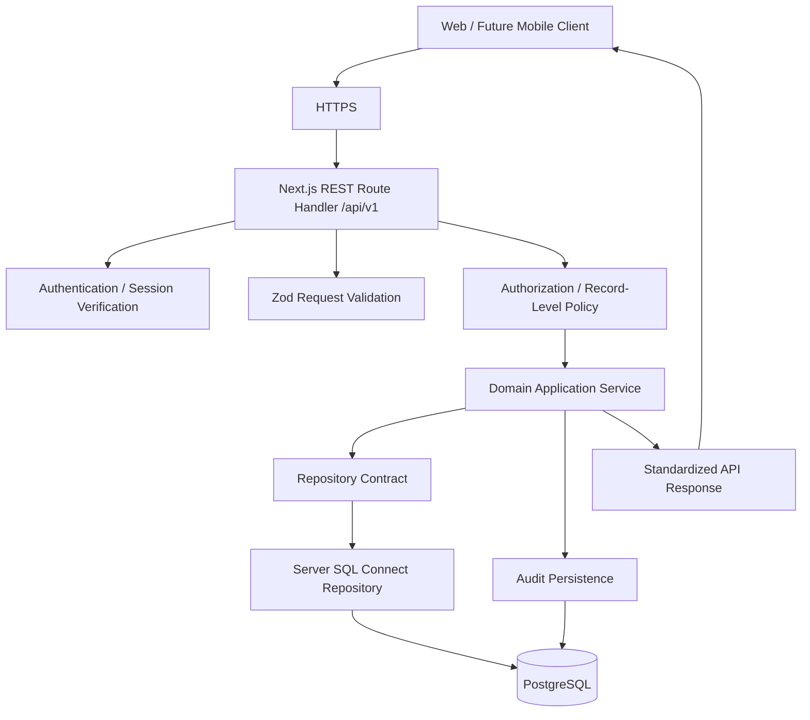

# AFHomes Platform — Backend Architecture

> Authoritative backend architecture for the AFHomes Platform.
> Read `docs/development/architecture.md` for system architecture, `docs/development/database.md` for database architecture, and `docs/business-rules/` (01–14) for authoritative business behavior.
> This document is documentation only; no backend code is implemented here.

---

## 1. Purpose and Scope

This guide defines the single Next.js backend, REST `/api/v1`, Firebase Auth, centralized authorization, domain services, typed SQL Connect repositories, PostgreSQL transactions, duplicate-request protection, audit integration, and environment boundaries.

---

## 2. Approved Backend Technology Stack

| Area | Technology or architecture |
|---|---|
| Application framework | Next.js (App Router) |
| Backend language | TypeScript |
| Backend runtime | Supported Node.js server runtime |
| Backend topology | Same Next.js application |
| API architecture | REST |
| API prefix | `/api/v1` |
| Validation | Zod |
| Authentication | Firebase Auth, with a verified server session |
| Authorization | Centralized RBAC and record-level policies |
| Business services | Domain-oriented application services |
| Persistence abstraction | Typed repository contracts |
| Repository integration | Typed SQL Connect operations via the Firebase Admin SDK |
| Local database | SQL Connect Emulator with its integrated local database |
| Cloud database | Separate staging and production Cloud SQL for PostgreSQL instances |
| Hosting | Vercel demo, then verified Firebase App Hosting or Cloud Run |
| Deployment | Owner-approved release on the host verified in staging |
| Transport security | HTTPS |
| Audit | Centralized, protected business audit history |

Use the Next.js server runtime, REST `/api/v1`, Zod request validation, Firebase Auth, and SQL Connect. Verify version compatibility and actual installed dependencies when implementing.

---

## 3. Current Versus Target Implementation

- **Historical snapshot (HEAD 0512a31, 2026-11-12):** frontend prototype on typed in-memory mock data (Next.js, mock repositories, mock sign-in, Vitest tests); no API, database or real authentication.
- **Approved target:** as above.
- **Future implementation work:** all backend development requires separate explicit authorization.

---

## 4. Backend Architectural Principles

1. Single Next.js modular monolith; no separate backend application.
2. Domain services platform-neutral (no React/browser deps).
3. Thin route handlers.
4. Centralized auth and authorization.
5. Repository contracts abstract persistence.
6. Server-side validation authoritative.
7. Business rules in domain services, not UI.
8. Financial transaction integrity.
9. Audit integration for state changes.
10. Minimal unnecessary complexity.

---

## 5. Single Next.js Modular Monolith

The same application contains web presentation, route handlers, authentication infrastructure, authorization policies, domain application services, repository contracts, server-side persistence adapters, background operations where appropriate, and audit integration. Business services must not depend on React components, page layouts, browser APIs, Next.js presentation hooks, or UI component libraries. Domain rules platform-neutral. API entry points adapt HTTP requests to shared business services. This supports future React Native mobile clients consuming the same APIs. No microservices, no separate Express/NestJS, no independent backend repository, no one deployment per module. A separately scheduled worker process/container may be considered later if a real operational requirement justifies it, without turning the project into an unapproved distributed application design.

---

## 6. Backend Request Lifecycle

Validation, authentication and authorization ordering can vary appropriately by operation, but every protected operation must enforce the necessary checks before sensitive effects occur. The server's responsibility is returning only authorized records and fields. Do not imply that a single generic `team` scope automatically covers every module-specific privacy rule.

---

## 7. Target Backend Folder Organization

(See architecture.md target layout.) Target conceptual layout; do not create directories now. Only actual business APIs required by a separately authorized implementation phase should be created in the future. Disabled modules must not be exposed merely because their names appear in the target folder structure.

Keep thin handlers under `src/app/api/`, canonical rules and application services under `src/modules/`, and shared repository contracts under `src/data/contracts/`. Keep SQL Connect configuration, Firebase Auth session verification, concrete repositories, and security tooling in the planned server-only infrastructure. Client-safe HTTP and mock adapters stay in `src/data/`. Create files only for approved implementation work.

### 7.1 Dependency injection and composition

Use explicit composition so domain services depend on repository and policy interfaces. The server constructs repositories, authorized services, and audit integration. Keep transaction ownership with the service boundary and its approved connector operation.

---

## 8. Domain Module Conventions

Representative module layout (example, not command to create files): domain (types, rules, states), application (use cases), contracts (repository interfaces), schemas (Zod), index.ts. Document domain entity ownership, application use cases, validation contracts, repository interfaces, controlled exports, business lifecycle rules, audit responsibility, cross-module dependencies. Avoid placing all backend business logic into a single generic service file. Avoid forcing every trivial operation into many empty abstractions.

---

## 9. REST API Architecture

Approved API prefix: `/api/v1`. Document HTTP method conventions, resource naming, pagination, filtering, search, sorting, Zod input validation, success/error responses, authentication, authorization, status codes, idempotency, API compatibility. Do not invent a huge endpoint catalog of supposedly approved production APIs. Use representative examples only.

### 9.1 Route handler rules

Thin handlers: accept HTTP request, resolve auth context, parse request, validate inputs, evaluate authorization, call application service, map result to API response, map failures to safe HTTP errors, record relevant diagnostic context. Do not put complex financial logic directly inside route handlers. Do not put DB transactions directly into UI components. Do not place privileged business operations inside unauthenticated/unguarded endpoints.

### 9.2 API design ownership

Define conceptual API namespaces aligned with modules. Do not claim specific resource paths approved/implemented unless supported by actual documentation. Use examples to illustrate route conventions without creating a falsely finalized exhaustive endpoint inventory.

---

## 10. API Request and Response Contracts

### 10.1 Request formats

JSON bodies, query parameters, route parameters, authentication/session context, required HTTP headers, idempotency keys where appropriate, file upload handling.

### 10.2 Successful responses

Define consistent response envelope or clearly explain selected response conventions. For example, a proposed convention may include data, pagination metadata, optional response metadata. Clearly label any new response-envelope format as a technical convention proposed for future implementation if not already approved.

### 10.3 Error responses

Stable error structure supporting machine-readable code, user-safe message, relevant validation details, request/correlation reference. Do not leak stack traces, DB connection strings, internal queries, private customer data, authentication tokens.

### 10.4 HTTP status behavior

Appropriate categories: successful request, created record, invalid input, unauthenticated, unauthorized, missing record, duplicate/conflict, invalid lifecycle transition, rate-limited request, server error, temporary dependency failure. Do not use HTTP 200 for every failure.

---

## 11. Zod Request Validation

Zod is the approved validation direction. Validation categories: path params, query params, JSON payloads, identifiers, date ranges, monetary amounts, status values, pagination limits, file metadata, search filters.

### 11.1 Shared validation

Share relevant validation contracts with frontend code where appropriate. Backend validation is authoritative.

### 11.2 Domain validation

Zod verifies data structure and input constraints. It does not replace permission evaluation, Finance authority, contract eligibility, membership activation requirements, genealogy relationship rules, commission approval, points balance validation. Business invariants belong in domain/application services.

### 11.3 Database validation

PostgreSQL constraints and SQL Connect transactional mutations support domain and request validation. Authorization still runs on the server.

---

## 12. Authentication Integration

Use Firebase Auth. Verify Node.js, Next.js, Firebase Admin SDK, and server-session compatibility before rollout. Check sessions, sign-in and revocation, account status, role changes, cookie settings, CSRF protection, and the protected API. Future mobile clients require their own approved session integration.

### 12.1 Authentication responsibilities

Cover: account login, account logout, session establishment, session verification, session expiration, revocation, account deactivation, suspension, staff approval, IST/OST account status, security-sensitive events.

### 12.2 Server authentication context

Protected application services must receive verified actor context. Do not trust arbitrary client-supplied user IDs, roles or permission names.

### 12.3 Development demo authentication

Frontend's mock account switching is development-only. Not a production authentication implementation. Do not let demo switching bypass production authentication.

### 12.4 Future mobile compatibility

Future mobile clients may use the same backend API. Mobile session and token handling require separate compatibility verification. Do not assume web cookies work unchanged in mobile clients.

---

## 13. Centralized Authorization

Use `docs/business-rules/01-roles-and-permissions.md`. Document authorized role assignments, multiple roles, module access, operation permissions, record-level visibility, sensitive operation restrictions, deactivated accounts, suspension, privilege escalation prevention, audit of access changes.

### 13.1 Role versus permission

A role does not automatically grant every operation. Permission evaluation must follow approved role and module policy.

### 13.2 Record-level scopes

Support approved access-scope concepts: `own`, `team`, `all`. Also support module-specific constraints not fully represented by those three simple labels.

### 13.3 Authorization enforcement

Every protected backend operation must evaluate: (1) verified identity; (2) account eligibility; (3) applicable role/module permission; (4) requested operation; (5) actual target-record scope; (6) any additional business-specific restrictions. Do not rely solely on frontend filters.

### 13.4 Super Administrator protection

Protect privileged administrative access. Document requirements to prevent unauthorized role escalation and improper removal of essential administrative authority according to canonical business rules. Do not invent a universal permission matrix.

---

## 14. Record-Level Data Access

Backend repositories and application services must enforce authorized data access. Examples: OST sees permitted personal sales; SVD sees authorized descendants; SSM sees permitted downline; SM sees permitted OST relationships; Staff see only authorized operational records; Finance sees financial records necessary for approved duties; Public users see only explicitly disclosed verification fields. Use authoritative hierarchy from documents 02 and 03.

### 14.1 Read operations

Apply authorization to single-record retrieval, list endpoints, search, pagination totals, export, autocomplete, related-record lookups. Do not leak hidden data indirectly through search counts or metadata.

### 14.2 Write operations

Verify both authority to perform the operation and authority over the target record. Do not allow a user to modify another seller's records merely by changing an ID in the request.

---

## 15. Database Integration

Use the SQL Connect Emulator locally and separate hosted SQL Connect/Cloud SQL for PostgreSQL in staging and production.

### 15.1 Local development connection

Use only the authorized local demo project and emulator endpoints. Keep the backend and emulator project IDs consistent, and fail safely when the local emulator configuration is incomplete.

### 15.2 Production connection

Use the runtime's dedicated service identity to invoke SQL Connect. Keep protected data operations behind the AFHomes server. Configure the verified managed host, service location, project scope, and private storage for the deployed environment.

### 15.3 Configuration

Validate server-only project ID, service ID, location, emulators, and service identity configuration. Keep private values out of browser settings and use placeholders in examples.

### 15.4 Connection lifecycle

Document client initialization and reuse, deadlines, safe handling when the database is unavailable, retry limits, and readiness checks. Avoid retrying a sensitive operation unless duplicate handling is verified.

### 15.5 Runtime compatibility

Use the Node.js server runtime for the Firebase Admin SDK. Verify the selected runtime and connector version on the actual host.

---

## 16. SQL Connect Repositories

The backend architecture must describe concrete repository responsibilities. Conceptual examples: CustomerRepository, StaffRepository, GenealogyRepository, AccreditationRepository, ContractRepository, SaleRepository, PaymentRepository, CommissionRepository, MembershipRepository, PointsLedgerRepository, AuditRepository. These are examples, not mandatory code files.

### 16.1 Repository boundaries

Repositories handle typed operations, queries, persistence, schema mapping, and safe persistence errors. Application services own eligibility, role and record scope, state transitions, cross-domain workflows, and the transaction boundary. Keep related approved writes and their audit event together.

### 16.2 Domain contract compatibility

Keep browser mock and HTTP adapters and server-side SQL Connect repositories compatible through the existing typed contracts.

---

## 17. Business Domain Service Architecture

The finalized document must explain each primary backend module. For each module, document: business responsibility, principal application use cases, owned data, key validation requirements, authorization boundary, cross-module dependencies, audit responsibility, transaction or idempotency considerations. Do not merely list module names.

### 17.1 Organization, Staff and Roles

- **Organization:** organization info, department management, staff relationships, authorized organizational configuration.
- **Staff:** account creation, staff approval, account status, staff profile updates, department association. Preserve authorized distinction between ordinary staff approval and Sales Network account creation rules.
- **Roles and Permissions:** role configuration, permission definitions, role assignment, effective permission evaluation, record-level authorization integration, audit of sensitive access changes. Do not create competing role engines in each module.

### 17.2 Sales Network and Genealogy Services

Use documents 02 and 03. Sales Network: SVD → SSM → SM → OST; OST may be assigned directly to authorized SVD/SSM/SM. Backend supports Sales Network account creation, parent selection, authorized sponsor approval where applicable, hierarchy validation, genealogy queries, downline visibility, account transfers, IST/OST conversions, historical relationship retention.

Transfer safety: a transfer must not retroactively rewrite historical upline attribution of existing sales. Document actual prior relationship, actual new relationship, effective date, authorized actor, related sales history, audit event.

Genealogy consistency: avoid cycles, invalid parent relationships, fake intermediate managers, unauthorized transfers, inconsistent downline references, historical attribution loss. Do not implement an entire second genealogy database structure for reporting when an authoritative source already exists.

### 17.3 IST/OST Accreditation Services

Backend responsibilities: accreditation creation, official AA number assignment, accreditation eligibility, approval, renewal, suspension, deactivation, reactivation, expiration checks, public verification.

- **Numbering:** use authoritative AAI/AAO rules; do not create competing AA-number allocator.
- **Public verification:** return only permitted data; do not expose private identification documents, contact information, financial details, unrestricted Sales Network info.
- **Public query controls:** input normalization, exact identifier lookup, rate limiting, generic non-disclosing failures, eligible accreditation status evaluation. Public search behavior must follow currently approved verification rules.

### 17.4 Customer Management Services

Use document 04. Backend responsibilities: canonical customer identity, customer creation, customer draft, application submission, profile changes, customer search, customer import/export, identity reconciliation, historical customer record handling. There is no public customer lookup (owner ruling R11; doc 11 §21).

- **Customer lifecycle:** customer creation is not the same as submitted VIP application, finalized contract, Confirmed Sale, Fully Paid settlement, Active VIP Membership. Preserve these distinctions.
- **Customer drafts:** allow authorized incomplete drafts per approved workflow. Do not apply final-submission requirements to every draft-saving operation.
- **Customer privacy:** internal search follows permitted business scope; public lookup discloses only approved active membership information.
- **Customer import:** parsing, validation, normalization, duplicate detection, identity reconciliation, preview, authorized confirmation, error reporting, audit. Do not insert unverified payment claims as Finance-verified monetary transactions.

### 17.5 VIP Products, Contracts and Payment Schemes

Use document 05. Backend responsibilities: product configuration, tier definitions, payment schemes, contract classification, contract creation, contract validation, authorized approval, finalization, historical contract snapshots.

- **Configurable business rules:** authorized commercial configuration may change over time. Do not recalculate finalized historical contracts using newly edited product prices.
- **Contract integrity:** a finalized contract is not proof of actual payment. Preserve the contract's agreed commercial terms.
- **Non-Standard contracts:** apply only authorized exceptions. Do not invent a universal discount or commercial override process.

### 17.6 Sales Services

Use documents 05, 07 and 13. Backend responsibilities: sales creation, contract association, direct seller attribution, historical genealogy attribution, sale state transitions, Confirmed Sales recognition, reversals and adjustments, authorized sales reporting.

- **Confirmed Sale:** use the approved sale record and approved receipt thresholds in [doc 13](../business-rules/13-sales-performance-reporting.md) and [doc 14](../business-rules/14-igp-sales.md). Formal contract finalization is a separate event. Count the qualifying sale once and track full payment separately.
- **Historical attribution:** preserve seller and eligible upline relationships as applicable at the relevant sale-time business event. Do not recalculate historical seller ownership using only current genealogy.

### 17.7 Finance and Payment Services

Use document 07. Finance is one of the most sensitive backend domains. Document complete architecture for payment submission, payment evidence, payment verification, payment rejection, payment correction, reservation payments, down payments, installments, full payments, outstanding balances, overdue installments, refunds, reversals, Financial Holds, reconciliation, Finance audit events.

- **Receipt approval:** Finance, the Administrator, or the Super Administrator approves a receipt under [doc 07](../business-rules/07-finance-and-payments.md). A Clerk can enter a receipt. A seller's payment evidence does not grant approval authority.
- **Payment states:** distinguish actual payment-submission and verification states. Do not invent a universal Finance status enum if authoritative document defines different statuses.
- **Financial atomicity:** critical Finance operations require appropriate consistency. Document state validation, atomic transaction boundary, balance updates, idempotency, audit persistence, error rollback, safe retries, concurrency control.
- **Reversals and refunds:** original verified transaction history must remain traceable. Do not silently delete previous payment evidence. Do not implement unauthorized automatic monetary clawbacks.

### 17.8 Commission Management Services

Use document 08. Backend responsibilities: per-person DSC/DRI rates on the seller record (changed by Admin or Super Admin for future sales only), freezing the closing seller's and referrer's rates on the sale at VIP Number issuance, commission calculation on the contract TCP, staged release, approval by Finance, Admin or Super Admin, commission Holds, clawbacks, adjustments, payout recording, confirmed disbursement, recovery history, BA/PA/PB allowances for IST leaders, commission reporting.

- **Calculation basis:** use the contract TCP (including an approved Non-Standard TCP) times the frozen rate (doc 08 §10). Do not independently substitute collection totals or profit calculations without an approved policy.
- **Release and approval:** commission is released when approved collection reaches the stage mark (VIP 40%), and is approved and paid at month-end by Finance, Admin or Super Admin; a Confirmed Sale alone releases nothing.
- **Paid status:** Approved is not Paid. Paid requires actual authorized disbursement-confirmation event.
- **Reversals:** unpaid releases are held and paid releases become clawbacks on the sale events of doc 08 §14. No automatic deduction before the IST Clawback Addendum is signed; an OST clawback is collected directly unless a signed OST agreement allows a deduction.

### 17.9 VIP Membership and Card Issuance

Use documents 06 and 09. Backend responsibilities: membership eligibility, official activation, VIP Number allocation at Reservation Agreement recording, membership lifecycle, expiration, Financial Holds, historical contract entitlement preservation, membership audit events.

- **Critical distinctions:** do not conflate customer creation, contract finalization, Confirmed Sale, Fully Paid settlement, official activation.
- **Activation eligibility:** respect applicable full-settlement and authorized official activation requirements. Do not automatically activate a membership after an arbitrary installment verification.
- **VIP Number:** approved format `YYMMDDNNNNNVTPMMS`, issued once when the signed Reservation Agreement is recorded; YYMMDD is the recording date and NNNNN the monthly company-wide sequence (document 06). Do not introduce an independent duplicate VIP serial allocator.
- **Idempotent activation:** activation never creates a number; repeated activation attempts must not assign a second VIP Number, create duplicate memberships, reissue the same activation event as another completed activation, or corrupt historical validity dates. Document appropriate transaction and unique-index requirements.

### 17.10 Stay Points Services

Use document 09. Document architecture for the Points Activation Date, Annual Welcome Gift tranches, measurement periods, resort bill intake and approval, Qualifying Spend, tranche release and non-activation, Compassionate Waiver, weekday/weekend buckets, released, reserved, redeemed and forfeited balances, expiration, refund reconciliation, historical balance correction.

- **Current points principle:** the signed Grant's Annual Welcome Gift (doc 09). Each tranche is a fixed amount per tier, released on its due date only when the measurement period's approved Qualifying Spend reaches the tier minimum. Points are not earned per peso.
- **Ledger authority:** backend owns authoritative points transactions. Frontend components may display balances but must not independently grant or consume points.
- **Weekday and Weekend:** preserve separate balances; each tranche's split is fixed by tier.
- **Gold supplementary holders:** Gold primary and approved supplementary holders share the applicable membership entitlement pool. Do not create unrelated duplicate points balances for the same membership.
- **Refund handling:** a refund lowers the period's Qualifying Spend; an unreleased tranche waits, a released tranche is never taken back. Do not invent automatic negative balances.

### 17.11 Reports and Analytics Services

Use documents 11 and 13. Reports must consume authoritative data from relevant business modules. Document backend reporting responsibilities for Confirmed Sales, Finance collections, outstanding balances, overdue installments, seller performance, historical genealogy, commission liabilities, commission payouts, active memberships, VIP tier distribution, Stay Points activity, customer analytics, audit events.

- **Reporting endpoints:** reporting operations should be read-only unless an explicitly authorized reporting-configuration change is requested. A report request must never independently create business transactions.
- **Date filtering:** support approved date-range semantics (Today, Past 7 Days, Past 28 Days, Past 6 Months, optional custom Start/End Date). Use correct business-event dates. Do not calculate Finance collections using the wrong sale-confirmation timestamp.
- **Access control:** apply record-level permission filtering before returning aggregate results. Do not disclose unauthorized sales indirectly through totals, graphs or exports.
- **Performance:** document indexed queries, aggregations, pagination, potential projections, cache invalidation where justified, consistency with authoritative source records. Do not introduce a second independent financial source of truth merely for reporting performance.

### 17.12 Audit Log Services

Use document 12. Document a centralized logical audit architecture. Relevant audit data includes actor, action, target record, timestamp, outcome, relevant state transition, business reason, related transaction, correlation reference, policy context.

- **Append-only business history:** ordinary business corrections should create new audit events rather than silently rewriting original history.
- **Audit consistency:** critical business state changes and audit records should have reliable consistency guarantees. A transaction should not be reported as complete if the required authoritative business state change failed.
- **Privacy:** exclude passwords, secrets, tokens and unnecessary sensitive personal data.
- **Operational distinction:** Business Audit Logs are different from ordinary application diagnostic logs. Do not treat console logging as sufficient financial audit history.

---

## 18. Redemption Prototype and Disabled Services

The staff Redemption prototype is authorized (2026-11-17) with synthetic data and sample points-per-night values; live Redemption and customer submissions require separate authorization. **Services: Disabled.**

Backend architecture must support future live activation without exposing live workflows. Do not remove the authorized prototype route.

### 18.1 Feature flag enforcement

A disabled feature must be blocked by server-side checks. Do not rely only on hidden frontend navigation.

### 18.2 API protection

Direct calls to disabled feature routes must not enable business processing.

### 18.3 Historical records

Preserve legitimate historical records and future domain interfaces where applicable. Do not delete working code when future implementation exists. Do not implement new redemption or Services functionality under this documentation task.

---

## 19. Transaction Management

This section is mandatory and must be detailed. AFHomes has sensitive workflows spanning multiple business records.

### 19.1 PostgreSQL transaction prerequisites

Use SQL Connect transactional mutations for related writes. Verify rollback, concurrent retries, guarded writes, and unique constraints in hosted staging after emulator checks. A passing single operation or local test alone does not establish the production guarantee. Escalate connector gaps before expanding financial workflows.

### 19.2 Transaction boundaries

Examples include receipt approval and linked balances, VIP Number issuance at signed Reservation Agreement recording, official membership activation as a separate workflow, payout and points-ledger changes, and audit events for sensitive transitions.

### 19.3 Transaction coordinator ownership

Avoid allowing several independent domain modules to begin conflicting transactions for the same business workflow. Define a clear application-service orchestrator for cross-module operations.

### 19.4 Failure handling

Document: rollback on failure; transaction retries where appropriate; conflict handling; duplicate prevention; appropriate timeout behavior; correct audit behavior; safe response handling.

### 19.5 External side effects

Do not perform irreversible external operations inside retryable database transaction callbacks without safeguards. Examples: sending an email, calling a payment provider, writing a third-party notification, starting an irreversible external job. For workflows requiring reliable asynchronous external delivery, describe an appropriate after-commit or durable outbox-style approach as a technical option, not as an already selected implementation. Do not invent an external message broker.

---

## 20. Idempotency and Concurrency

### 20.1 Idempotency

Repeated requests must not create repeated business effects. Potential operations: Payment verification, Refund, Payment reversal, Sale confirmation, Commission approval, Payout confirmation, VIP Membership activation, Points earning, Customer import, Historical data reconciliation.

### 20.2 Idempotency design

Document a conceptual strategy covering: stable business-operation identity; authorized actor and operation scope; request identity; result tracking; duplicate request behavior; conflicting payload behavior; expiry/retention considerations; database uniqueness; transaction integration. Do not rely solely on disabling a frontend button.

### 20.3 Concurrency

Consider: two Finance users approving the same payment; repeated membership activation; concurrent identifier allocation; multiple points requests; simultaneous genealogy edits; replayed import requests. Define required consistency properties without inventing actual code implementations.

---

## 21. Error Handling

Define a consistent backend error taxonomy. Relevant classes: Validation failure; Authentication required; Permission denied; Record not found; Conflict; Duplicate identifier; Invalid business transition; Financial reconciliation failure; External dependency unavailable; Database unavailable; Rate limit exceeded; Unexpected internal error.

### 21.1 Error mapping

Map internal errors to safe API responses. Keep stack traces, raw SQL Connect/database errors, and credentials out of client responses.

### 21.2 Business-specific errors

Preserve meaningful distinctions. For example, "Payment evidence submitted" is not the same as "Payment verified." "Membership activation blocked due to outstanding balance" is not the same as "Customer does not exist." Do not expose private information in public-facing errors.

### 21.3 Correlation

Use an appropriate request/correlation identifier strategy. Do not log full sensitive request bodies without authorization.

---

## 22. Pagination, Search and Filtering

Define consistent backend conventions for pagination, sort order, filter validation, search normalization, date ranges, record-level scoping, maximum result sizes, export permissions, query performance.

### 22.1 Authorization before disclosure

Search must not expose inaccessible records through matching names, counts, autocomplete, error details, aggregates, exports.

### 22.2 SQL Connect and PostgreSQL performance

Queries should align with the indexes and modeling strategy from `database.md`. Do not create unbounded scans for every dashboard request.

### 22.3 Public search

Apply stricter disclosure controls and rate limiting. Use approved exact-identifier behavior for public accreditation verification.

---

## 23. File Upload and Download Services

Document secure file handling for customer documents, government ID images, payment proofs, contract attachments, accreditation photos, public website media.

### 23.1 Upload validation

Backend responsibilities: authorization, file-size limits, file-type checking, content validation where appropriate, safe filenames, storage reference creation, error handling, audit logging. Do not rely only on browser MIME types.

### 23.2 Download authorization

Private documents must require appropriate server-side access checks. Do not expose unrestricted public URLs for sensitive files.

### 23.3 Storage abstraction

Use private Cloud Storage for Firebase for production uploads. Keep the storage interface behind the AFHomes service boundary so it can use the local Storage Emulator and, when approved, a private staging-only sample bucket.

### 23.4 Database versus file storage

Keep binary files in private Cloud Storage for Firebase and store authorized metadata and parent-record links in PostgreSQL. Use a storage adapter that runs with the emulator, and verify the production path in staging.

---

## 24. Background Jobs

The backend must support future authorized scheduled and asynchronous processing. Examples: accreditation expiration checks, installment overdue evaluation, membership expiry, annual points-cycle evaluation, notifications, reconciliation, authorized report generation, operational cleanup.

### 24.1 Job architecture

Document: job ownership, trigger mechanism, schedule, idempotency, retry limits, failure handling, audit events, monitoring, duplicate execution prevention.

### 24.2 Next.js deployment consideration

Use approved scheduling and execution services if background work is needed. Bound its execution time and verify its identity, duplicate protection, logs, and recovery. An ordinary API request must not be relied on as an indefinite worker.

### 24.3 Business policy separation

Scheduled processing must follow approved business rules. Do not invent automatic refunds, commission releases, or points consumption merely because a background job framework is available.

---

## 25. Notifications

Describe backend notification architecture as a conditional capability. Potential events: account approval, application status changes, Finance verification outcome, membership activation, accreditation renewal reminders, authorized payment reminders, commission status updates.

### 25.1 Notification ownership

Business events are authoritative. Notification delivery is a separate side effect. Failure to deliver an email must not automatically invalidate an otherwise correctly completed financial transaction.

### 25.2 Delivery guarantees

Describe: retry strategy, delivery tracking, duplicate prevention, sensitive-content minimization, consent/preference requirements where applicable. Do not choose an unapproved email/SMS provider. Do not invent mandatory notification triggers where no business rule authorizes them.

---

## 26. Configuration and Environment Variables

### 26.1 Environments

Development, Staging, Production.

### 26.2 Database configuration

Development uses the local SQL Connect Emulator. Staging and production use isolated hosted SQL Connect and Cloud SQL for PostgreSQL. Verify project ID and service identity at startup.

### 26.3 Server-only secrets

Categories: database connection credentials, authentication secrets, storage credentials, email/SMS provider credentials, external integration tokens. Never expose secrets in Client Components or public environment variables.

### 26.4 Configuration validation

Use validated server configuration. Fail safely when required configuration is missing.

### 26.5 Feature flags

Live Redemption and Services must default to disabled unless explicitly authorized; the staff Redemption prototype is authorized. Feature flags must be enforced by protected backend operations.

---

## 27. API Security

Document: authentication, session verification, authorization, record-level filtering, input validation, rate limiting, CSRF protections where applicable, CORS policy where applicable, secure cookies, TLS, safe HTTP headers, file upload security, sensitive error handling, secrets, abuse prevention, audit logging, security-sensitive operations, production demo-mode restrictions.

### 27.1 Same-origin deployment

The main frontend and `/api/v1` run within the same Next.js application. Do not introduce permissive cross-origin configurations without a real client requirement. Future mobile clients may require separately appropriate API authentication and origin/session handling.

### 27.2 Never trust client permissions

Client-supplied role names or `staffId` values do not independently authorize a user to access another person's records. Authorization must derive from authenticated identity and server-verified permissions.

---

## 28. Logging and Observability

Document structured backend application logging. Include request identifier, route or operation, status, duration where appropriate, safe failure metadata, dependency failures, database connection errors, background job failures, security events. Do not log passwords, authentication secrets, raw access tokens, unnecessary full ID images, sensitive financial attachments, private customer data without authorized necessity. Separate operational logs from append-only business audit records.

---

## 29. Health and Readiness

Verify liveness and readiness on the approved Google host. Check validated configuration, database access, and critical dependencies without exposing infrastructure details. Confirm endpoints and provider checks in staging before relying on them.

---

## 30. Backend Testing

Follow [testing.md](testing.md) for domain, API, service, repository, Firebase Auth, RBAC, genealogy, accreditation, customer, contract, Finance, payout, membership, points, reports, audit, idempotency, concurrency, rollback, and hosted security checks.

### 30.1 Emulator and hosted integration

Use the SQL Connect Emulator and isolated test data for repeatable local integration checks. Prove transactional behavior, concurrency, and recovery in hosted staging before release. Keep destructive tests out of production.

### 30.2 Production readiness

Manual frontend testing alone is not sufficient for production release. Critical backend workflows require automated validation before deployment approval.

---

## 31. Deployment Architecture

Follow [deployment.md](deployment.md). The single Next.js backend runs on Firebase App Hosting once verified or on the rehearsed Cloud Run fallback. Verify Node.js, identity, HTTPS, SQL Connect and PostgreSQL, private files, health, monitoring, logs, backups, and rollback.

---

## 32. Future Mobile API Compatibility

A future React Native + Expo application may use the same authorized `/api/v1` contracts. Keep server validation, permissions, pagination, errors, and duplicate protection client-independent. Do not create competing business logic or allow direct access to protected SQL Connect operations.

---

## 33. Implementation Phases

Use the [implementation phase mapping](implementation.md) and [Firebase environment guides](../implementation/firebase/README.md). Establish the local database, backend, and API before connecting the pilot screens. Verify the hosted pilot before expanding sensitive workflows. Rehearse the release in staging before owner-approved production deployment.

---

## 34. Critical Backend Invariants

1. One Next.js application.
2. Backend remains inside the approved modular monolith.
3. `/api/v1` is the approved REST API prefix.
4. No unapproved Express/NestJS backend.
5. Thin route handlers.
6. Shared domain services.
7. Zod request validation.
8. Server-side business validation.
9. Centralized authentication.
10. Centralized authorization.
11. Module permissions and record visibility remain separate.
12. No client-trusted role escalation.
13. Use the SQL Connect Emulator for local database integration.
14. Cloud SQL for PostgreSQL backs SQL Connect in separate staging and production projects.
15. Privileged Firebase Admin SDK calls and SQL Connect operations stay server-only.
16. Direct clients use approved API endpoints for protected business records.
17. No production credentials in client code.
18. Financial operations require correct atomicity.
19. Sensitive writes require idempotency.
20. Official identifiers have one authoritative allocation path.
21. Historical VIP Numbers are preserved.
22. Genealogy transfers do not rewrite historical sales attribution.
23. Customer creation is not membership activation.
24. Contract finalization is not payment verification.
25. Confirmed Sale is not necessarily Fully Paid.
26. Fully Paid is not automatically proof of completed official activation.
27. Finance, Admin or Super Admin approves receipts; a Clerk enters only.
28. Commissions use per-person rates frozen on the sale and are approved and paid by Finance, Admin or Super Admin.
29. Approved commission is not Paid commission.
30. Payouts require confirmed disbursement.
31. Stay Points are ledger-controlled.
32. Annual earning caps do not equal available points.
33. Weekday and Weekend pools remain separate.
34. Gold supplementary holders share the applicable membership entitlement.
35. Reporting uses authoritative source data.
36. No double-counting of sales.
37. Audit events preserve significant historical state changes.
38. Disabled modules are blocked server-side.
39. Live Redemption remains disabled; the staff prototype is authorized under the 2026-11-17 status.
40. Services remains disabled.
41. Public APIs disclose only authorized information.
42. Sensitive customer and financial data remain protected.
43. Backend services support future mobile clients.
44. No automatic migration of previous Supabase production records.
45. Business policies may change through authorized decisions.
46. Historical signed contract terms remain protected.
47. Production deployment requires separate authorization.
48. Documentation does not authorize implementation.

---

## 35. Engineering Decisions Versus Business Rules

### Approved Decisions

Next.js App Router, one application, REST `/api/v1`, TypeScript, Zod, Firebase Auth, SQL Connect with PostgreSQL, centralized permissions, and the verified Firebase App Hosting or Cloud Run deployment.

### Technical Conventions

Response envelopes, repository method naming, API error code patterns, transaction coordinator structure, background job interfaces. These may be specified as recommended engineering standards, but do not falsely claim they were explicitly approved if no source establishes that.

### Unresolved Dependencies

Verify SDK and runtime compatibility, hosted transactional approval, App Hosting or fallback qualification, and approved recovery settings. Use canonical rules and owner decisions for finance, privacy, and historical data.

---

## 36. Cross-Document Consistency

Check this guide against architecture, frontend, database, security, testing, implementation, deployment, and the canonical business rules. The Firebase environment roadmap is the execution sequence.

---

## 37. Documentation Validation

### Architecture
- [ ] Next.js App Router explicitly selected.
- [ ] One application.
- [ ] No separate backend application.
- [ ] TypeScript.
- [ ] REST `/api/v1`.
- [ ] Thin route handlers.
- [ ] Domain services.
- [ ] Repository contracts.
- [ ] Dependency direction.

### Database
- [ ] SQL Connect Emulator.
- [ ] Hosted PostgreSQL isolation.
- [ ] Typed server-only SQL Connect operations.
- [ ] Secure server-only connection.
- [ ] Transaction prerequisites.
- [ ] Data consistency.
- [ ] Index/identifier requirements.

### Authentication and Authorization
- [ ] Firebase Auth identity and server session verification.
- [ ] Compatibility verification.
- [ ] Verified server-side sessions.
- [ ] RBAC.
- [ ] Record-level visibility.
- [ ] Sensitive operation authorization.
- [ ] No production demo-account bypass.

### Business Services
- [ ] Organization.
- [ ] Staff.
- [ ] Roles.
- [ ] Sales Network.
- [ ] Genealogy.
- [ ] Accreditation.
- [ ] Customers.
- [ ] VIP Products.
- [ ] Contracts.
- [ ] Sales.
- [ ] Finance.
- [ ] Commissions.
- [ ] VIP Membership.
- [ ] Stay Points.
- [ ] Reports.
- [ ] Audit.
- [ ] Redemption staff prototype authorized; live use disabled.
- [ ] Disabled Services.

### Operational Correctness
- [ ] Transactions.
- [ ] Idempotency.
- [ ] Concurrency handling.
- [ ] Error conventions.
- [ ] Pagination.
- [ ] Search.
- [ ] File handling.
- [ ] Background work.
- [ ] Notifications.
- [ ] Feature flags.
- [ ] Logging.
- [ ] Health checks.

### Implementation Readiness
- [ ] Testing guidance.
- [ ] Deployment integration.
- [ ] Phase alignment.
- [ ] Historical integrity.
- [ ] No fabricated financial rules.
- [ ] No unapproved architecture.
- [ ] No undocumented major module boundaries.

Only mark an item complete when actually documented. Documentation completeness does not mean backend functionality has been implemented.

---

## 38. Strict Execution Limits

The backend plan does not authorize source changes, test or production environment setup, migrations, deployment, or Git writes. Apply the authorization rules in AGENTS.md to every milestone.

---

## 39. Final Verification

Check the single runtime, API contracts, module and auth boundaries, SQL Connect data path, finance and membership consistency, points, privacy, audit, feature gates, links, and diagrams. Report actual verification and preserve existing working-copy changes.

---

## 40. Historical Completion Report

> This report describes the earlier backend documentation review. The infrastructure choices in it are superseded.

### A. Repository Verification
- Actual repository: `afhomes-platform`; branch: `develop`; initial working tree held untracked docs/workflow files. At the time of writing this was a documentation-only repository; the current repository now contains a frontend prototype.

### B. Document Updated
- `docs/development/backend.md` (comprehensively rewritten/expanded).

### C. Backend Architecture Coverage
Next.js runtime, REST `/api/v1`, authentication, authorization, domain services, repository architecture, Mongoose, local MongoDB, MongoDB Atlas.

### D. Business Module Coverage
All AFHomes domains have documented backend responsibilities: organization/staff/roles, sales network/genealogy, accreditation, customers, VIP products/contracts, sales, finance, commissions, VIP membership/card issuance, stay points, reporting, audit, disabled redemption/services.

### E. Financial Integrity
Finance authority, Confirmed Sales, commission approval, membership activation, VIP Numbers, Stay Points, transactions, idempotency, audit all covered.

### F. API and Security
`/api/v1`, Zod, safe API response/error conventions, RBAC, record-level access, request validation, sensitive file access, feature flags.

### G. Operational Architecture
Background jobs, notifications, logging, health checks, testing, DigitalOcean deployment alignment.

### H. Cross-Document Consistency
Aligned with architecture, frontend, database, security, testing, implementation, deployment, business rules 01–14. No material mismatches.

### I. Critical Dependencies
Better Auth adapter compatibility; selected Node.js/Next.js versions; local replica-set setup; selected Atlas tier and transaction support; financial rounding policies; a legally advised retention period (records are kept indefinitely until then); selected object-storage provider.

### J. Validation
Markdown validation, link validation, Mermaid validation, cross-document review, git diff verification performed.

### K. Execution Safety
- Application code modified: No.
- Backend scaffold created: No.
- API endpoints created: No.
- Authentication implemented: No.
- Mongoose models created: No.
- MongoDB modified: No.
- Atlas configured: No.
- Local database started: No.
- Migrations executed: No.
- Other documentation modified: No.
- Git commit: No.
- Git push: No.
- Git merge: No.
- Deployment: No.
- Redemption live use enabled: No; staff prototype authorized 2026-11-17.
- Services enabled: No.
- Production data migrated: No.

Historical note: this stop point applied before the frontend prototype. Backend coding, database setup and deployment still require authorization.

## Consistency update (2026-11-12)

Aligned with the business-rule documents as rewritten on 2026-11-12. No architecture decision changed.

1. Section 17.8: Finance manual percentage assignment replaced by per-person frozen DSC/DRI rates, staged release and clawback rules (doc 08).
2. Section 17.9: the activation-tied VIP Card ID with an RA-derived sequence replaced by the VIP Number issued at Reservation Agreement recording (doc 06).
3. Section 17.10: Spend-to-Earn (one point per peso) replaced by the Annual Welcome Gift (doc 09).
4. Invariants 27 and 28: Finance-only verification replaced by Finance, Admin or Super Admin approval (doc 07 §5.2).
