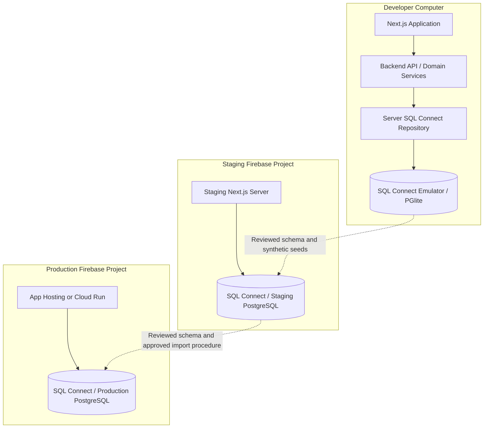

# AFHomes Platform — Database Architecture

> Authoritative database architecture for the AFHomes Platform.
> Read `docs/development/architecture.md` for system architecture and `docs/business-rules/` (01–14) for authoritative business behavior.
> This document is documentation only; no database is configured or migrated here.

---

## 1. Purpose and Scope

This guide covers data modeling, identifiers, financial atomicity, ledger integrity, security, indexes, schema changes, approved imports, backups, and environment isolation.

Use PostgreSQL through Firebase SQL Connect. Start in the SQL Connect Emulator on localhost, prove the pilot against PostgreSQL in staging, then use a separate company-owned production database. The app has no browser mock layer (removed in F9): `db:seed` and `db:seed:clean` load the true data only, and `db:seed:fixtures` adds the synthetic local records used by the test suites.

---

## 2. Approved Database Decisions

| Component | Approved direction |
|---|---|
| Local development | Firebase SQL Connect Emulator with integrated PGlite |
| Local connection | Loopback-only emulator endpoints and an explicit demo project ID |
| Staging and production database | Separate Cloud SQL for PostgreSQL instances through SQL Connect |
| Server data access | Typed SQL Connect operations via the Firebase Admin SDK |
| Backend and API | Next.js server services and REST `/api/v1` |
| Production application hosting | Firebase App Hosting if verified, otherwise Cloud Run |
| Data movement | Versioned schema changes and approved, validated application imports |
| Original Supabase production records | No automatic migration, separate authorization required |

---

## 3. Current Versus Target State

- **Historical snapshot (HEAD 0512a31, 2026-11-12):** frontend prototype on typed in-memory mock data (Next.js, mock repositories, mock sign-in, Vitest tests); no database or Atlas cluster.
- **Approved target:** SQL Connect Emulator for localhost, then isolated hosted SQL Connect in staging and production.
- **Future implementation work:** all database setup, schema creation, migration, import requires separate authorization.

---

## 4. Local Seed Versus Persistent Database

Two data-development modes:

1. **Local full stack:** Next.js uses the SQL Connect Emulator through a server repository. `db:seed` and `db:seed:clean` load the true data only: one Super Admin and the confirmed reference data. `db:seed:fixtures` adds the synthetic pilot records used by the emulator test suites. Every seed variant clears the local tables first. Records survive browser refreshes; recreate or persist test state through the documented seed and emulator procedures.
2. **Hosted database:** Independent staging and production SQL Connect/Cloud SQL pairs. Each has project-specific authentication, service credentials, reviewed schema releases, and an approved backup and recovery policy.

---

## 5. Database Environment Strategy

Use clear environment naming. Illustrative development database name: `afhomes_development`. Actual naming consistent across environments. Separate development, staging, production. Never use real production customer data as ordinary development seeds.

---

## 6. High-Level Topology

Conceptual. Data movement must be authorized and controlled; not automatic.

---

## 7. Local SQL Connect Setup

Use the [localhost database guide](../implementation/02-full-stack/01-localhost/01-database-and-emulators.md) to configure SQL Connect, Auth, and Storage emulators for a dedicated demo project. Bind listeners to loopback and keep staging and production credentials out of local settings. Maintain a versioned schema, named operations, and a repeatable synthetic seed. Use an isolated target and explicit authorization for resets.

---

## 8. Generated Server SDK

Generate trusted server bindings from the reviewed schema and named operations. Verify Node.js, Firebase Admin SDK, and emulator compatibility. Keep generated operations behind typed server repository contracts.

---

## 9. PostgreSQL Constraints and Data Types

Use primary and foreign keys for durable entity relationships. Enforce the approved uniqueness scope in the database. Review indexes and schema changes. Keep exact money and date-only fields distinct from their display format.

---

## 10. Transaction Support

Test local transactions, then prove concurrent requests and rollback in hosted staging. A single successful request or emulator-only test is insufficient.

### 10.1 Hosted proof

Repeat overlapping approval, retry, and forced rollback against real staged PostgreSQL. If required guarantees cannot be verified using SQL Connect operations, raise an architecture decision before expanding the affected workflow.

### 10.2 Transaction-dependent workflows

Finance verification and linked balances, official VIP Number issuance, membership activation, commission payment, points-ledger updates, authorized genealogy changes, and the corresponding audit entries.

### 10.3 Requirements

Cover atomicity, retries, duplicate protection, conflict detection, rollback, and audit-event consistency. Apply transactions when related records must change together.

---

## 11. Local Data Persistence and Security

Use synthetic records and a documented local seed or state procedure. Restrict emulator access to localhost and verify production configuration is absent.

---

## 12. Hosted SQL Connect and Cloud SQL

Staging uses the owner-approved SQL Connect Spark trial, then approved paid services as needed for full rehearsal. Production uses a separate company-owned Blaze project. Review service identity, location, database capacity, configuration limits, costs, backups, and monitoring before provisioning.

---

## 13. Development, Staging and Production Isolation

Use separate projects and database instances for staging and production, with distinct server identities and secrets. Keep the sample-data demo and local emulator separate from both.

---

## 14. SQL Connect Integration

Keep named and typed queries and mutations in the Firebase Admin SDK server boundary. Sensitive SQL Connect operations stay unavailable to direct clients.

### 14.1 Server-only boundary

Browsers and future mobile clients use the AFHomes API for protected records. The server checks account status, role, and record scope before every privileged operation.

### 14.2 Business validation

Use Zod at the request boundary, canonical rules in application services, and PostgreSQL constraints and transactions for data integrity.

### 14.3 Repository architecture

Keep typed mock, HTTP, and server repository contracts so UI code can switch adapters without duplicating business rules.

---

## 15. Repository Abstraction

Typed repository interfaces; mock and real adapters; UI communicates via services/repositories. Supports testing and domain separation.

---

## 16. Domain-Oriented Data Modeling

For each domain document table ownership, internal and official identifiers, links and cardinality, expected queries, indexes, consistency, audit, and sensitive-data classification. Derive values and rules from the approved sources.

Domains: Organization and Staff; Sales Network and Genealogy; Accreditation; Customers; VIP Products and Contracts; Sales; Finance; Commissions; VIP Membership; Stay Points; Redemption (staff prototype authorized; live use disabled); Reports and Audit.

---

## 17. Table and Relationship Strategy

Define table ownership, primary and foreign keys, transactional relationships, and the indexes needed for approved queries.

---

## 18. Relationships and Historical Snapshots

Store independent business records in related rows. Payment references its canonical sale or contract. Historical genealogy references stable member identities. Preserve signed terms separately from later product configuration. Keep financial and points event histories linked and independently auditable.

---

## 19. Official Identifiers

Keep the internal database key separate from Customer ID, VIP Number, accreditation number, sale reference, payment reference, and commission reference.

- **Customer ID:** follow Customer Management rules; preserve approved format; do not invent generator.
- **VIP Number:** approved format `YYMMDDNNNNNVTPMMS`; one number for the Reservation Agreement, Grant and card, issued when the signed Reservation Agreement is recorded (YYMMDD = recording date, monthly company-wide sequence; doc 06); unique; never reused; no independent VIP serial allocator. There is no separate RA number.
- **Accreditation identifiers:** preserve AAI/AAO numbering conventions; verify exact shared-sequence and uniqueness rules from doc 03; do not allocate same official AA number twice.
- **Concurrency:** safe identifier allocation during simultaneous requests via unique indexes, atomic allocation, transaction boundaries where necessary, idempotent retries, collision detection, controlled errors, preservation of issued historical numbers. Do not "fix" duplicate business identifiers by silently renumbering legitimate historical transactions.

---

## 20. Indexing

Index planning approach: unique identifiers, email/account lookup, customer search, accreditation search, historical genealogy, sales by seller, sales by confirmation date, payments by sale/customer/status, Finance verification queues, due/overdue installments, commissions by recipient/status, memberships by customer/status/expiry, Stay Points ledger by membership/date, audit history by entity/time, reporting date filters.

Unique indexes where business domain requires uniqueness; beware nullable/optional identifiers; evaluate partial unique indexes. Avoid indexing every field. Validate via actual query plans. Index changes via controlled process, especially production. No index creation in live cluster during this task.

---

## 21. Transactions and Atomicity

Use PostgreSQL-backed SQL Connect transactions for multi-record operations. Use `@transaction` where the connector meets the needed guarantees. Prove guarded transitions, uniqueness, duplicate-request behavior, and rollback under concurrent attempts. Include corresponding audit writes in the same transaction. Preserve the distinct business rules for receipt approval, official number issuance, and activation.

---

## 22. Financial Numeric Precision

Use exact currency arithmetic and verify end-to-end connector and API conversion. Consider integer minor units or PostgreSQL fixed-precision numeric types. Apply the approved rounding and calculation basis. Retain repeatable reconciliation and traceable corrections.

---

## 23. Date and Timezone Handling

Store precise events with appropriate canonical timestamp. Use consistent timezone conversion at presentation and business-date boundaries. AFHomes business operations use Asia/Manila business-date context. Explain how date-only business events differ from exact timestamps. Do not allow UTC date conversion to accidentally change intended local activation, expiry, or scheduled stay date. Historical preservation: do not replace actual historical dates with import dates; do not backdate official activation merely to match a purchase record.

---

## 24. Business State and Historical Snapshots

Database must support future authorized policy revisions. Document current authorized configuration, effective dates, historical snapshots, applicable source contract, authorized actor, policy-change audit, historical transaction linkage. Do not overwrite historical finalized business records when Admin modifies current settings.

---

## 25. Stay Points Ledger Integrity

Model points ledger and relevant projections. Distinguish Earned, Pending, Unlocked, Available, Reserved, Held, Consumed, Forfeited, Expired. Separate Weekday and Weekend buckets. Gold primary and supplementary holders share a membership points pool. Do not rely exclusively on a mutable balance field without ledger reconciliation.

---

## 26. Audit Persistence

Follow document 12. Logically centralized, append-only for ordinary operations. Document actor, event, entity, timestamp, relevant changes, correlation reference, status, policy context, audit access security. Corrections should not silently erase original event; record authorized correction/reversal separately. Privacy: do not duplicate sensitive documents/secrets unnecessarily. Retention: formal retention and exceptional legal deletion policies subject to appropriate authorization; do not invent permanent retention periods.

---

## 27. Data Privacy and Classification

Define conceptual sensitivity levels: Public, Internal operational, Confidential customer, Sensitive identity documentation, Financial information, Authentication data, Restricted audit data. Document least-privilege access, data minimization, appropriate masking, server-side record restrictions, encryption in transit, secure storage, authorized deletion/retention, backup protection, import/export restrictions. Database access must not bypass application RBAC design.

---

## 28. Database Security

For local and hosted access, require least privilege, secure transport, protected configuration, environment isolation, observability, and protected backups.

### 28.1 Local development

Bind emulators to loopback using the local demo project identity.

### 28.2 Hosted PostgreSQL

Use restricted service and migration identities with isolated credentials per project.

### 28.3 Credentials

Do not store credentials in Git or documentation. Use placeholders in examples. Do not expose connection strings through frontend environment variables.

---

## 29. SQL Connect Connectivity

The Next.js server uses its dedicated service identity to call SQL Connect. Verify the project, service, region, secure transport, timeouts, retries, and connectivity for each environment. SQL Connect and Cloud SQL use the same supported location. Clients use the AFHomes API for data access.

---

## 30. Backups and Recovery

Use Cloud SQL backups and approved recovery settings. Restore to isolation first and verify data, official identifiers, balances, audit history, and app compatibility. Follow the authorized retention and recovery policy and [production recovery guide](../implementation/02-full-stack/03-production/06-monitoring-backups-and-recovery.md).

---

## 31. Schema Evolution

Review and version SQL Connect schema changes, PostgreSQL indexes and constraints, backfills, and connector changes. Rehearse migration and rollback compatibility before applying changes to production.

### 31.1 Migration safety

Require review, backup, dry-run/rehearsal, validation, explicit production authorization, controlled execution, reconciliation, rollback plan. No schema migration authorized by this documentation task.

---

## 32. Database Seeding

Distinguish local emulator seeds, staged test records, and authorized production reference data.

### 32.1 Seed safety

Do not seed production with fake customers, fake payments, fake memberships, or demo accounts.

### 32.2 Repeatable local seeding

Future dev tools should support idempotent seed routines, controlled resets, known synthetic relationships, reproducible test states, explicit destructive-operation safeguards. Do not execute them now.

---

## 33. Data Quality and Import Reconciliation

Document mandatory data integrity checks for future imports: missing identities, duplicate official identifiers, invalid reference relationships, contradictory payment states, inconsistent contract totals, missing activation facts, invalid genealogy parents, incorrect points totals, unsupported legacy formats, date inconsistencies, duplicate financial events.

### 33.1 Import outcomes

Valid records may proceed under authorized workflow. Invalid or contradictory records must not silently become Active financial or membership records. Support clear rejection or hold/reconciliation handling.

### 33.2 Repeat imports

Re-importing same source must not duplicate customers, sales, payments, commissions, memberships, or points credits. Document idempotency and source reconciliation requirements.

### 33.3 Financial import safety

A historical payment should not be invented from missing evidence. A certified historical import must follow applicable authorization, validation and reconciliation rules.

---

## 34. Migration and Import Acceptance Scenarios

(See Part 30 of task prompt for scenarios A–M; summarized with expected outcomes.)

- **Scenario A (Local development):** only the local emulator is used. The documented seed procedure recreates state, and records survive browser refreshes.
- **Scenario B (Transactional rollback):** hosted staging demonstrates concurrent requests and forced rollback without duplicate or partial financial or audit effects.
- **Scenario C (Backup):** an authorized test backup preserves records and metadata, with restricted access.
- **Scenario D (Staging rehearsal):** apply the reviewed schema and rehearse approved imports with test data. Verify identifiers, links, and totals.
- **Scenario E (Production import):** require separate authorization, recovery point, validation, reconciliation, and rollback criteria. Load only approved records.
- **Scenario F (CSV import):** correct field mapping; type validation; duplicate detection; no bypass of business authorization.
- **Scenario G (XLSX customer import):** application-level parsing; business validation; preview and confirmation; referential integrity; reconciliation; audit history.
- **Scenario H (Duplicate VIP Number):** conflict detected; original valid identifier preserved; no silent automatic renumbering.
- **Scenario I (Duplicate financial import):** no duplicate monetary collection; existing authoritative transaction preserved.
- **Scenario J (Historical customer import):** invalid lifecycle states held for review; no fabricated activation or payment verification.
- **Scenario K (Unapproved Supabase migration):** no automatic migration; separate authorization required.
- **Scenario L (Database outage):** backend handles DB errors safely; frontend receives appropriate non-sensitive errors; no false success or duplicate transaction claims.
- **Scenario M (Schema change):** existing historical documents remain valid where appropriate; migration compatibility considered; no destructive update without approval.

---

## 35. Implementation Phase Alignment

Follow the [technical phase mapping](implementation.md) and the [Full-stack roadmap](../implementation/02-full-stack/README.md). Test local emulators before the hosted pilot. Rehearse reviewed schema changes and approved imports in staging before authorized production changes.

---

## 36. Required Database.md Structure

(See Part 32 of task prompt; document covers all major sections.)

---

## 37. Architectural Invariants

1. PostgreSQL backs Firebase SQL Connect.
2. The Firebase Admin SDK and generated SQL Connect operations stay server-only.
3. Database-backed development starts with the SQL Connect Emulator.
4. Local database-backed records survive browser refreshes.
5. There is no browser mock layer; local records live in the emulator database.
6. Local emulator data and hosted databases are separate environments.
7. Separate Cloud SQL instances back staging and production.
8. The verified Google host runs Next.js and uses SQL Connect for persistence.
9. Database credentials are server-only.
10. Frontend components use the AFHomes API for protected records.
11. Use secure service access with least privilege.
12. Verify transactions and concurrent requests on the hosted service.
13. Financial data must preserve consistency.
14. Official identifiers must remain unique according to the approved scope.
15. One VIP Number (NUM v6.2) covers the Reservation Agreement, the Grant and the Card. It is issued when the signed Reservation Agreement is recorded, with a monthly sequence, and is never reused (doc 06, owner ruling R2).
16. Historical issued identifiers are preserved.
17. Canonical customer identities are not replaced by new purchase IDs.
18. Historical genealogy attribution must survive transfers.
19. A Clerk enters receipts; Finance, the Administrator or the Super Administrator approves them, and the Administrator and Super Administrator may approve their own entries with the audit trail showing it (docs 01 and 07).
20. Commission approval and payout confirmation remain Finance controlled, with the Administrator and Super Administrator also authorized (doc 08).
21. Membership activation follows applicable full-settlement and official activation rules.
22. Stay Points ledger history remains auditable.
23. Weekday and Weekend points remain separate.
24. Refunds do not silently erase original financial events.
25. Audit history remains traceable.
26. Production business data must not be replaced with synthetic local test records.
27. Promote reviewed schemas and connectors. Import real production data using approved procedures only.
28. Import/export requires validation and authorization.
29. Excel workbook imports use an appropriate application-level parser.
30. Direct raw imports must not bypass business invariants.
31. Legacy Supabase production data is not automatically migrated.
32. Schema changes require controlled migration.
33. Production cutover requires explicit authorization.
34. Backups and recovery must be documented.
35. Database and application environments must remain isolated.
36. Business policies may change without corrupting finalized historical records.
37. Live Redemption remains disabled; the staff prototype is authorized under the 2026-11-17 status.
38. Services remains disabled.
39. Database changes require separate owner authorization.

---

## 38. Technical Reference Sources

Use the [SQL Connect Emulator guide](https://firebase.google.com/docs/sql-connect/data-connect-emulator-suite), [SQL Connect transaction guide](https://firebase.google.com/docs/sql-connect/mutations-guide), [SQL Connect service and database management](https://firebase.google.com/docs/sql-connect/manage-services-and-databases), and [Cloud SQL backups](https://docs.cloud.google.com/sql/docs/postgres/backup-recovery/backups). Record command results only after testing them on the target environment.

---

## 39. Cross-Document Alignment

Keep the development guides and [Full-stack roadmap](../implementation/02-full-stack/README.md) consistent. Use canonical business rules for data and permission requirements.

---

## 40. Documentation Validation

### Local Database
- [ ] SQL Connect, Auth, and Storage emulators configured and isolated.
- [ ] Documented emulator state or reproducible seed procedure.
- [ ] Confirmed the emulator seed is the only local data source (browser mock removed).
- [ ] Local mutations and hosted concurrency verified.

### Hosted SQL Connect
- [ ] Separate staging and production services.
- [ ] Typed server-only operations through the Firebase Admin SDK.
- [ ] Secure connections.
- [ ] Least-privilege users.
- [ ] Indexes.
- [ ] Transactions.
- [ ] Backups.
- [ ] Monitoring.
- [ ] Recovery.

### Data Modeling
- [ ] All major AFHomes domains included.
- [ ] Table ownership.
- [ ] Relationships and foreign keys.
- [ ] Historical snapshots.
- [ ] Identifier uniqueness.
- [ ] Financial precision.
- [ ] Historical contract snapshots.
- [ ] Genealogy history.
- [ ] Points ledger integrity.
- [ ] Audit events.

### Migration
- [ ] Reviewed schema promotion.
- [ ] Approved domain import tooling.
- [ ] Backup and restore.
- [ ] Compatibility checks.
- [ ] Rehearsal.
- [ ] Financial reconciliation.
- [ ] Source-write handling.
- [ ] Controlled cutover.
- [ ] Rollback.
- [ ] No unauthorized execution.

### Import and Export
- [ ] JSON import.
- [ ] CSV import.
- [ ] XLSX application import.
- [ ] Duplicate prevention.
- [ ] Business validation.
- [ ] Historical data handling.
- [ ] Import preview.
- [ ] Reconciliation.
- [ ] No automatic Supabase migration.

### Safety and Consistency
- [ ] No direct browser-to-database connection.
- [ ] No secrets in client code.
- [ ] No contradictory technical architecture.
- [ ] No fabricated business rules.
- [ ] No automatic activation of disabled modules.
- [ ] No schema implementation.
- [ ] No actual database operations.

Only mark items complete if genuinely documented.

---

## 41. Cross-Document Alignment

Review the database plan alongside the active architecture, backend, frontend, security, testing, implementation, and deployment guides. Use the Firebase environment roadmap for stage order and acceptance.

---

## 42. Critical Technical Dependencies

- SQL Connect Emulator, Firebase SDK, and Node.js compatibility.
- Hosted SQL Connect atomicity and concurrency.
- Runtime service identity and isolation.
- Cloud SQL configuration, costs, and approved recovery settings.
- Financial precision policy.
- Production data migration authorization.
- Apply the working retention and privacy requirements in doc 12. Confirm applicable Legal and DPO requirements before production.

---

## 43. Historical Completion Report

> This report describes the earlier database documentation work under the superseded stack.

- **File created/updated:** `docs/development/database.md` (rewritten/expanded).
- **Local MongoDB:** documented localhost development, Docker/native options, local persistence, local security, replica-set transaction support, backend integration.
- **MongoDB Atlas:** documented managed cloud database, security, Mongoose integration, environment separation, indexes, transactions, backups, monitoring.
- **Domain data modeling:** covered all major AFHomes domains and relevant integrity requirements.
- **Migration and import:** local-to-Atlas strategy, backup/restore, validation, controlled cutover, CSV/JSON, XLSX business importer, duplicate prevention, historical reconciliation, no automatic Supabase migration.
- **Cross-document consistency:** aligned with architecture, frontend, backend, security, testing, implementation, deployment, business-rules 01–14.
- **Critical technical dependencies:** listed in Section 42.
- **Validation:** Markdown structure, diagrams, links, cross-document consistency, git scope verified.
- **Execution safety:** Application code modified: No. MongoDB locally installed: No. MongoDB containers started: No. Local database created: No. Atlas cluster configured: No. Existing databases modified: No. Migrations executed: No. Imports executed: No. Production data copied: No. Other documents modified: No. Git commit: No. Git push: No. Git merge: No. Deployment: No. Redemption live use enabled: No; staff prototype authorized 2026-11-17. Services enabled: No.

Historical note: this stop point applied before the frontend prototype. Setting up local MongoDB or beginning database implementation still requires authorization.

## Consistency update (2026-11-12)

Aligned with the business-rule documents as rewritten on 2026-11-12. No architecture decision changed.

1. Section 19: the separate RA reference and the activation-dated VIP Card ID are replaced by the single VIP Number issued at Reservation Agreement recording (doc 06).
