# AFHomes Platform — Database Architecture

> Authoritative database architecture for the AFHomes Platform.
> Read `docs/development/architecture.md` for system architecture and `docs/business-rules/` (01–13) for authoritative business behavior.
> This document is documentation only; no database is configured or migrated here.

---

## 1. Purpose and Scope

This document defines the complete database architecture for the AFHomes Platform, covering local MongoDB development, MongoDB Atlas Cloud production, Mongoose integration, domain data modeling, identifiers, financial atomicity, Stay Points ledger integrity, security, indexing, schema evolution, import/export, local-to-Atlas migration, backup/recovery, and environment separation.

AFHomes will develop and test against MongoDB running locally on localhost before moving to MongoDB Atlas Cloud. Frontend mock data (browser-scoped, resets on refresh) is separate from persistent local MongoDB data.

---

## 2. Approved Database Decisions

| Component | Approved direction |
|---|---|
| Local development database | Local MongoDB |
| Local database connection | localhost / loopback |
| Local database deployment | Native MongoDB or local Docker container |
| Preferred reproducible local setup | Docker-based MongoDB development environment |
| Local transaction testing | Single-node replica set where appropriate |
| Production database | MongoDB Atlas Cloud |
| Production database hosting | MongoDB-managed Atlas service |
| ODM | Mongoose |
| Language | TypeScript |
| Backend | Next.js server-side domain services and API handlers |
| API | `/api/v1` |
| Production application hosting | DigitalOcean Droplet |
| Production container deployment | Docker Compose |
| Database administration GUI | MongoDB Compass, optional |
| Local-to-cloud migration | Supported through controlled tools and procedures |
| Business-data import | Supported through validated domain-specific workflows |
| Original Supabase production migration | Not automatically authorized |

Mongoose is the selected target ODM under the approved architecture; actual installation and package compatibility must still be verified during implementation.

---

## 3. Current Versus Target State

- **Verified current implementation:** documentation-only repository; no application code, database, or Atlas cluster.
- **Approved target:** local MongoDB first, then MongoDB Atlas Cloud for staging/production.
- **Future implementation work:** all database setup, schema creation, migration, import requires separate authorization.

---

## 4. Frontend Mock Versus Persistent Database

Three data-development modes:

1. **Mode A — Frontend In-Memory Mocks:** browser-scoped synthetic data; no MongoDB; resets on full browser refresh; development-only demo identities. Governed by `frontend.md`. Not confused with local MongoDB.
2. **Mode B — Local MongoDB:** real persistent development database; backend connects to localhost; data persists across browser refreshes and app restarts; real Mongoose models and repositories; synthetic/authorized dev data.
3. **Mode C — MongoDB Atlas Cloud:** cloud staging/production; secure credentials; protected network access; Atlas monitoring; approved backup; production transaction support.

---

## 5. Database Environment Strategy

Use clear environment naming. Illustrative development database name: `afhomes_development`. Actual naming consistent across environments. Separate development, staging, production. Never use real production customer data as ordinary development seeds.

---

## 6. High-Level Topology

```mermaid
flowchart TB
    subgraph Local["Developer Computer"]
        WEB["Next.js Application"]
        API["Backend API / Domain Services"]
        MONGOOSE["Mongoose"]
        LOCALDB[("Local MongoDB")]
        COMPASS["MongoDB Compass — Optional"]
    end

    subgraph Production["Production Hosting"]
        DROPLET["DigitalOcean Droplet"]
        PRODAPP["Next.js Application"]
        PRODAPI["Backend Services"]
    end

    subgraph Cloud["MongoDB Atlas Cloud"]
        STAGING[("Staging Database")]
        PRODDB[("Production Database")]
    end

    WEB --> API
    API --> MONGOOSE
    MONGOOSE --> LOCALDB
    COMPASS -. "Local Administration" .-> LOCALDB

    DROPLET --> PRODAPP
    PRODAPP --> PRODAPI
    PRODAPI --> PRODDB

    LOCALDB -. "Authorized Migration / Import" .-> STAGING
    STAGING -. "Validated Release / Data Cutover" .-> PRODDB
```

Conceptual. Data movement must be authorized and controlled; not automatic.

---

## 7. Local MongoDB Setup

### 7.1 Local setup options

- **Option A — MongoDB with Docker:** recommended for reproducible dev environments. Components: MongoDB server container, persistent Docker volume, loopback-bound port, environment-specific credentials, replica-set config when transaction tests require.
- **Option B — Native MongoDB Installation:** install MongoDB Community Server directly. Consider service startup, local data directory, local auth, port config, replica-set config where required, backup/restore.

Both provide a real MongoDB server. MongoDB Compass is an optional management client and does not replace either. Do not require simultaneous native and Docker installations.

### 7.2 Local MongoDB host

Preferred local access: `127.0.0.1`. Default port: `27017` (unless config requires otherwise). Illustrative local URI: `mongodb://127.0.0.1:27017/afhomes_development`. For single-node replica set: `mongodb://127.0.0.1:27017/afhomes_development?replicaSet=rs0&directConnection=true`. These are examples, not confirmed working settings. Actual URI depends on auth, replica-set config, host resolution, container vs host. Never use real production credentials in examples.

### 7.3 Localhost networking

Distinguish application running on host vs inside Docker container. Inside Docker, `localhost` refers to that container, not host or another container. For container-to-container, use Docker service hostname and configured network. For host-to-container, use approved published loopback port. Document these differences to prevent connection failures.

### 7.4 Local data persistence

Local MongoDB supports persistent development records: persistent data directories, Docker volumes, DB initialization, controlled reset procedures, seed data, environment isolation, local backup. Do not automatically delete the database on app restart. Do not automatically remove persistent volume during routine dev commands.

### 7.5 Local security

Even local dev follows reasonable security: loopback-only DB exposure, no public network binding by default, no production credentials, no real production customer data in ordinary dev, appropriate local auth, protected env files, restricted DB users where practical, clear separation from Atlas production.

### 7.6 Local development database names

Use clear environment naming. Illustrative: `afhomes_development`. Do not present example names as already provisioned.

---

## 8. Docker-Based Local Development

Conceptual components: MongoDB server container, persistent Docker volume, loopback-bound port, env-specific credentials, replica-set configuration when transaction tests require. Provide reproducible dev environment. No actual container creation authorized now.

---

## 9. Native Local Installation Alternative

Native MongoDB Community Server. Consider service startup, data directory, local auth, port, replica-set where required, backup/restore. Either approach provides real MongoDB; Compass optional.

---

## 10. Local Transaction Support

MongoDB multi-document transactions require appropriate deployment config (replica set or sharded cluster). Standalone does not support same multi-document transaction behavior.

### 10.1 Local replica-set direction

Use local MongoDB replica set for realistic integration testing. Single-node replica set may suffice for local functional transaction testing. Does not provide production HA.

### 10.2 Transaction-dependent workflows

Finance verification and related state updates; official VIP Membership activation; VIP Card ID allocation; financial balance reconciliation; commission payout confirmation; points ledger updates; authorized genealogy transfers affecting related records; audit records associated with sensitive state changes.

### 10.3 Requirements

Transaction session lifecycle, atomicity, retry behavior, idempotency, conflict detection, rollback on failure, state consistency, audit-event consistency, DB deployment prerequisites. Do not invent blanket requirement to put every read/write in a transaction. Use transactions where needed to preserve multi-document invariants.

---

## 11. Local Data Persistence and Security

Local persistence across browser refreshes and app restarts. Controlled reset procedures. No automatic volume deletion. Loopback-only exposure. No production credentials/data. Protected env files. Restricted users where practical.

---

## 12. MongoDB Atlas Architecture

Target production managed database. Document: managed cluster, application database, dev/staging/prod environments, database users, least-privilege access, network access, TLS, credentials, secret rotation, backups, restore, monitoring, scaling considerations. Do not assume advanced networking/backup on every pricing tier.

---

## 13. Development, Staging and Production Isolation

Separate clusters/databases per environment. Environment-specific credentials and network access. No real production customer data as ordinary dev seeds.

---

## 14. Mongoose Integration

Selected target ODM under approved architecture; actual installation and package compatibility must be verified. Topics: TypeScript models, schema design, schema options, validation, relationships, index definitions, unique constraints, middleware boundaries, transaction sessions, safe serialization, sensitive-field handling, model registration, connection reuse, repository abstraction, schema evolution.

### 14.1 Server-only boundary

Mongoose must remain in server-side infrastructure. React Client Components must never import Mongoose, DB connection utilities, DB credentials, or server-only model implementations.

### 14.2 Business validation

Mongoose validation does not replace domain authorization or application business rules. Use Zod at request boundaries, domain invariants in business services, DB validation where appropriate, unique indexes, transaction guarantees. Avoid placing entire business workflow inside Mongoose middleware.

### 14.3 Repository architecture

Backend services depend on typed repository contracts rather than direct Mongoose model operations throughout unrelated modules. Supports testing, controlled persistence, mock-to-real integration, domain separation, future migration options.

---

## 15. Repository Abstraction

Typed repository interfaces; mock and real adapters; UI communicates via services/repositories. Supports testing and domain separation.

---

## 16. Domain-Oriented Data Modeling

For each domain document: business purpose, source-of-truth ownership, conceptual entity/collection, important identifiers, core attributes, relationship references, cardinality, expected queries, required indexes, consistency requirements, audit/history requirements, sensitive-data classification. Do not invent approved commercial values or create actual Mongoose schemas.

Domains: Organization and Staff; Sales Network and Genealogy; Accreditation; Customers; VIP Products and Contracts; Sales; Finance; Commissions; VIP Membership; Stay Points; Redemption (disabled); Reports and Audit.

---

## 17. Collection and Relationship Strategy

Define ownership, identity, references, relationships, indexing needs, transaction concerns. Do not blindly convert SQL tables to collections.

---

## 18. Embedding Versus References

Document when to use embedded vs referenced documents based on ownership, update frequency, cardinality, document growth, query patterns, transaction boundaries, history, security, independent lifecycles. Examples: contract may need immutable snapshot of product terms; payment may reference canonical sale; genealogy history record may reference stable member identities. Do not embed unbounded collections of transaction history in one customer document. Do not blindly convert every previous SQL table into a separate collection. Avoid excessive cross-collection joins for ordinary workflows without considering MongoDB modeling patterns.

---

## 19. Official Identifiers

Separate internal DB identity (`_id`) from public/business identity (Customer ID, RA reference, VIP Card ID, accreditation number, sale reference, payment reference, commission reference). Internal `_id` does not replace company official numbers.

- **Customer ID:** follow Customer Management rules; preserve approved format; do not invent generator.
- **RA references:** follow authoritative RA numbering and business ownership; scope/uniqueness require verification; do not assume global uniqueness if source rules establish different scope.
- **VIP Card ID:** approved format `YYMMDDNNNNNVTPMMS`; preserve RA-derived sequence and actual activation date rules; no independent VIP serial allocator.
- **Accreditation identifiers:** preserve AAI/AAO numbering conventions; verify exact shared-sequence and uniqueness rules from doc 03; do not allocate same official AA number twice.
- **Concurrency:** safe identifier allocation during simultaneous requests via unique indexes, atomic allocation, transaction boundaries where necessary, idempotent retries, collision detection, controlled errors, preservation of issued historical numbers. Do not "fix" duplicate business identifiers by silently renumbering legitimate historical transactions.

---

## 20. Indexing

Index planning approach: unique identifiers, email/account lookup, customer search, accreditation search, historical genealogy, sales by seller, sales by confirmation date, payments by sale/customer/status, Finance verification queues, due/overdue installments, commissions by recipient/status, memberships by customer/status/expiry, Stay Points ledger by membership/date, audit history by entity/time, reporting date filters.

Unique indexes where business domain requires uniqueness; beware nullable/optional identifiers; evaluate partial unique indexes. Avoid indexing every field. Validate via actual query plans. Index changes via controlled process, especially production. No index creation in live cluster during this task.

---

## 21. Transactions and Atomicity

Use MongoDB transactions where multi-document consistency required (Finance verification + balance updates, official activation + Card ID assignment, conversion with downline reassignment, audit records associated with sensitive state changes). Verify transaction support on chosen Atlas tier. Do not claim transaction support verified on a tier not yet selected. Document session lifecycle, atomicity, retry, idempotency, conflict detection, rollback, state consistency, audit-event consistency, deployment prerequisites. Do not put every read/write in a transaction; use where needed to preserve multi-document invariants.

---

## 22. Financial Numeric Precision

Do not use uncontrolled binary floating-point for authoritative currency. Evaluate consistent exact-money representation: integer minor currency units where domain permits, or Decimal128 with explicit precision/rounding. Do not silently mix. Preserve manually approved commission rates and calculation bases. Avoid floating-point discrepancies. Stay Points: approved policy includes whole-peso earning and 70/30 allocation; document need for consistent precision/rounding; do not invent unapproved rounding policy where business source ambiguous. Reconciliation: exact amounts, consistent arithmetic, repeatable calculations, traceable corrections, financial auditability.

---

## 23. Date and Timezone Handling

Store precise events with appropriate canonical timestamp. Use consistent timezone conversion at presentation and business-date boundaries. AFHomes business operations use Asia/Manila business-date context. Explain how date-only business events differ from exact timestamps. Do not allow UTC date conversion to accidentally change intended local activation, expiry, or scheduled stay date. Historical preservation: do not replace actual historical dates with import dates; do not backdate official activation merely to match a purchase record.

---

## 24. Business State and Historical Snapshots

Database must support future authorized policy revisions. Document current authorized configuration, effective dates, historical snapshots, applicable source contract, authorized actor, policy-change audit, historical transaction linkage. Do not overwrite historical finalized business records when Admin modifies current settings.

---

## 25. Stay Points Ledger Integrity

Model points ledger and relevant projections. Distinguish Earned, Pending, Unlocked, Available, Reserved, Held, Consumed, Forfeited, Expired. Separate Weekday and Weekend buckets. Gold primary and supplementary holders share a membership points pool. Do not rely exclusively on a mutable balance field without ledger reconciliation.

---

## 26. Audit Persistence

Follow document 12. Logically centralized, append-only for ordinary operations. Document actor, event, entity, timestamp, relevant changes, correlation reference, status, policy context, audit access security. Corrections should not silently erase original event; record authorized correction/reversal separately. Privacy: do not duplicate sensitive documents/secrets unnecessarily. Retention: formal retention and exceptional legal deletion policies subject to appropriate authorization; do not invent permanent retention periods.

---

## 27. Data Privacy and Classification

Define conceptual sensitivity levels: Public, Internal operational, Confidential customer, Sensitive identity documentation, Financial information, Authentication data, Restricted audit data. Document least-privilege access, data minimization, appropriate masking, server-side record restrictions, encryption in transit, secure storage, authorized deletion/retention, backup protection, import/export restrictions. Database access must not bypass application RBAC design.

---

## 28. Database Security

For local and cloud: DB authentication, least-privilege users, TLS where applicable, secure connection strings, secrets, environment isolation, network restrictions, restricted maintenance access, logging/monitoring, backup security.

### 28.1 Local development

Avoid exposing local MongoDB broadly over the network.

### 28.2 Production Atlas

Use Atlas database users and network policies. Do not use highest-privilege administrative credentials for normal application requests.

### 28.3 Credentials

Do not store credentials in Git or documentation. Use placeholders in examples. Do not expose connection strings through frontend environment variables.

---

## 29. Atlas and DigitalOcean Connectivity

Intended production path: Next.js Backend on DigitalOcean Droplet → Secure Connection → MongoDB Atlas Cloud. Document env vars, DNS connectivity, TLS, restricted Atlas network access, DB authentication, connection pooling, retry behavior, timeouts, health monitoring, credential rotation. No browser or mobile client may connect directly to Atlas. Document approved connectivity options without assuming private endpoint support on every Atlas tier.

---

## 30. Backups and Recovery

Distinguish local backups (preserve dev work or create controlled migration snapshots) and Atlas backups (managed cloud backup facilities, subject to tier/config). Document backup frequency policy requirements, retention policy dependencies, secure storage, restore rehearsal, recovery checks, historical financial integrity, recovery authorization. Do not assume every Atlas tier includes same point-in-time restore. Do not invent fixed retention period. Do not treat application hosting snapshots as replacements for database backups.

---

## 31. Schema Evolution

MongoDB schema-flexible but AFHomes requires controlled data structures. Document Mongoose schema changes, DB validation, new optional fields, backward compatibility, index changes, data backfills, controlled collection changes, migration scripts, rollback, compatibility with historical records. Do not use unrestricted direct collection manipulation as normal release process for financial records.

### 31.1 Migration safety

Require review, backup, dry-run/rehearsal, validation, explicit production authorization, controlled execution, reconciliation, rollback plan. No schema migration authorized by this documentation task.

---

## 32. Database Seeding

Distinguish Frontend Mock Seeds (browser-scoped, reset on refresh), Local MongoDB Development Seeds (persistent synthetic data for integration testing), Staging Test Data (controlled nonproduction datasets), Production Reference Data (authorized app config/reference records).

### 32.1 Seed safety

Do not seed production with fake customers, fake payments, fake memberships, or demo accounts.

### 32.2 Repeatable local seeding

Future dev tools should support idempotent seed routines, controlled resets, known synthetic relationships, reproducible test states, explicit destructive-operation safeguards. Do not execute them now.

---

## 33. Data Quality and Import Reconciliation

Document mandatory data integrity checks for future imports: missing identities, duplicate official identifiers, invalid reference relationships, contradictory payment states, inconsistent contract totals, missing activation facts, invalid genealogy parents, incorrect points totals, unsupported legacy formats, date inconsistencies, duplicate financial events.

### 33.1 Import outcomes

Valid records may proceed under authorized workflow. Invalid or contradictory records must not silently become Active financial or membership records. Support clear rejection or hold/reconciliation handling.

### 33.2 Repeat imports

Re-importing same source must not duplicate customers, sales, payments, commissions, memberships, or points credits. Document idempotency and source reconciliation requirements.

### 33.3 Financial import safety

A historical payment should not be invented from missing evidence. A certified historical import must follow applicable authorization, validation and reconciliation rules.

---

## 34. Migration and Import Acceptance Scenarios

(See Part 30 of task prompt for scenarios A–M; summarized with expected outcomes.)

- **Scenario A (Initial local development):** backend connects only to approved dev DB; local data persists across browser refreshes; Atlas production untouched.
- **Scenario B (Local transaction):** transaction behavior tested using appropriate local replica-set; partial failures do not leave inconsistent authoritative state.
- **Scenario C (Local database backup):** authorized backup; data and metadata preserved; backup files protected.
- **Scenario D (Local to Atlas rehearsal):** authorized local snapshot restored into isolated Atlas staging; relationships preserved; indexes validated; identifiers preserved; reconciliation completed.
- **Scenario E (Production migration):** separately authorized; production data excludes unauthorized synthetic records; source-write handling documented; cutover controlled; rollback conditions established.
- **Scenario F (CSV import):** correct field mapping; type validation; duplicate detection; no bypass of business authorization.
- **Scenario G (XLSX customer import):** application-level parsing; business validation; preview and confirmation; referential integrity; reconciliation; audit history.
- **Scenario H (Duplicate VIP Card ID):** conflict detected; original valid identifier preserved; no silent automatic renumbering.
- **Scenario I (Duplicate financial import):** no duplicate monetary collection; existing authoritative transaction preserved.
- **Scenario J (Historical customer import):** invalid lifecycle states held for review; no fabricated activation or payment verification.
- **Scenario K (Unapproved Supabase migration):** no automatic migration; separate authorization required.
- **Scenario L (Database outage):** backend handles DB errors safely; frontend receives appropriate non-sensitive errors; no false success or duplicate transaction claims.
- **Scenario M (Schema change):** existing historical documents remain valid where appropriate; migration compatibility considered; no destructive update without approval.

---

## 35. Implementation Phase Alignment

Align with `docs/development/implementation.md`. Do not create independent contradictory roadmap. Phase 0 documentation; Phase 1 frontend foundation (browser-scoped mock data); Phase 2 local database design and setup (local MongoDB first real persistent DB); Phase 3 backend foundation (connect to local MongoDB); Phase 4 business modules; Phase 5 integration; Phase 6 testing (real local transactions, authorization, consistency, uniqueness, reconciliation, import testing, failure handling); Phase 7 cloud deployment and cutover (prepare/verify Atlas, authorized staging rehearsals, approved migration/seed/import procedures, deploy to DigitalOcean, switch production config only after approval/validation); Phase 8 stabilization. Inclusion of phases in documentation does not authorize execution.

---

## 36. Required Database.md Structure

(See Part 32 of task prompt; document covers all major sections.)

---

## 37. Architectural Invariants

1. MongoDB is the selected database technology.
2. Mongoose is the selected ODM.
3. Real database-backed development starts with local MongoDB.
4. Local MongoDB data persists across browser refreshes.
5. Frontend mocks remain browser-scoped and reset on refresh.
6. Local mock behavior and local MongoDB persistence are separate modes.
7. MongoDB Atlas is the selected production managed database.
8. The DigitalOcean Droplet hosts the application, not a second default production MongoDB.
9. Database credentials are server-only.
10. Frontend components never connect directly to MongoDB.
11. Secure Atlas connectivity is required.
12. Appropriate MongoDB transaction support must be verified.
13. Financial data must preserve consistency.
14. Official identifiers must remain unique according to the approved scope.
15. VIP Card ID allocation follows the authoritative RA-derived rules.
16. Historical issued identifiers are preserved.
17. Canonical customer identities are not replaced by new purchase IDs.
18. Historical genealogy attribution must survive transfers.
19. Finance alone verifies payments.
20. Commission approval remains Finance-controlled.
21. Membership activation follows applicable full-settlement and official activation rules.
22. Stay Points ledger history remains auditable.
23. Weekday and Weekend points remain separate.
24. Refunds do not silently erase original financial events.
25. Audit history remains traceable.
26. Production business data must not be replaced with synthetic local test records.
27. Local-to-Atlas migration is a supported planned capability.
28. Import/export requires validation and authorization.
29. Excel workbook imports use an appropriate application-level parser.
30. Direct raw imports must not bypass business invariants.
31. Legacy Supabase production data is not automatically migrated.
32. Schema changes require controlled migration.
33. Production cutover requires explicit authorization.
34. Backups and recovery must be documented.
35. Database and application environments must remain isolated.
36. Business policies may change without corrupting finalized historical records.
37. Redemption remains disabled.
38. Services remains disabled.
39. No database implementation is authorized by this documentation task.

---

## 38. Technical Reference Sources

Use authoritative MongoDB documentation for technical details. Relevant official references: MongoDB Atlas — Migrate or Import Data (https://www.mongodb.com/docs/atlas/import/); MongoDB Atlas — Seed with mongorestore (https://www.mongodb.com/docs/atlas/import/mongorestore/); MongoDB Database Tools (https://www.mongodb.com/docs/database-tools/); MongoDB mongoimport (https://www.mongodb.com/docs/database-tools/mongoimport/); MongoDB Transactions (https://www.mongodb.com/docs/manual/data-modeling/enforce-consistency/transactions/). When documenting MongoDB technical details, prefer verified official documentation over assumptions. Do not copy obsolete commands without checking compatibility with target MongoDB version and deployment. Do not introduce unsupported Atlas-tier guarantees. Do not claim a migration command has been tested unless it actually was tested.

---

## 39. Cross-Document Alignment

The finalized database document must agree with architecture.md, frontend.md, backend.md, security.md, testing.md, implementation.md, deployment.md, business-rules 01–13. If another document omits the newly approved local MongoDB-first requirement, identify the precise mismatch in the final report. Do not modify the other documents during this task. (Other dev docs already mention MongoDB Atlas; local-first addition is new in this document.)

---

## 40. Documentation Validation

### Local Database
- [ ] Local MongoDB explicitly supported.
- [ ] Native and Docker deployment options explained.
- [ ] Localhost network behavior explained.
- [ ] Local persistence explained.
- [ ] Local security explained.
- [ ] Replica-set transaction support explained.
- [ ] Mock/frontend database distinction explained.

### MongoDB Atlas
- [ ] Atlas is target production database.
- [ ] Environment separation.
- [ ] Mongoose integration.
- [ ] Secure connections.
- [ ] Least-privilege users.
- [ ] Indexes.
- [ ] Transactions.
- [ ] Backups.
- [ ] Monitoring.
- [ ] Recovery.

### Data Modeling
- [ ] All major AFHomes domains included.
- [ ] Collection responsibilities explained.
- [ ] Relationships and references.
- [ ] Embedding guidance.
- [ ] Identifier uniqueness.
- [ ] Financial precision.
- [ ] Historical contract snapshots.
- [ ] Genealogy history.
- [ ] Points ledger integrity.
- [ ] Audit events.

### Migration
- [ ] Local MongoDB to Atlas strategy.
- [ ] Database Tools described.
- [ ] Backup and restore.
- [ ] Compatibility checks.
- [ ] Rehearsal.
- [ ] Financial reconciliation.
- [ ] Source-write handling.
- [ ] Controlled cutover.
- [ ] Rollback.
- [ ] No unauthorized execution.

### Import and Export
- [ ] JSON import.
- [ ] CSV import.
- [ ] XLSX application import.
- [ ] Duplicate prevention.
- [ ] Business validation.
- [ ] Historical data handling.
- [ ] Import preview.
- [ ] Reconciliation.
- [ ] No automatic Supabase migration.

### Safety and Consistency
- [ ] No direct browser-to-database connection.
- [ ] No secrets in client code.
- [ ] No contradictory technical architecture.
- [ ] No fabricated business rules.
- [ ] No automatic activation of disabled modules.
- [ ] No schema implementation.
- [ ] No actual database operations.

Only mark items complete if genuinely documented.

---

## 41. Cross-Document Alignment

The finalized database document agrees with architecture.md (single Next.js app, backend services in Next.js server runtime, MongoDB Atlas target, DigitalOcean Droplet hosting, server-only DB access), frontend.md (frontend-first mock stage, in-memory mock reset, typed repository interfaces, API adapters, no direct MongoDB access), backend.md (Mongoose repositories, domain services, validation, transactions, idempotency, audit integration), security.md (secure credentials, DB access restrictions, RBAC, privacy, environment isolation, sensitive data protection), testing.md (local MongoDB integration tests, transaction tests, unique identifier tests, financial reconciliation, import testing, migration verification), implementation.md (Phase 1 mock frontend, Phase 2 local MongoDB, Phase 3 backend integration, Phase 7 cloud deployment), deployment.md (MongoDB Atlas in production, DigitalOcean Droplet, Docker Compose for app services, secure connectivity, monitoring, backup/recovery), business-rules 01–13.

Other dev docs already mention MongoDB Atlas; the local-first addition is new in this document. No mismatch requiring separate doc update beyond note.

---

## 42. Critical Technical Dependencies

- MongoDB/Node/Mongoose compatibility.
- Local replica-set configuration.
- Atlas transaction support.
- Network connectivity (Droplet-to-Atlas).
- Financial precision policy.
- Official identifier uniqueness (RA scope).
- Production data migration authorization.
- Accreditation active-status/expiry evaluation rules.
- Formal audit retention policy.

---

## 43. Completion Report

- **File created/updated:** `docs/development/database.md` (rewritten/expanded).
- **Local MongoDB:** documented localhost development, Docker/native options, local persistence, local security, replica-set transaction support, backend integration.
- **MongoDB Atlas:** documented managed cloud database, security, Mongoose integration, environment separation, indexes, transactions, backups, monitoring.
- **Domain data modeling:** covered all major AFHomes domains and relevant integrity requirements.
- **Migration and import:** local-to-Atlas strategy, backup/restore, validation, controlled cutover, CSV/JSON, XLSX business importer, duplicate prevention, historical reconciliation, no automatic Supabase migration.
- **Cross-document consistency:** aligned with architecture, frontend, backend, security, testing, implementation, deployment, business-rules 01–13.
- **Critical technical dependencies:** listed in Section 42.
- **Validation:** Markdown structure, diagrams, links, cross-document consistency, git scope verified.
- **Execution safety:** Application code modified: No. MongoDB locally installed: No. MongoDB containers started: No. Local database created: No. Atlas cluster configured: No. Existing databases modified: No. Migrations executed: No. Imports executed: No. Production data copied: No. Other documents modified: No. Git commit: No. Git push: No. Git merge: No. Deployment: No. Redemption enabled: No. Services enabled: No.

STOP — awaiting explicit project-owner authorization before setting up local MongoDB or beginning database implementation.