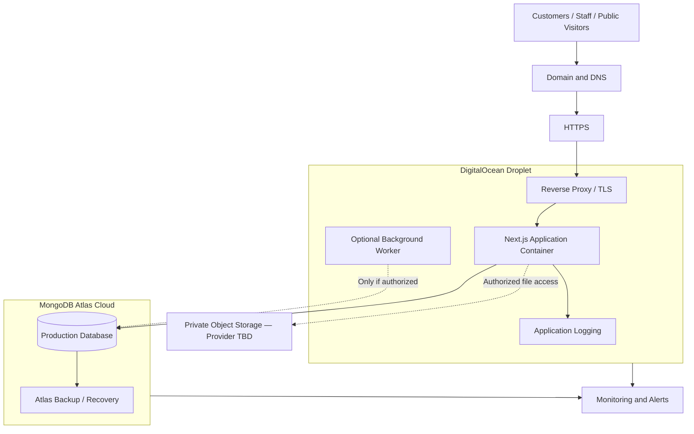

# AFHomes Platform — Deployment, Infrastructure, and Production Operations

> Authoritative deployment and operations architecture for the AFHomes Platform.
> Read `docs/development/architecture.md` for system architecture and `docs/business-rules/` (01–13) for authoritative business behavior.
> This document is documentation only; no infrastructure is provisioned or deployed here.

---

## 1. Purpose and Scope

This document defines the complete deployment, infrastructure, and production operations architecture for the AFHomes Platform: local development, local MongoDB, cloud staging, MongoDB Atlas, DigitalOcean Droplet, Docker Compose, HTTPS reverse proxy, CI/CD, monitoring, backups, disaster recovery, and operational runbooks.

---

## 2. Current Versus Target Deployment State

- **Verified current implementation:** documentation-only repository; no application code, infrastructure, or deployment.
- **Approved target deployment:** DigitalOcean Droplet (application) + Docker Compose + HTTPS reverse proxy + MongoDB Atlas Cloud (database).
- **Future implementation work:** all infrastructure setup, deployment, migration requires separate authorization.

---

## 3. Approved Infrastructure Decisions

| Component | Approved direction |
|---|---|
| Application hosting | DigitalOcean Droplet |
| Database hosting | MongoDB Atlas Cloud |
| Container orchestration | Docker Compose |
| Reverse proxy | HTTPS-enabled production reverse proxy |
| CI/CD | Future, provider TBD |
| Monitoring | Future, provider TBD |
| Backup | Atlas + Droplet + config backups |
| Domain/DNS | Future, provider TBD |

The architecture must not suggest DigitalOcean App Platform as primary target. Do not introduce Kubernetes, Docker Swarm, or another orchestration platform without authorization.

---

## 4. System Hosting Architecture

DigitalOcean hosts the application (Linux VM, Docker Engine, Docker Compose, Next.js app container, reverse proxy, optional worker, health checks, app logs). MongoDB Atlas hosts the managed database (replication, auth, monitoring, backup/recovery per tier). External services (DNS, certificates, object storage, email/SMS, monitoring, CI/CD) are potential, not yet selected.

Trust boundaries: public internet → DNS/HTTPS → reverse proxy → app container → server-side services → secure Atlas connection → private object storage → administrative infra access. Browser never connects directly to MongoDB Atlas.

---

## 5. Deployment Topology Diagram



Conceptual. Optional services not yet provisioned.

---

## 6. Development to Production Environments

Four distinct stages:

### 6.1 Frontend mock development

Next.js frontend, browser-scoped in-memory mock store, synthetic test data, mock roles/permissions, no production DB connection. Mock records reset on full browser refresh. Not confused with MongoDB persistence.

### 6.2 Local full-stack development

Next.js locally, local MongoDB, Mongoose, local backend API routes, dev auth config, isolated dev records. Local MongoDB data persists across browser refreshes and app restarts. Supported setups: native MongoDB or Docker-hosted MongoDB. For transaction-dependent integration tests, use appropriate local replica-set configuration.

### 6.3 Staging

Production-like environment for approved integration and deployment rehearsals: separate config, isolated database, synthetic or authorized nonproduction data, auth testing, API integration testing, DB transaction testing, deployment smoke tests, migration rehearsal, backup/restore rehearsal. Do not use production customer records as ordinary staging data without separately authorized privacy-compliant process. Exact staging hosting arrangement subject to future infrastructure approval; do not mandate unnecessary additional production-class Droplet without sizing/budget review.

### 6.4 Production

DigitalOcean Droplet, Docker Compose, Next.js production build, HTTPS reverse proxy, MongoDB Atlas, production authentication, authorized persistent records, monitoring, backup/recovery, controlled releases. No mock identity switching or synthetic test transactions as unrestricted production workflows.

---

## 7. DigitalOcean Droplet Architecture

### 7.1 Operating system

Supported Linux distribution, preferably appropriate Ubuntu LTS release. Select supported and patched OS version. Do not hardcode outdated OS release.

### 7.2 Droplet region

Choose based on primary user geography, latency, MongoDB Atlas region, supported services, cost, network connectivity, operational needs. AFHomes primarily operates in the Philippines. Regional selection should consider Philippine user latency and connectivity to selected Atlas region. Do not invent a final approved region.

### 7.3 Droplet sizing

Document sizing considerations for CPU, memory, disk storage, network transfer, concurrent users, Next.js server rendering, API workload, image processing, application logs, background jobs, build process, monitoring overhead. Do not invent guaranteed CPU/RAM capacity requirements without measured workload. Provide practical sizing evaluation process. Recommend validating selected Droplet against actual staging load tests before production approval.

### 7.4 Resource monitoring

Reevaluate sizing using CPU usage, memory consumption, disk growth, request latency, concurrent connections, container restarts, application throughput, database performance.

---

## 8. Server Provisioning and Initial Hardening

Future authorized setup process: create Droplet; select supported OS; configure SSH key-based admin access; establish appropriate non-root admin user; configure controlled privilege elevation; apply OS security updates; configure timezone and clock sync; configure host firewall; apply DigitalOcean Cloud Firewall rules; install Docker using supported official methods; install Docker Compose plugin; configure application directories; set up monitoring; configure secrets; validate network security; document recovery access.

### 8.1 SSH

Prefer SSH keys over password-only admin access. Restrict management access where feasible. Do not disable all recovery paths before validating administrative connectivity.

### 8.2 Firewall

Least-privilege exposure policy. Typical public services: HTTP for redirect/certificate validation where required; HTTPS for application access. SSH restricted to authorized management sources where feasible. Do not expose Next.js internal ports, MongoDB, or Docker management APIs publicly.

### 8.3 Cloud and host firewalls

Explain relationship between DigitalOcean Cloud Firewall, OS firewall rules, Docker networking. Docker-published ports require special care because container port exposure may not behave exactly like ordinary host processes under some firewall configurations. Use restricted published ports, internal Compose networks, loopback binding where appropriate, Cloud Firewall controls, verified host firewall behavior. Do not assume a host firewall rule automatically protects every published container port.

---

## 9. Docker Engine and Compose Architecture

Production application uses Docker Compose.

### 9.1 Container topology

Standard target deployment contains: Next.js application container (frontend rendering, server-side app logic, REST API `/api/v1`, auth integration, domain services, Mongoose repositories, required app runtime); Reverse proxy container (public HTTPS, request forwarding, TLS termination, security headers, request limits, access logging); Optional worker container (only if approved and necessary for scheduled jobs, background notifications, reconciliation tasks, other authorized async operations).

### 9.2 No separate frontend/backend containers

One Next.js application. Do not split into independent frontend and backend services without separately approved change.

### 9.3 No production MongoDB container

MongoDB Atlas is selected production database. Do not add separate MongoDB server container to production Compose design by default. Local development Docker Compose may include MongoDB, but production should not.

---

## 10. Docker Compose Configuration Standards

Document required future Compose design. Cover service naming, container images, internal networks, published ports, environment configuration, secrets handling, volumes, restart policies, health checks, resource considerations, container dependencies, graceful shutdown, logging, production overrides, service isolation.

### 10.1 Internal network

Reverse proxy communicates with Next.js over controlled internal Docker network. Next.js application port should not be publicly exposed unnecessarily.

### 10.2 Persistent volumes

Use volumes only where data persistence actually needed: reverse proxy certificate state, necessary runtime-generated files, selected application state that cannot be externalized. Do not assume local application containers should permanently store customer uploads. Use suitable authorized storage architecture for durable business files.

### 10.3 Container restart

Document appropriate restart behavior and health checks. Do not assume automatic restarting alone guarantees business availability.

### 10.4 Secrets

Do not place production credentials directly in a Git-tracked Compose file.

---

## 11. Next.js Production Build Architecture

The platform is a single Next.js application. Document production container build strategy.

### 11.1 Supported Node.js runtime

Use a Node.js release compatible with selected Next.js, Mongoose, and Better Auth versions. Do not invent exact version without verification.

### 11.2 Production build

Document dependency installation, lockfile consistency, type checking, build process, runtime image, environment configuration, startup, health verification.

### 11.3 Multi-stage Docker build

Recommend appropriately optimized multi-stage build. Distinguish dependency/build stage and production runtime stage. Use official Next.js self-hosting guidance.

### 11.4 Next.js standalone output

Evaluate use of Next.js standalone output to reduce runtime image requirements. Document appropriate packaging of server runtime, required static assets, public assets, environment configuration. Do not claim all Next.js runtime features work identically under every possible deployment mode.

### 11.5 No static-export substitution

AFHomes requires server-side authentication, APIs, Mongoose, and protected domain services. Do not recommend deploying the entire application as a static-only export. The runtime must support server-side Next.js functionality.

### 11.6 Runtime security

Document non-root application process where practical, minimal runtime dependencies, restricted file permissions, no production secrets embedded in images, appropriate OS/package patching, safe environment injection.

---

## 12. Application Ports and Networking

Intended port architecture:

```text
Internet
   |
   | 443 / HTTPS
   v
Reverse Proxy Container
   |
   | Internal Docker Network
   v
Next.js Application Container
   |
   | Secure Outbound Connection
   v
MongoDB Atlas
```

Define public ports, internal application ports, container DNS, Docker networks, host networking boundaries, outbound Atlas connectivity. Do not treat `localhost` inside a container as equivalent to the Droplet host. Do not publicly expose MongoDB ports as inbound application services. Do not expose internal API debugging endpoints through unrestricted public ports.

---

## 13. Reverse Proxy Architecture

The project owner has selected HTTPS reverse proxy architecture. The exact reverse proxy product may be finalized during deployment implementation. Potential compatible choices include Nginx, Caddy. Do not falsely claim either has already been installed. The document must define required behavior regardless of selected proxy.

### 13.1 Reverse proxy responsibilities

HTTPS termination, HTTP-to-HTTPS redirect, request forwarding, trusted forwarding headers, secure response headers, request body size controls, appropriate timeouts, access logging, rate limiting where suitable, TLS certificate handling, health-aware upstream behavior.

### 13.2 Next.js compatibility

Consider server-rendered pages, REST APIs, static assets, image optimization, file upload request sizes, streaming responses where used, WebSocket/upgrade behavior if future features require it. Do not assume every caching or proxy configuration is safe for authenticated dynamic content.

### 13.3 Proxy trust

Configure and validate trusted forwarding information. Do not blindly trust arbitrary client-supplied `X-Forwarded-*` headers for identity, security decisions or rate limiting.

---

## 14. Domain Name and DNS

Document future domain configuration: domain ownership verification, DNS provider, public DNS records, appropriate A records, AAAA records only where IPv6 actually configured, domain/subdomain routing, DNS propagation, TLS validation, staging hostname strategy where applicable.

### 14.1 Domain selection

Do not invent the final official AFHomes production domain. Use placeholders in examples.

### 14.2 Public and Admin interfaces

Because AFHomes uses one Next.js application, its Public and Admin interfaces may be served through the same application deployment with separate route namespaces. Do not automatically require separate infrastructure deployments for each panel. Any domain/subdomain split must remain compatible with the approved authentication, routing, and cookie architecture.

### 14.3 Staging access

Staging must not inadvertently become a publicly accessible production-equivalent system without appropriate protection. Document access restrictions for staging.

---

## 15. HTTPS and TLS Certificates

Production must use HTTPS. Document certificate issuance, certificate validation, automatic renewal, renewal monitoring, HTTP-to-HTTPS redirect, secure TLS configuration, certificate storage, reverse proxy integration, renewal failure recovery. Let's Encrypt may be used as an appropriate certificate authority. Do not claim it is already configured.

### 15.1 Authentication security

HTTPS must protect authentication and session traffic.

### 15.2 API security

The REST API must be accessed securely.

### 15.3 Database transport

MongoDB Atlas connections require appropriate TLS support independently from the public website certificate. Do not confuse application HTTPS certificates with Atlas database connection security.

---

## 16. Environment Variables and Secrets

Define an environment configuration strategy. Separate Local Development, Staging, Production.

### 16.1 Configuration categories

Examples: Node environment; Public application URL; MongoDB connection string; Authentication secrets; Session configuration; Storage credentials; Notification provider credentials; Feature flags; Log configuration; Monitoring integration.

### 16.2 Public versus private configuration

Only explicitly intended public configuration may reach frontend bundles. Never expose MongoDB credentials, Better Auth signing/encryption secrets, provider API secrets, production service credentials. Do not put secrets in `NEXT_PUBLIC_` variables.

### 16.3 Production configuration

Document restricted environment files, deployment-time secret injection, file permissions, secret rotation, revocation, access control, safe backups. Do not commit production `.env` files to Git.

### 16.4 Environment verification

The application should fail safely when required production configuration is missing. Avoid silently connecting production code to the wrong database.

---

## 17. Local MongoDB Versus Production Atlas

This section is mandatory. The project owner explicitly wants local MongoDB before cloud deployment.

### 17.1 Local development

Backend connects to local MongoDB. Data persists across application/browser restarts. Local development may use Docker MongoDB or a native installation. Use appropriate local transaction support.

### 17.2 Staging

Use an isolated Atlas staging environment where approved. Validate connection, indexes, authentication, transactions, API integration, import/migration behavior, application compatibility.

### 17.3 Production

Use MongoDB Atlas Cloud. Do not install a second MongoDB production database on the Droplet.

### 17.4 Database configuration switching

Different environments must use separate authorized credentials. Changing the database connection configuration must not automatically execute data migration. Data movement requires an explicit approved migration procedure.

---

## 18. DigitalOcean to MongoDB Atlas Connectivity

The application must connect securely to Atlas. Document Atlas project, cluster, database user, database role, network access restrictions, TLS, MongoDB connection URI, DNS resolution, outbound connectivity, connection pooling, timeouts, retry behavior, monitoring.

### 18.1 Source IP

Atlas IP access restrictions must permit the actual production application's authorized outbound source. Document how Droplet public egress addresses and network topology affect Atlas connectivity. Do not add unrestricted `0.0.0.0/0` access as the default production solution.

### 18.2 Database credentials

The application should use an appropriately least-privileged database user. Do not use Atlas administrative credentials for ordinary application operations.

### 18.3 Private connectivity

Private network approaches may be evaluated if supported by the selected Atlas tier and hosting/network topology. Do not claim DigitalOcean and MongoDB Atlas private networking is automatically available or configured.

### 18.4 Region planning

Consider application latency, Atlas region, network cost, reliability, cross-cloud egress charges. Do not invent a final region or cost estimate without verification.

---

## 19. MongoDB Atlas Cluster Requirements

The deployment document must include practical database-readiness requirements. Cover supported Atlas tier, connection limits, transaction capabilities, storage capacity, backup features, recovery capabilities, monitoring, database access policies, availability, scaling. The selected tier must satisfy actual business-critical workloads. Do not claim transaction support, point-in-time recovery, or advanced networking is identical across all Atlas tiers. Do not automatically select a free tier for production simply because it is adequate for early development.

---

## 20. Local to Cloud Database Migration

The deployment architecture must describe the future migration path: Local MongoDB → MongoDB Atlas. Migration is technically possible through appropriate MongoDB tools and controlled procedures.

### 20.1 Migration methods

Document appropriate options: `mongodump`, `mongorestore`, validated import/export workflows, relevant supported Atlas migration tools where applicable. Do not claim one tool is appropriate for every migration size or requirement.

### 20.2 Staging rehearsal

Before production cutover: inspect source; create authorized backup; prepare destination; restore/migrate to staging; validate collections; validate indexes; verify official identifiers; reconcile Finance records; validate genealogy relationships; validate Membership and Stay Points records; validate audit history; test application against destination.

### 20.3 Production data policy

Do not automatically promote synthetic local development data into production. Local-to-Atlas migration capability does not mean every local test record should become a real production record.

### 20.4 Legacy Supabase separation

No automatic migration of previous Supabase production records is authorized. A future legacy import requires separate approval.

### 20.5 Cutover

Document source-write handling, final backup, final reconciliation, destination verification, application configuration switch, monitoring, rollback conditions. Do not execute a migration under this documentation task.

---

## 21. Application File and Media Storage

AFHomes may store customer ID images, accreditation photographs, contracts, payment evidence, public website media, other authorized attachments. The deployment architecture must address durable file storage.

### 21.1 Storage requirements

Data durability, private access, authorized downloads, file metadata, secure URLs where appropriate, backup, recovery, retention, access logging, appropriate privacy controls.

### 21.2 Object storage

A managed object-storage solution compatible with the infrastructure may be appropriate. DigitalOcean Spaces may be evaluated as a candidate. Do not claim it has been selected without approval.

### 21.3 Container storage

Do not rely on ephemeral application-container storage for permanent customer documents.

### 21.4 Public versus private files

Public website media and private customer identification files have different access rules. Keep their exposure and access models distinct.

---

## 22. Deployment Artifacts and Container Registry

Document a future image-build and release-artifact strategy. Include production build, build identifier, commit reference, image tag, immutable release reference, container registry, artifact retention, vulnerability scanning where appropriate, rollback artifact availability. The registry provider remains subject to future selection. Do not claim a specific registry is already configured.

### 22.1 Reproducibility

Releases should be traceable to a specific source revision and build artifact. Avoid deploying unknown mutable image versions without a controlled release policy.

### 22.2 Build security

Do not bake production secrets into Docker image layers.

---

## 23. Controlled Deployment Process

Document the future production deployment workflow. A recommended controlled sequence: confirm authorization; identify source revision; validate quality gates; prepare artifact; validate production configuration; verify database compatibility; protect recoverability; deploy application; verify health; smoke test; monitor; confirm acceptance. These are future operational procedures. Do not execute them now.

---

## 24. Database Schema and Index Release Control

MongoDB schema and index changes must be managed separately from ordinary application deployment where needed. Document approved schema evolution, backward compatibility, index review, data migration, backup, execution authorization, reconciliation, rollback planning, safe application-version compatibility.

### 24.1 No automatic destructive migrations

Starting a new application container must not automatically run destructive production database changes.

### 24.2 Migration approval

Material data migration requires separate approval.

### 24.3 Application rollback limitation

Rolling back a Docker image does not automatically roll back database writes or schema changes. Document database/application compatibility planning.

### 24.4 Historical integrity

Production migrations must preserve official customer and VIP identifiers, historical contracts, Finance records, Sales genealogy attribution, Commission history, Membership state, Stay Points ledger, Audit events.

---

## 25. Rollback and Release Recovery

Define a controlled rollback strategy.

### 25.1 Application rollback

Use the previous approved image where compatible. Verify environment configuration, database compatibility, authentication compatibility, runtime dependencies, API behavior.

### 25.2 Database changes

Do not assume image rollback restores the prior database state. Database recovery requires a separate approved procedure.

### 25.3 Partial deployment failures

Document container failure, failed startup, failed health checks, database connection failure, incorrect environment configuration, reverse proxy failure, TLS failure.

### 25.4 Single Droplet limitation

Do not promise automatic zero-downtime deployment from a basic single-Droplet Docker Compose setup. A simple deployment may involve brief interruption. Higher availability requires a separately justified architecture.

---

## 26. Health Checks

Define health-check architecture. Liveness: application process is running. Readiness: application can serve required operations. Relevant dependency checks may include application configuration, database connection, critical dependency availability, appropriate startup readiness. Do not publicly expose private infrastructure details in health responses. Do not assume the presence of a working health endpoint until implemented.

---

## 27. Monitoring and Observability

A production system must provide appropriate operational visibility.

### 27.1 Application monitoring

Monitor request errors, response times, authentication failures, API failures, background job failures, database connection failures, unhandled exceptions, resource exhaustion.

### 27.2 Droplet monitoring

Monitor CPU, memory, disk, network, system load, container status, restart counts.

### 27.3 MongoDB Atlas monitoring

Monitor connection usage, query performance, slow queries, storage, CPU/memory where exposed, transaction failures, backup state, cluster alerts.

### 27.4 External availability monitoring

Use a suitable monitoring service or infrastructure capability when approved.

### 27.5 Alerting

Document alert severity, responsible operational roles, notification routing, investigation steps, escalation procedures, recovery validation. Do not invent official on-call schedules or guaranteed response times.

---

## 28. Application Logging

Document structured application logging. Include timestamp, severity, operation, request correlation, safe error code, deployment revision, environment, relevant service identity.

### 28.1 Sensitive-data handling

Do not log passwords, session secrets, raw authentication tokens, database credentials, government ID images, unnecessary customer information, sensitive payment attachments.

### 28.2 Log retention

Retention must follow approved operational and legal requirements. Do not invent a mandatory fixed retention period.

### 28.3 Log storage

Document container stdout/stderr, log collection, rotation, disk protection, authorized access, off-host retention where appropriate. Do not allow container logs to consume all available Droplet disk space.

### 28.4 Audit separation

Business audit records are not the same as container/application diagnostic logs. Financial audit history must remain authoritative in the approved business system.

---

## 29. Background Job Deployment

The backend may need scheduled processing. Possible authorized use cases: accreditation expiry, installment overdue evaluation, membership expiry, points-cycle processing, approved notifications, reconciliation, maintenance.

### 29.1 Initial architecture

Explain whether particular jobs can safely run through a controlled scheduler. Do not rely on an ordinary HTTP request remaining active indefinitely.

### 29.2 Optional worker

A dedicated worker process/container may be introduced when justified. Document execution ownership, scheduling, idempotency, retries, failure handling, database access, secrets, monitoring.

### 29.3 Duplicate execution prevention

A restarted or duplicated worker must not create duplicate financial or business outcomes.

### 29.4 No automatic feature activation

Background jobs must not activate Redemption or Services.

---

## 30. Authentication and Session Deployment

Better Auth is the intended authentication direction. Production deployment must account for stable application URL, HTTPS, secure cookies, appropriate session configuration, server-side secrets, callback/origin validation where applicable, account status checks, session revocation, protected login endpoints.

### 30.1 No production demo mode

Frontend mock identity switching must not be enabled as an unrestricted production authentication method.

### 30.2 Multi-instance considerations

If future scaling introduces multiple Next.js application instances, authentication/session behavior must remain consistent. Do not assume in-memory session state is shared across containers.

### 30.3 Compatibility

Verify Better Auth, Next.js and MongoDB integration before implementation. Do not claim compatibility has already been tested.

---

## 31. Feature Flags in Deployment

The target system preserves but disables Redemption and Services. Deployment configuration must enforce these defaults.

### 31.1 Frontend

Disabled modules do not appear in user-facing navigation.

### 31.2 Backend

Disabled module workflows remain inaccessible even if someone directly calls an API.

### 31.3 Production configuration

A production deployment must not accidentally enable disabled modules because an environment variable is omitted or interpreted incorrectly. Use secure defaults.

### 31.4 Future activation

Any activation requires separate project-owner authorization and testing. Do not enable these modules during this task.

---

## 32. Production Database Data Protection

AFHomes handles sensitive business records (customers, staff, accreditation, contracts, payments, commissions, memberships, Stay Points, audit records). The deployment architecture must protect these records.

### 32.1 Environment isolation

Production data must not be used casually in local development.

### 32.2 Database user privileges

Use least-privilege Atlas credentials.

### 32.3 Backups

Ensure the chosen Atlas deployment supports the approved recovery requirements.

### 32.4 Access logging

Administrative access and material operational changes must be traceable according to the security architecture.

### 32.5 Data migration

No automatic production import from the old Supabase-based system.

---

## 33. Backup Architecture

A complete deployment architecture requires more than one type of backup.

### 33.1 MongoDB Atlas backups

Protect persistent business records according to the selected Atlas tier and approved policy.

### 33.2 Droplet backups

Protect necessary operating-system and infrastructure recovery information.

### 33.3 Deployment configuration

Protect approved Compose configuration, reverse proxy configuration, required infrastructure settings, recovery instructions. Do not rely on a backup of an unencrypted secrets file without appropriate safeguards.

### 33.4 Object/media storage backups

Protect durable business files and attachments separately.

### 33.5 Source and release artifacts

Ensure authorized source revision and container images remain recoverable.

### 33.6 Important distinction

A DigitalOcean Droplet snapshot is not a substitute for MongoDB Atlas database backups. An Atlas snapshot is not a substitute for application configuration and private-file recovery. Do not claim all backup features are available on every service tier.

---

## 34. Recovery Objectives and Data Retention

Document the need to establish RPO, RTO, backup frequency, retention policy, restoration authority, recovery testing frequency. These are business/operational decisions. Do not invent official numeric guarantees. The document should identify how those decisions influence Atlas tier selection, backup configuration, Droplet recovery strategy, file storage, monitoring, cost.

---

## 35. Restore Procedures

Document conceptual restore workflows.

### 35.1 Atlas database restore

Steps: verify authorization; identify recovery target; select approved restore point; restore to an isolated destination when practical; validate data; reconcile business records; test application compatibility; approve cutover; monitor recovery.

### 35.2 Droplet recovery

Document rebuilding the host, restoring approved application configuration, restoring container services, reestablishing HTTPS, reconnecting to Atlas, verifying health.

### 35.3 File recovery

Restore authorized customer documents and media without exposing private information.

### 35.4 Validation

Recovery is not complete solely because containers start. Verify authentication, API availability, customer data, Finance balances, contracts, memberships, points, audit records.

---

## 36. Disaster Recovery

Document major failure scenarios: Droplet failure, failed Docker deployment, Atlas connectivity outage, database corruption, compromised secret, unauthorized database change, backup failure, certificate expiration, domain/DNS failure, media storage outage, application security incident. For each scenario, describe detection, immediate containment, required evidence, recovery options, data integrity verification, business impact, reopening criteria. Do not promise high availability from a single-Droplet deployment. Document limitations and future options honestly.

---

## 37. Security Incident Response

Align with `security.md`. Include detection, triage, containment, investigation, evidence preservation, credential rotation, host isolation, database access restrictions, recovery, reporting, post-incident review. Do not invent legal notification deadlines. Applicable privacy obligations require proper company/legal interpretation.

---

## 38. Continuous Integration

Document future CI strategy. Potential checks: source checkout, dependency installation, TypeScript validation, linting, unit tests, component tests, API/service integration tests, security checks, container build, build artifact validation. The CI provider has not necessarily been selected. GitHub Actions may be evaluated as a candidate. Do not claim any workflow is already implemented. Do not create workflow YAML files now.

---

## 39. Continuous Deployment

Document a controlled CD strategy. Distinguish Development builds, Staging releases, Production releases.

### 39.1 Production approval

Do not automatically deploy every Git push to production unless such a policy is explicitly approved.

### 39.2 Release identity

Record commit, build, container image, deployment timestamp, target environment, authorized approver, release result.

### 39.3 Secrets

CI/CD must not expose production secrets in logs or build artifacts.

### 39.4 Remote deployment

Describe a secure mechanism for delivering approved container images/configuration to the Droplet. Do not mandate storing unrestricted root SSH credentials in arbitrary CI jobs.

### 39.5 Rollback

Previous approved release artifacts should remain available under the chosen retention policy.

---

## 40. Release Acceptance Criteria

Define production release conditions. A release should require appropriate evidence for successful build, type checking, required automated tests, security validation, auth/RBAC tests, Finance consistency, Commission correctness, VIP identifier uniqueness, Membership activation, Stay Points integrity, database compatibility, environment configuration, HTTPS, health checks, backup readiness, monitoring, rollback planning. Do not invent numerical coverage requirements if not approved.

### 40.1 Release blockers

A release must not proceed with unresolved critical defects involving authentication bypass, privilege escalation, unauthorized financial actions, duplicate payment verification, duplicate commission payout, incorrect VIP activation, duplicate official identifiers, corrupted Stay Points, production data leakage, destructive migration inconsistency, disabled feature exposure, unrecoverable critical infrastructure failure. Exceptions require explicit authorized risk review. Do not silently waive critical quality gates.

---

## 41. Smoke Testing After Deployment

Define safe operational smoke tests. Examples: public homepage responds; authentication endpoint behaves appropriately; protected routes deny unauthenticated access; authorized test account can authenticate in a controlled environment; public verification safely responds; REST API health is available; Atlas connection is healthy; static assets load; HTTPS certificate is valid; role-aware navigation works; disabled feature routes remain protected. Do not create real payments, memberships, commissions or points in production merely to conduct a smoke test. Use isolated synthetic staging scenarios for destructive business workflow testing.

---

## 42. Operational Maintenance

Document routine maintenance responsibilities: OS security patching, Docker Engine updates, dependency updates, Node.js support lifecycle, Next.js security patches, Better Auth updates, Mongoose/MongoDB driver compatibility, certificate renewal, backup verification, disk utilization, log rotation, Atlas monitoring, credential rotation, vulnerability review, performance monitoring.

### 42.1 Update safety

Major upgrades require compatibility review, staging verification, backups, release approval, recovery planning. Do not enable automatic destructive upgrades.

---

## 43. Production Operations Runbook

Include a practical operational runbook. Explain what future operators should check when:

**Application is unavailable:** Droplet availability, Docker services, reverse proxy, application health, DNS, TLS, database dependency.

**Login fails:** authentication service health, session configuration, application URL, backend errors, relevant account status, database access.

**API returns errors:** request logs, correlation ID, runtime health, database connectivity, relevant deployment changes.

**Atlas connection fails:** DNS resolution, Atlas IP access list, database user, credentials, TLS, outbound networking, connection limits.

**Disk is full:** container logs, unused artifacts, backup files, runtime cache, storage growth.

Never recommend blindly deleting live business data or database volumes to free space.

**Deployment fails:** build artifact, container startup, health checks, configuration, database compatibility, previous known-good release.

The runbook must remain conceptual until the actual tools, hosts and services are implemented. Do not invent real hostnames, credentials or active deployment commands.

---

## 44. Scaling and Future Evolution

The initial production architecture uses a single DigitalOcean Droplet. Document realistic scaling options.

### 44.1 Vertical scaling

Possible when CPU, memory or storage capacity becomes insufficient.

### 44.2 Application optimization

Before scaling, investigate query efficiency, caching, connection pooling, large report generation, bundle performance, background processing, database indexes.

### 44.3 Horizontal scaling

Future horizontal scaling may require load balancing, multiple application instances, consistent authentication sessions, shared cache coordination where necessary, shared file storage, distributed rate limiting, safe background-job ownership, coordinated releases. Do not assume multi-instance behavior is already supported or tested.

### 44.4 Database scaling

MongoDB Atlas scaling follows its supported deployment capabilities and selected tier. Do not treat the DigitalOcean Droplet as responsible for scaling Atlas cluster resources.

### 44.5 No premature Kubernetes

Do not introduce Kubernetes or a microservice redesign merely because future growth is possible.

---

## 45. Cost and Capacity Planning

The architecture should provide a planning framework without fabricating prices. Include major cost categories: DigitalOcean Droplet, storage, backups, network transfer, MongoDB Atlas tier, Atlas backups, cross-cloud network traffic, object storage, domain, monitoring, CI/CD, email/SMS services where applicable. Explain that actual prices and tier capabilities must be checked before procurement. Do not create a fictional monthly operating budget. Document capacity planning and future review.

---

## 46. Infrastructure Access Governance

Production access must be controlled. Define conceptual roles for authorized project owner, authorized infrastructure operator, application developer, database administrator, Finance/Business administrator, security reviewer. Do not assume application Super Administrator automatically receives root SSH or Atlas infrastructure administration. Distinguish Application business RBAC from Infrastructure access control. These are separate authorization systems. Record significant infrastructure and database administrative changes. Do not expose production secrets to ordinary application users.

---

## 47. Deployment Acceptance Scenarios

Include realistic scenarios with expected outcomes (see Part 46 of task prompt; summarized with expected outcomes).

- **Scenario A (Local development):** Next.js connects to localhost MongoDB; development DB connection succeeds; no production Atlas access required; data persists across browser refresh.
- **Scenario B (Staging deployment):** Next.js runs in approved staging environment; correct staging secrets; correct staging Atlas destination; no production record modification.
- **Scenario C (Production HTTPS):** user opens approved public domain; valid HTTPS; correct application routing; no unnecessary internal port exposure.
- **Scenario D (Unauthorized API request):** user calls protected endpoint without permission; backend denies access; no unauthorized database effect.
- **Scenario E (MongoDB Atlas outage):** DB connectivity unavailable; safe application error behavior; appropriate logging; monitoring alert; no false financial success response.
- **Scenario F (Deployment rollback):** release fails health checks; controlled attempt to restore compatible previous application version; DB compatibility verified; recovery outcome recorded.
- **Scenario G (Local-to-Atlas migration rehearsal):** authorized local MongoDB dataset restored to isolated staging; identifier integrity; relationship integrity; financial reconciliation; no accidental production data replacement.
- **Scenario H (Droplet failure):** application host unavailable; recovery process documented; approved image/configuration available; Atlas persistent DB remains separately managed; recovery validated before service reopening.
- **Scenario I (Expired TLS certificate):** certificate renewal fails; monitoring identifies condition; authorized remediation process available; no suggestion to leave production permanently on insecure HTTP.
- **Scenario J (Backup restore):** recovery rehearsal restores approved data snapshot; correct records; preserved official identifiers; reconciled balances; valid application compatibility.
- **Scenario K (Feature flag mismatch):** Redemption or Services accidentally configured as enabled; safe default protection; unauthorized workflows remain inaccessible; release validation identifies problem.
- **Scenario L (CI/CD credential compromise):** deployment credential exposed; revocation; rotation; investigation; access review; recovery controls.

Use these as documentation acceptance scenarios, not evidence that any scenario has been executed.

---

## 48. Implementation Phase Alignment

Follow `docs/development/implementation.md`.

- **Phase 0 — Documentation Foundation:** complete deployment architecture. No infrastructure provisioned.
- **Phase 1 — Frontend Foundation:** develop Next.js application locally with synthetic mock data.
- **Phase 2 — Local Database:** set up local MongoDB through separately authorized implementation. Do not require Atlas production access.
- **Phase 3 — Backend Foundation:** develop `/api/v1`, authentication, authorization and Mongoose repositories.
- **Phase 4 — Business Modules:** develop and validate business workflows against approved database design.
- **Phase 5 — Integration:** connect frontend and backend. Verify full local application behavior.
- **Phase 6 — Testing and Production Readiness:** complete critical automated tests, staging tests and security validation.
- **Phase 7 — Cloud Deployment:** with separate authorization: provision DigitalOcean Droplet; prepare MongoDB Atlas; configure secure connectivity; build application image; configure Docker Compose; configure reverse proxy; configure domain and HTTPS; configure monitoring; configure backups; perform migration or approved initialization; complete controlled production release.
- **Phase 8 — Stabilization:** monitoring, patching, optimization, incident handling and future authorized improvements.

Do not automatically execute Phase 7 merely because deployment instructions are documented.

---

## 49. Critical Deployment Invariants

1. AFHomes uses one Next.js application.
2. Frontend and backend REST API share the same application runtime.
3. No separate backend application by default.
4. No unapproved microservice architecture.
5. Local MongoDB is used for real database-backed development.
6. Frontend mock data is separate from local MongoDB.
7. MongoDB Atlas is the production managed database.
8. DigitalOcean Droplet is the production application host.
9. Docker Compose is the selected deployment approach.
10. HTTPS is mandatory for production access.
11. A reverse proxy protects the Next.js runtime.
12. The backend `/api/v1` remains server-authoritative.
13. Browser clients never connect directly to MongoDB.
14. Database credentials remain server-only.
15. Production secrets are never committed to Git.
16. Internal application ports are not unnecessarily public.
17. Host and cloud firewall policies are required.
18. SSH management is restricted.
19. Containers use appropriate security restrictions.
20. Database access follows least privilege.
21. Authentication works correctly in the deployed environment.
22. Session security is preserved.
23. RBAC remains enforced after deployment.
24. Financial transactions remain consistent.
25. Deployment does not automatically approve payments.
26. Deployment does not automatically activate memberships.
27. Official identifiers remain preserved.
28. Genealogy history remains preserved.
29. Commission and Stay Points ledgers remain authoritative.
30. Database schema changes require controlled approval.
31. Local-to-Atlas migration is supported as a planned capability.
32. Synthetic local data is not automatically migrated into production.
33. No automatic legacy Supabase production migration.
34. Application image rollback is not database rollback.
35. Monitoring is part of production readiness.
36. Application logs are separate from business audit events.
37. Backups must protect database, configuration and files appropriately.
38. Recovery must be validated.
39. Production releases require authorization.
40. CI/CD cannot bypass production approval.
41. Redemption remains disabled.
42. Services remains disabled.
43. Production demo login remains disabled.
44. Future mobile clients may reuse `/api/v1`.
45. Scaling must follow actual needs.
46. Business policies may change through authorized processes.
47. Historical signed contract rights remain preserved.
48. The deployment document does not authorize actual deployment.

---

## 50. Critical Unresolved Dependencies

Do not invent final decisions for material unresolved infrastructure items. Relevant dependencies may include: Droplet final region, initial CPU/RAM/disk sizing, production OS release, expected traffic/capacity; Reverse proxy Nginx vs Caddy or another approved option, actual certificate-management configuration; Domain final domain, DNS provider, staging hostname; MongoDB Atlas final cluster tier, final region, network access strategy, backup capabilities, transaction support, connection limits; Storage object-storage provider, private media retention, storage backup requirements; Deployment image registry, CI/CD platform, secret delivery mechanism; Recovery approved RPO, approved RTO, backup frequency, retention policy, incident responsibility. Keep unresolved items concise and actionable. Do not imply the overall deployment architecture is undecided. The main infrastructure choices have already been approved.

---

## 51. Documentation Quality Requirements

The final document must be specific to AFHomes, technically detailed, clearly identify approved decisions, distinguish current versus target implementation, provide accurate topology diagrams, explain configuration boundaries, explain security, include deployment workflows, include recovery procedures, include operational runbooks, explain environment separation, include local MongoDB and Atlas, support controlled data migration, explain CI/CD, include acceptance criteria, avoid invented provider pricing, avoid unverified service guarantees, avoid obsolete project-version labels, avoid unsupported production-completion claims. Do not merely expand the existing 10 sections into generic paragraphs. Produce a usable production deployment and operations architecture.

---

## 52. Validation Checklist

### Application Architecture
- [ ] Single Next.js application.
- [ ] Frontend/backend API in the same application runtime.
- [ ] No unapproved separate backend.
- [ ] No unnecessary microservices.
- [ ] Production Node.js requirements.
- [ ] REST `/api/v1`.

### Local and Cloud Environments
- [ ] Frontend mock environment.
- [ ] Local MongoDB environment.
- [ ] Staging.
- [ ] MongoDB Atlas production.
- [ ] Environment separation.
- [ ] Safe data movement.

### DigitalOcean
- [ ] Droplet architecture.
- [ ] OS selection.
- [ ] Sizing considerations.
- [ ] Region selection.
- [ ] SSH.
- [ ] Firewalls.
- [ ] Docker Engine.
- [ ] Docker Compose.
- [ ] Container security.

### Networking
- [ ] Reverse proxy.
- [ ] Domain.
- [ ] DNS.
- [ ] HTTPS.
- [ ] Certificate renewal.
- [ ] Internal Docker networking.
- [ ] No unnecessary exposed ports.
- [ ] Secure Atlas connectivity.

### Operations
- [ ] Application build.
- [ ] Container registry.
- [ ] Deployment workflow.
- [ ] Database migration controls.
- [ ] Rollback.
- [ ] Health checks.
- [ ] Logging.
- [ ] Monitoring.
- [ ] Alerting.
- [ ] Background jobs.
- [ ] Maintenance.

### Recovery
- [ ] Atlas backup.
- [ ] Droplet backup.
- [ ] File/media backup.
- [ ] Recovery planning.
- [ ] Restore validation.
- [ ] Incident response.
- [ ] No invented RTO/RPO guarantees.

### Release
- [ ] CI.
- [ ] CD.
- [ ] Security checks.
- [ ] Tests.
- [ ] Staging.
- [ ] Smoke tests.
- [ ] Production approval.
- [ ] Release traceability.
- [ ] Disabled feature verification.

Only mark requirements complete when actually covered by the document. Documentation completion does not prove infrastructure has been deployed.

---

## 53. Official Technical References

Use authoritative technical documentation where appropriate. Verify version-sensitive details before describing exact commands or feature availability. Relevant references: Next.js Self-Hosting (https://nextjs.org/docs/app/guides/self-hosting); Next.js Deployment (https://nextjs.org/docs/app/getting-started/deploying); Docker Compose Production (https://docs.docker.com/compose/how-tos/production/); DigitalOcean Droplets (https://docs.digitalocean.com/products/droplets/); DigitalOcean Cloud Firewalls (https://docs.digitalocean.com/products/networking/firewalls/); DigitalOcean Backups (https://docs.digitalocean.com/products/backups/); MongoDB Atlas Connection Security (https://www.mongodb.com/docs/atlas/security/ip-access-list/); MongoDB Atlas Connectivity (https://www.mongodb.com/docs/atlas/connect-to-database-deployment/); MongoDB Atlas Backups (https://www.mongodb.com/docs/atlas/backup-restore-cluster/); MongoDB Database Tools (https://www.mongodb.com/docs/database-tools/). Do not blindly copy outdated commands. Do not claim provider services or cluster features are enabled without verification. Do not invent infrastructure pricing.

---

## 54. Cross-Document Consistency

After rewriting `deployment.md`, compare with remaining development documents. architecture.md must agree on single Next.js app, modular monolith, DigitalOcean Droplet, MongoDB Atlas, Docker Compose, HTTPS. frontend.md must agree on Next.js App Router, frontend-first development, in-memory mock store, no public DB credentials, client/server separation. backend.md must agree on same Next.js app runtime, `/api/v1`, domain services, Node.js runtime, Mongoose, authentication integration, health checks. database.md must agree on local MongoDB before Atlas, replica-set transaction requirements, Atlas staging and production, import/migration, backup/recovery, data consistency. security.md must agree on HTTPS, authentication, RBAC, firewall, SSH, secret protection, database security, secure file handling, incident response. testing.md must agree on CI testing, staging, release validation, health checks, DB migration verification, backup/restore tests, production acceptance. implementation.md must agree on Phases 0–8, Phase 7 deployment, no automatic implementation authorization. If another document contains a conflicting statement, report it. Do not modify that document.

---

## 55. Critical Unresolved Dependencies

Do not invent final decisions for material unresolved infrastructure items. Relevant dependencies may include: Droplet final region, initial CPU/RAM/disk sizing, production OS release, expected traffic/capacity; Reverse proxy Nginx vs Caddy or another approved option, actual certificate-management configuration; Domain final domain, DNS provider, staging hostname; MongoDB Atlas final cluster tier, final region, network access strategy, backup capabilities, transaction support, connection limits; Storage object-storage provider, private media retention, storage backup requirements; Deployment image registry, CI/CD platform, secret delivery mechanism; Recovery approved RPO, approved RTO, backup frequency, retention policy, incident responsibility. Keep unresolved items concise and actionable. Do not imply the overall deployment architecture is undecided. The main infrastructure choices have already been approved.

---

## 56. Documentation Quality Requirements

The final document must be specific to AFHomes, technically detailed, clearly identify approved decisions, distinguish current versus target implementation, provide accurate topology diagrams, explain configuration boundaries, explain security, include deployment workflows, include recovery procedures, include operational runbooks, explain environment separation, include local MongoDB and Atlas, support controlled data migration, explain CI/CD, include acceptance criteria, avoid invented provider pricing, avoid unverified service guarantees, avoid obsolete project-version labels, avoid unsupported production-completion claims. Do not merely expand the existing 10 sections into generic paragraphs. Produce a usable production deployment and operations architecture.

---

## 57. Validation Checklist

### Application Architecture
- [ ] Single Next.js application.
- [ ] Frontend/backend API in the same application runtime.
- [ ] No unapproved separate backend.
- [ ] No unnecessary microservices.
- [ ] Production Node.js requirements.
- [ ] REST `/api/v1`.

### Local and Cloud Environments
- [ ] Frontend mock environment.
- [ ] Local MongoDB environment.
- [ ] Staging.
- [ ] MongoDB Atlas production.
- [ ] Environment separation.
- [ ] Safe data movement.

### DigitalOcean
- [ ] Droplet architecture.
- [ ] OS selection.
- [ ] Sizing considerations.
- [ ] Region selection.
- [ ] SSH.
- [ ] Firewalls.
- [ ] Docker Engine.
- [ ] Docker Compose.
- [ ] Container security.

### Networking
- [ ] Reverse proxy.
- [ ] Domain.
- [ ] DNS.
- [ ] HTTPS.
- [ ] Certificate renewal.
- [ ] Internal Docker networking.
- [ ] No unnecessary exposed ports.
- [ ] Secure Atlas connectivity.

### Operations
- [ ] Application build.
- [ ] Container registry.
- [ ] Deployment workflow.
- [ ] Database migration controls.
- [ ] Rollback.
- [ ] Health checks.
- [ ] Logging.
- [ ] Monitoring.
- [ ] Alerting.
- [ ] Background jobs.
- [ ] Maintenance.

### Recovery
- [ ] Atlas backup.
- [ ] Droplet backup.
- [ ] File/media backup.
- [ ] Recovery planning.
- [ ] Restore validation.
- [ ] Incident response.
- [ ] No invented RTO/RPO guarantees.

### Release
- [ ] CI.
- [ ] CD.
- [ ] Security checks.
- [ ] Tests.
- [ ] Staging.
- [ ] Smoke tests.
- [ ] Production approval.
- [ ] Release traceability.
- [ ] Disabled feature verification.

Only mark requirements complete when actually covered by the document. Documentation completion does not prove infrastructure has been deployed.

---

## 58. Cross-Document Consistency

After rewriting `deployment.md`, compare with remaining development documents. architecture.md must agree on single Next.js app, modular monolith, DigitalOcean Droplet, MongoDB Atlas, Docker Compose, HTTPS. frontend.md must agree on Next.js App Router, frontend-first development, in-memory mock store, no public DB credentials, client/server separation. backend.md must agree on same Next.js app runtime, `/api/v1`, domain services, Node.js runtime, Mongoose, authentication integration, health checks. database.md must agree on local MongoDB before Atlas, replica-set transaction requirements, Atlas staging and production, import/migration, backup/recovery, data consistency. security.md must agree on HTTPS, authentication, RBAC, firewall, SSH, secret protection, database security, secure file handling, incident response. testing.md must agree on CI testing, staging, release validation, health checks, DB migration verification, backup/restore tests, production acceptance. implementation.md must agree on Phases 0–8, Phase 7 deployment, no automatic implementation authorization. If another document contains a conflicting statement, report it. Do not modify that document.

---

## 59. Critical Unresolved Dependencies

(See Section 50.)

---

## 60. Official Technical References

Use authoritative technical documentation where appropriate. Verify version-sensitive details before describing exact commands or feature availability. Relevant references: Next.js Self-Hosting (https://nextjs.org/docs/app/guides/self-hosting); Next.js Deployment (https://nextjs.org/docs/app/getting-started/deploying); Docker Compose Production (https://docs.docker.com/compose/how-tos/production/); DigitalOcean Droplets (https://docs.digitalocean.com/products/droplets/); DigitalOcean Cloud Firewalls (https://docs.digitalocean.com/products/networking/firewalls/); DigitalOcean Backups (https://docs.digitalocean.com/products/backups/); MongoDB Atlas Connection Security (https://www.mongodb.com/docs/atlas/security/ip-access-list/); MongoDB Atlas Connectivity (https://www.mongodb.com/docs/atlas/connect-to-database-deployment/); MongoDB Atlas Backups (https://www.mongodb.com/docs/atlas/backup-restore-cluster/); MongoDB Database Tools (https://www.mongodb.com/docs/database-tools/). Do not blindly copy outdated commands. Do not claim provider services or cluster features are enabled without verification. Do not invent infrastructure pricing.

---

## 61. Final Verification

After completing `deployment.md`: re-read entire document; verify single Next.js application topology; confirm correct container organization; confirm DigitalOcean hosting; confirm MongoDB Atlas hosting; confirm local MongoDB-first development; verify environment separation; verify reverse proxy and HTTPS; verify domain and DNS planning; verify secrets management; verify firewall and SSH security; verify Docker architecture; verify Atlas connectivity; verify local-to-cloud migration; verify production data protection; verify CI/CD design; verify controlled deployment; verify rollback; verify monitoring; verify backups; verify recovery; verify incident response; verify staging acceptance; verify production release gates; verify disabled Redemption and Services; verify cross-document consistency; validate Markdown links; validate Mermaid diagrams; confirm only deployment.md changed; inspect final Git diff. Use read-only commands: `git status --short`, `git diff --stat`, `git diff --check`. Inspect untracked Markdown separately as necessary. Do not stage, commit or push.

---

## 62. Completion Report

### A. Repository Verification
- Actual repository: `afhomes-platform`; branch: `develop`; initial working tree untracked docs/workflow files preserved. Documentation-only repository.

### B. Deployment Document Updated
- `docs/development/deployment.md` (comprehensively rewritten/expanded).

### C. Production Architecture
DigitalOcean Droplet, Linux, Docker Compose, single Next.js application container, reverse proxy, HTTPS, MongoDB Atlas.

### D. Local Development and Database Strategy
Local MongoDB, Atlas staging, Atlas production, environment separation, migration capability.

### E. Security and Connectivity
Firewalls, SSH, TLS, secrets, Atlas connectivity, internal Docker networking, infrastructure access restrictions.

### F. Deployment and CI/CD
Image build, release artifact, deployment, CI/CD, migration controls, health checks, rollback.

### G. Monitoring and Operations
Logs, monitoring, alerts, operational runbooks, maintenance, capacity planning.

### H. Backup and Recovery
Atlas backups, Droplet recovery, file/media backups, restore validation, disaster recovery, incident response.

### I. Cross-Document Consistency
Aligned with architecture, frontend, database, backend, security, testing, implementation. No material mismatches.

### J. Critical Remaining Decisions
Listed in Section 50.

### K. Validation
Markdown validation, diagram validation, link validation, cross-document consistency, git diff scope performed.

### L. Execution Safety
- Application code modified: No.
- Dockerfile created: No.
- Docker Compose modified: No.
- Droplet provisioned: No.
- Reverse proxy configured: No.
- Domain configured: No.
- Certificate issued: No.
- MongoDB Atlas modified: No.
- Database migrated: No.
- Production records modified: No.
- CI/CD implemented: No.
- Other documentation modified: No.
- Git commit: No.
- Git push: No.
- Git merge: No.
- Deployment: No.
- Redemption enabled: No.
- Services enabled: No.

STOP — awaiting explicit project-owner authorization before any infrastructure setup, Docker implementation, cloud configuration, Git operation, database migration or deployment.