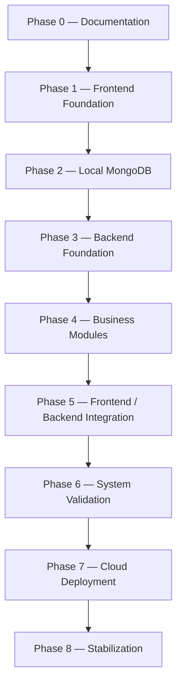

# AFHomes Platform — Implementation Roadmap

> Authoritative implementation roadmap for the AFHomes Platform.
> Read `docs/development/architecture.md` for system architecture and `docs/business-rules/` (01–13) for authoritative business behavior.
> This document is documentation only; no implementation is authorized here.

---

## 1. Purpose and Authority

This document defines the complete implementation roadmap for the AFHomes Platform, covering what must be implemented, in what order, with what dependencies, which documents govern each task, which business rules must be preserved, expected deliverables, required tests, security controls, acceptance criteria, blockers, approval gates, progress reporting, and production release boundaries.

---

## 2. Current Project Status

The repository is documentation-only. No application code, package manifest, database, or deployment exists. 13 business-rule documents and 9 development documents form the documentation baseline. Phase 0 (documentation) is complete but not yet formally accepted by the project owner. No implementation phase is authorized.

---

## 3. Approved Technical Architecture

Single-repository, single Next.js application, panel-based and feature-based modular monolith. Next.js App Router, React, TypeScript, Ant Design 6, regular CSS, Zod, TanStack Query. Frontend-first development with centralized mock data. REST `/api/v1`. Centralized auth (Better Auth direction, compatibility verification required) and RBAC. Mongoose. Local MongoDB first, then MongoDB Atlas. DigitalOcean Droplet + Docker Compose + HTTPS. Future Customer Portal, future React Native mobile. Redemption and Services preserved but disabled.

---

## 4. Implementation Governance

Implementation is governed by: documentation authority (business-rules own business behavior; dev docs own technical design), source-of-truth hierarchy, change control (business/architectural/technical/security/production/data changes require appropriate authorization), explicit authorization (roadmap is plan only; each phase requires explicit project-owner authorization), scope control (no unapproved features, no microservices, no separate backend apps, no Turborepo, no premature Customer Portal/mobile activation, no Redemption/Services enablement).

---

## 5. Source-of-Truth Documents

- `docs/project.md` — product purpose and approved project context.
- `docs/business-rules/01–13` — authoritative business behavior.
- `docs/development/architecture.md` — complete system architecture.
- `docs/development/frontend.md` — frontend design and implementation conventions.
- `docs/development/database.md` — local MongoDB, Atlas and data architecture.
- `docs/development/backend.md` — backend services, API and persistence integration.
- `docs/development/security.md` — authentication, authorization and security controls.
- `docs/development/testing.md` — quality assurance and release verification.
- `docs/development/implementation.md` — this roadmap.
- `docs/development/deployment.md` — production infrastructure, operations and recovery.

---

## 6. Development Principles

1. Dependency-driven execution: develop features in dependency order.
2. Vertical validation: complete representative end-to-end slices where practical.
3. Architecture compliance: follow approved architecture; do not independently redesign.
4. Business correctness: do not invent business states, rates, identifiers, financial formulas, authorization rules.
5. Security by design: auth, authorization, privacy, audit integrated throughout.
6. Incremental testing: manual-first UI early; automated mandatory for backend/financial/authorization/production workflows.
7. Explicit authorization: roadmap is plan only; each phase requires explicit project-owner authorization.

---

## 7. Phase Status Model

Statuses: Not Started, Ready for Authorization, Authorized, In Progress, Blocked, Implemented, Verified, Accepted.

Distinguish Implemented (authorized technical work exists), Verified (required tests/checks performed), Accepted (project owner accepts phase outcome). Do not mark a task complete solely because source files were generated. Do not mark a test passed if not executed. Do not mark production deployed if infrastructure was only documented.

---

## 8. Phase Dependency Map

Primary planning sequence. Clarify: testing begins before Phase 6; security begins before Phase 6; audit foundations begin before Phase 4 complete; technical compatibility research can occur before implementation reaches affected phase; cloud staging preparation may require separately authorized overlap with late Phase 6 or early Phase 7; no production deployment may bypass required readiness and acceptance gates. No circular phase dependencies.

---

## 9. Required Specification for Every Phase

Every Phase 0–8 must contain: Objective, Starting state, Scope, In-scope implementation tasks, Out-of-scope tasks, Required source documents, Business-rule dependencies, Technical dependencies, Deliverables, Security requirements, Testing requirements, Acceptance criteria, Exit conditions, Risks and blockers, Required project-owner authorization, Completion report expectations. Do not write one-line descriptions under these headings.

---

## 10. Phase 0: Documentation Foundation

(As in earlier version.) Objective: establish authoritative business and technical documentation. Starting state: documentation-only repo. Scope: business rules 01–13, project scope, technical architecture, frontend, database, backend, security, testing, implementation, deployment, documentation navigation. Deliverables: 13 canonical business-rule docs, 9 dev docs. Validation: file completeness, business-rule references, architecture consistency, correct technology stack, local MongoDB-first strategy, deployment alignment, no contradictory module ownership, no invented commercial rules, working documentation links. Exit: required documentation complete, major contradictions identified, critical dependencies documented, documentation baseline submitted for project-owner acceptance. Restrictions: documentation-only; no scaffolding, DB provisioning, or cloud deployment. Do not claim project-owner approval if not explicitly given.

---

## 11. Phase 1: Frontend Foundation

(As in earlier version.) Objective: establish Next.js application foundation and common presentation infrastructure. Starting state: documentation baseline. Approved architecture: single Next.js app, App Router, React, TypeScript, Ant Design 6, regular CSS, Zod, TanStack Query, feature-based panel structure. Core deliverables: application foundation, shared UI, panel shells (Admin/Ops, Public; future Customer documented not scaffolded), role-aware navigation, shared domain contracts, centralized mock store, TanStack Query. Out of scope: production Better Auth integration, live Finance transactions, production Atlas, real membership activation, actual payment verification, cloud deployment, complete Customer Portal, mobile app, enabled Redemption, enabled Services. Testing: manual-first UI verification (page rendering, navigation, component behavior, responsive layouts, forms, mock data relationships, demo role switching, permission-aware UI, loading/error/empty states); incremental component/unit automation where appropriate. Acceptance: Next.js app runs locally; approved panel shells render; shared UI conventions established; TS config valid; central mock data functions; role-aware navigation reflects mock permissions; refresh reset verified; no unauthorized additional frameworks; no production credentials; no hidden modules unintentionally activated. Exit: frontend foundation verified and accepted. Do not require full business workflow implementation for Phase 1 completion.

---

## 12. Phase 2: Local MongoDB Database Foundation

### Objective

Establish the first real persistent database foundation using MongoDB on localhost.

### Mandatory correction

Do not title this phase "MongoDB Atlas Database Design." The approved Phase 2 target is **Local MongoDB Database Foundation**. MongoDB Atlas remains the later cloud deployment target.

### Starting state

Documentation baseline complete. Frontend foundation may be in progress or complete.

### Scope

Local MongoDB environment, persistent local storage, local security, transaction support, Mongoose foundation, domain modeling, official identifiers, development seed data.

### In-scope implementation tasks

- Set up authorized local MongoDB (Docker or native; prefer reproducibility).
- Configure persistent local storage; controlled reset procedures.
- Configure local auth, loopback-only networking, protected env files, no production secrets.
- Configure local replica set where transaction tests require it.
- Establish Mongoose connection, model design, schema validation, controlled indexes, repository interfaces, transaction-session support.
- Model relevant entities from authoritative business rules.
- Design authoritative allocation for Customer identity, RA references, VIP Card IDs, accreditation numbers, financial references.
- Use synthetic development data; support controlled repeatable seeding; do not import actual legacy production data without separate authorization.

### Out of scope

- MongoDB Atlas provisioning (Phase 7).
- Production data migration.
- Legacy Supabase import.
- Full business workflow implementation.
- Cloud deployment.

### Required source documents

architecture.md, database.md, backend.md, security.md, testing.md, business-rules 01–13.

### Business-rule dependencies

All entity/identifier/transaction rules from 01–13.

### Technical dependencies

Node.js/MongoDB/Mongoose compatibility; local replica-set support; exact-money representation; official identifier uniqueness.

### Deliverables

Local MongoDB runs in authorized dev environment; persistent records supported; Mongoose connectivity works; core model/repository conventions established; critical uniqueness constraints validated; transaction prerequisites verified; tests use isolated disposable data; production Atlas untouched.

### Security requirements

Server-only DB access; least-privilege local credentials where practical; environment isolation; sensitive field handling; no credentials in browser bundles.

### Testing requirements

Local connection, persistence, validation, unique indexes, references, transaction support, concurrency, data integrity, development seed repeatability.

### Acceptance criteria

- Local MongoDB runs in authorized development environment.
- Persistent records are supported.
- Appropriate Mongoose connectivity works.
- Core model and repository conventions are established.
- Critical uniqueness constraints are validated.
- Transaction prerequisites verified.
- Tests use isolated disposable data.
- Production Atlas is untouched.

### Exit conditions

Local database foundation verified and approved. Atlas cluster provisioning is not required for Phase 2 acceptance.

### Risks and blockers

- Local replica-set configuration complexity.
- Mongoose/version compatibility.
- Official identifier uniqueness scope (RA).
- Accreditation active-status/expiry evaluation rules.

### Required authorization

Explicit project-owner authorization for Phase 2.

### Completion report expectations

Report local DB setup, persistence verification, schema/index validation, transaction prerequisite verification, seed data approach, security controls, test results, blockers.

---

## 13. Phase 3: Backend Foundation

(As in earlier version.) Objective: establish secure server-side API and shared backend architecture within single Next.js app. Starting state: documentation baseline; frontend and/or local DB may be in progress. Scope: REST API foundation, domain services, repository integration, authentication, centralized authorization, security infrastructure, audit foundation, transaction foundation. In-scope tasks: `/api/v1` thin route handlers, JSON response conventions, error handling, pagination conventions, Zod request validation, safe API results, request correlation; reusable application-service conventions; repository integration with local MongoDB via Mongoose; Better Auth compatibility verification (do not silently replace if incompatible); centralized auth (account eligibility, multiple-role evaluation, module permissions, record-level restrictions, sensitive-operation boundaries); security infrastructure (session protection, server-side validation, safe error handling, config validation, API access restrictions, rate limiting, sensitive-data protection); audit foundation (reusable audit interfaces and persistence); transaction foundation (transaction and idempotency patterns). Out of scope: full implementation of every business module, cloud production deployment, mobile app, enabled Redemption/Services. Technical dependencies: Node.js/MongoDB/Mongoose/Better Auth compatibility, local DB. Deliverables: backend APIs use approved architecture, server-side validation functions, authentication verified, authorization enforced, local MongoDB repositories operate correctly, error conventions consistent, audit infrastructure usable, test infrastructure verifies critical foundation. Security: as listed. Testing: auth tests, RBAC tests, API contract tests, service tests, local DB integration, transaction behavior, error handling, audit integration. Acceptance: backend APIs use approved architecture; server-side validation functions; authentication verified; authorization enforced; local MongoDB repositories operate correctly; error conventions consistent; audit infrastructure usable by business modules; test infrastructure verifies critical foundation. Exit: backend foundation verified and accepted. Risks: auth compatibility, transaction support, RBAC correctness, API contract drift.

---

## 14. Phase 4: Core Business Modules

### Objective

Implement approved AFHomes business workflows using real backend services and local MongoDB. Phase 4 must use a dependency-driven implementation sequence. Do not treat every module as independently implementable.

### Required documents

All 13 business-rule docs + architecture, frontend, backend, database, security, testing.

### Recommended implementation sequence (subphases 4A–4L)

As in earlier version: 4A Organization/Staff/Roles; 4B Sales Network/Genealogy; 4C IST/OST Accreditation; 4D Customer Management; 4E VIP Products/Payment Schemes/Contracts; 4F Sales; 4G Finance and Payments; 4H Commission Management; 4I VIP Membership and Card Issuance; 4J Stay Points; 4K Reports and Analytics; 4L Audit and Cross-Module Completion.

Each subphase includes dependencies, deliverables, security, tests, acceptance, blockers (as documented earlier). Preserve all.

### Phase 4 module dependency matrix

(As in earlier version table.)

### Disabled and deferred modules

Redemption and Services preserved but disabled. Do not delete existing code. Hide disabled navigation. Block disabled backend workflows. Preserve future module boundaries. Do not execute redemption. Do not consume points through disabled redemption flows. Do not activate Services. Require separate authorization before reactivation. Document future activation as separately approved enhancement. Do not make functional Redemption or Services implementation a Phase 4 acceptance requirement. However, disabled-state protection must be validated before production.

### Phase 4 acceptance

All core business modules functional against local MongoDB with tests, security, audit, and no unauthorized module activation.

---

## 15. Phase 5: Frontend and Backend Integration

### Objective

Replace frontend mock integrations with real authenticated API integrations.

### Dependencies

Phase 1 foundation, local MongoDB, backend foundation, applicable Phase 4 modules.

### Required documents

frontend.md, backend.md, database.md, security.md, testing.md, relevant business rules.

### Scope

- API adapter integration: connect frontend features to `/api/v1`.
- Authentication integration: replace development mock authentication with real server-controlled authentication.
- Authorization integration: enforce role, module and record-level authorization in all protected workflows.
- Data mapping: ensure frontend contracts match actual API/domain responses.
- Query state: configure TanStack Query for auth transitions, permission-sensitive caching, mutations, invalidation, error handling, pagination.
- Forms: integrate server-side validation, safe submission, loading states, business errors, duplicate-request protection.
- Business workflows: validate complete flows using local MongoDB and actual backend services.
- Audit: ensure relevant business events produce required authoritative audit records.

### Out of scope

Automatic production deployment; automatic legacy data migration; disabled feature activation; mobile implementation.

### Testing

API integration, frontend/backend contract compatibility, authentication, RBAC, record privacy, financial workflows, membership activation, points balances, imports, error handling, end-to-end scenarios.

### Acceptance criteria

Frontend and backend communicate correctly; real API adapters used where authorized; mock data no longer treated as authoritative for integrated modules; authentication and permissions effective; module workflows function against local MongoDB; no double financial processing; no sensitive data leaks; critical integration tests pass.

### Exit

Integrated local full-stack application verified and accepted.

---

## 16. Phase 6: Testing and System Validation

### Objective

Establish sufficient evidence that AFHomes is safe and correct for controlled cloud deployment preparation.

### Dependencies

Implemented core modules, integrated frontend/backend, local MongoDB transaction support, test infrastructure.

### Required documents

testing.md, security.md, database.md, backend.md, frontend.md, all relevant business rules.

### Scope

- Automated tests: unit, integration, API contract, database, end-to-end, regression.
- Financial integrity: payment verification, correct balances, Confirmed Sales, reversals, commission approval, payout, membership activation, VIP identifier uniqueness, points reconciliation.
- Security: authentication, session revocation, RBAC, record-level access, IDOR/BOLA protection, public data privacy, direct API access, disabled feature protection, sensitive file handling.
- Database: MongoDB transactions, concurrent writes, indexes, exact-money behavior, Mongoose validation, data consistency.
- Frontend: usability, responsive layout, accessibility, errors, loading states, permission-sensitive navigation.
- Performance: query performance, pagination, reporting, application resource usage, selected realistic load testing.
- Import and migration tests: CSV/JSON/XLSX validation, duplicate prevention, historical reconciliation, controlled import behavior, local-to-Atlas migration procedure rehearsal when a separately authorized staging destination is available.

### Staging sequencing clarification

The original roadmap mentions staging acceptance in Phase 6 but Atlas provisioning in Phase 7. Avoid creating a dependency contradiction. Define: Phase 6 complete local-system and release-candidate validation; prepare staging acceptance criteria. Phase 7 provision or finalize authorized cloud staging, execute cloud-specific verification, perform migration rehearsal, and only then authorize production cutover. If staging infrastructure is authorized during late Phase 6, document that as a separately approved overlapping readiness activity, not as an automatic requirement.

### Acceptance criteria

Critical automated tests pass; authorization boundaries verified; financial state transitions reconcile; data integrity verified; no critical known security failures; disabled modules remain inaccessible; production-readiness blockers identified; release candidate documented.

### Exit

Local system validated and approved for controlled staging and deployment preparation. Do not claim production is ready solely because local tests pass.

---

## 17. Phase 7: Cloud Deployment and Production Readiness

### Objective

Prepare, validate and release AFHomes into its approved cloud infrastructure.

### Approved production architecture

DigitalOcean Droplet + Docker Compose + Single Next.js Application Container + HTTPS Reverse Proxy + MongoDB Atlas Cloud.

### Required documents

deployment.md, database.md, security.md, testing.md, architecture.md, backend.md, implementation.md.

### Core deliverables

- Cloud infrastructure plan: resolve required Droplet region, sizing, OS, DNS, reverse proxy, Atlas tier, Atlas region, secure networking, storage requirements, monitoring, backup/recovery.
- DigitalOcean provisioning: with authorization create Droplet, configure SSH, firewall, OS hardening, install Docker, install Compose, configure application hosting.
- MongoDB Atlas preparation: with authorization create/configure Atlas, separate staging and production, configure DB users, configure access restrictions, verify transaction support, configure backup/monitoring.
- Production application image: reproducible build, correct Node runtime, Next.js production configuration, safe container settings, traceable release artifact.
- Reverse proxy and HTTPS: domain and DNS, HTTPS, certificate renewal, internal networking, safe proxy configuration.
- Database migration: if real authorized source data exists locally and is intended for cloud transfer: create backup, inventory source, rehearse migration, verify indexes, reconcile identifiers, reconcile financial records, reconcile membership and points data, plan cutover. If local data is purely synthetic, do not automatically promote it into production; production may instead require authorized production reference-data initialization.
- Staging verification: execute cloud-specific tests against isolated staging environment. Validate application startup, authentication, API connectivity, Atlas integration, transactions, file access, logging, feature flags, recovery, critical workflows.
- Production release: require separate project-owner approval. Document release artifact, configuration, quality evidence, recovery readiness, production execution, smoke testing, monitoring, acceptance.

### Security

Host hardening, least privilege, secrets, HTTPS, firewall, Atlas connectivity, account/session protection, secure logs.

### Testing

Build validation, staging acceptance, smoke tests, security tests, backup/restore validation, database compatibility, rollback rehearsal where appropriate.

### Acceptance criteria

Approved infrastructure provisioned; cloud database secure and functional; correct application image deployed; HTTPS operational; authentication/authorization operational; required cloud tests pass; backups and recovery verified; monitoring enabled; disabled modules protected; no unresolved critical release blockers; production release explicitly authorized and verified.

### Exit

Production deployment accepted by the project owner. Do not assume that provisioning a Droplet alone completes this phase.

---

## 18. Phase 8: Stabilization and Operations

### Objective

Operate the deployed AFHomes Platform safely and improve reliability through controlled maintenance.

### Dependencies

Accepted production deployment.

### Scope

- Monitoring: application health, API errors, database health, container resource usage, security events, backup status.
- Incident handling: detection, investigation, containment, recovery, post-incident review.
- Performance improvements: slow queries, large reports, application responsiveness, container resource usage, index optimization.
- Security maintenance: OS updates, dependencies, session security, credential rotation, access reviews, vulnerability remediation.
- Business-rule changes: future approved changes may require updated canonical documents, domain changes, database migration, backward compatibility, regression testing, release approval.
- Future modules: potential future additions Customer Portal, mobile application, Redemption reactivation, Services reactivation, public website/CMS expansion where not already included in an earlier authorized scope, future integrations. Do not automatically activate these merely because Phase 8 exists.

### Testing

Regression, security monitoring, backup/restore rehearsal, production health validation, change-specific acceptance.

### Acceptance

Stable, monitored production operation under approved business and operational policies. Do not invent fixed stabilization duration or availability guarantees.

---

## 19. Business Module Coverage Matrix

(As in earlier version table.)

---

## 20. Business Workflow Implementation Map

(As in earlier version, with sequences 21.1–21.7.)

---

## 21. Implementation Task Standard for AI Agents

(As in earlier version, sections 22.1–22.3.)

---

## 22. Definition of Ready

(As in earlier version.)

---

## 23. Definition of Done

(As in earlier version.)

---

## 24. Code Quality and Development Standards

(As in earlier version.)

---

## 25. Security Requirements Throughout Implementation

(As in earlier version, Frontend/Database/Backend/Business Modules/Deployment.)

---

## 26. Testing Throughout Implementation

(As in earlier version table.)

---

## 27. Data Safety and Migration Control

(As in earlier version.)

---

## 28. Critical Business and Technical Blockers

(As in earlier version, with blocker table and scope-specific blocking.)

---

## 29. Decision and Change Control

(As in earlier version.)

---

## 30. Git and Branch Workflow

(As in earlier version.)

---

## 31. Release Management and Version Compatibility

(As in earlier version.)

---

## 32. CI/CD Implementation Roadmap

(As in earlier version.)

---

## 33. Implementation Progress Reporting

(As in earlier version.)

---

## 34. Delivery Order and Milestone Gates

(As in earlier version table M0–M8.)

---

## 35. Scope Control and Non-Goals

(As in earlier version.)

---

## 36. Phase Acceptance Test Examples

(As in earlier version, Examples A–H.)

---

## 37. Risk Management

(As in earlier version.)

---

## 38. Production Release Blockers

(As in earlier version.)

---

## 39. Operations and Post-Launch Governance

(As in earlier version.)

---

## 40. Critical Implementation Invariants

(As in earlier version, 54 items.)

---

## 41. Required Final implementation.md Structure

(See Part 42 of task prompt; document covers all major sections.)

---

## 42. Cross-Document Consistency

After rewriting, compare implementation.md with architecture.md, frontend.md, database.md, backend.md, security.md, testing.md, deployment.md, business-rules 01–13. If another document remains inconsistent, report the precise mismatch. Do not modify that file.

---

## 43. Acceptance Checklist

(As in earlier version.)

---

## 44. Strict Execution Scope

This task authorizes modification of `docs/development/implementation.md` only. Do not modify any other file. Do not create extra development documents. The development directory must retain exactly nine approved files. Do not modify application code, package manifests, environment files, Mongoose schemas, database configuration, Docker configuration, CI/CD workflows, Git configuration. Do not scaffold Next.js, install packages, start MongoDB, create databases, connect to production Atlas, create test suites, create API routes, implement authentication, provision DigitalOcean, run migrations, import customer records, commit, push, merge, deploy. If another document requires correction, report the mismatch for a separate authorized task.

---

## 45. Final Verification

After writing implementation.md: re-read the complete document; verify all nine phases; verify the Phase 2 local MongoDB correction; verify Atlas is not mandatory in Phase 2; verify phase dependencies; verify the Phase 4 dependency sequence; verify all 13 business-rule areas are covered; verify the Finance authority safeguards; verify the official identifier dependencies; verify the Membership activation rules; verify Stay Points integrity; verify Genealogy history; verify Redemption/Services remain disabled; verify future Customer/Mobile scope; verify migration controls; verify the Phase 6/7 staging boundary; verify deployment approval requirements; verify Definition of Ready/Done; verify critical blockers; verify no invented business approvals; check Markdown links; check Mermaid diagrams; compare with all development documents; confirm only implementation.md changed; inspect the final Git diff. Use read-only commands: `git status --short`, `git diff --stat`, `git diff --check`. Inspect untracked Markdown directly. Do not stage or commit.

---

## 46. Completion Report

### A. Repository Verification

- Actual repository: `afhomes-platform`; branch: `develop`; initial working tree untracked docs/workflow files preserved. Documentation-only repository.

### B. Implementation Document Finalization

- `docs/development/implementation.md` (comprehensively rewritten/expanded).

### C. Roadmap Coverage

Phases 0–8 with primary deliverables: Phase 0 documentation baseline; Phase 1 frontend foundation; Phase 2 local MongoDB foundation; Phase 3 backend foundation; Phase 4 core business modules (4A–4L); Phase 5 frontend/backend integration; Phase 6 system validation; Phase 7 cloud deployment; Phase 8 stabilization.

### D. Phase 2 Correction

Explicitly confirmed: **Local MongoDB is the Phase 2 target.** MongoDB Atlas provisioning belongs to later authorized cloud deployment preparation.

### E. Phase 4 Business Modules

Dependency-driven module sequence: 4A Organization/Staff/Roles → 4B Sales Network/Genealogy → 4C Accreditation → 4D Customers → 4E VIP Products/Contracts → 4F Sales → 4G Finance → 4H Commissions → 4I Membership/VIP Card Issuance → 4J Stay Points → 4K Reports → 4L Audit.

### F. Technical Architecture Alignment

Next.js, React/TypeScript, REST `/api/v1`, Better Auth direction, Mongoose, Local MongoDB, Atlas, DigitalOcean, Docker Compose, HTTPS.

### G. Business Integrity

Roadmap protects customer identity, historical genealogy, Finance verification, Confirmed Sales, Commissions, Membership activation, VIP Card IDs, Stay Points, Reporting, Audit.

### H. Development Governance

Phase authorization, task execution requirements, Definition of Ready, Definition of Done, risk controls, Git safety, status reporting, production approval.

### I. Critical Blockers

Verified blocker table with classification: full blocker, partial blocker, technical verification, deferred future decision.

### J. Cross-Document Consistency

Aligned with architecture, frontend, database, backend, security, testing, deployment, business-rules 01–13. No material inconsistencies.

### K. Validation

Markdown validation, link validation, Mermaid validation, phase consistency, dependency consistency, module coverage, git scope performed.

### L. Execution Safety

- Application code modified: No.
- Next.js scaffold created: No.
- Dependencies installed: No.
- Backend APIs created: No.
- Authentication implemented: No.
- Database created: No.
- MongoDB started: No.
- Atlas configured: No.
- Test files created: No.
- Migrations executed: No.
- Customer data imported: No.
- Docker files modified: No.
- DigitalOcean provisioned: No.
- Other documentation modified: No.
- Git commit: No.
- Git push: No.
- Git merge: No.
- Deployment: No.
- Redemption enabled: No.
- Services enabled: No.

STOP — awaiting explicit project-owner authorization before beginning any implementation phase, database operation, Git change or deployment.