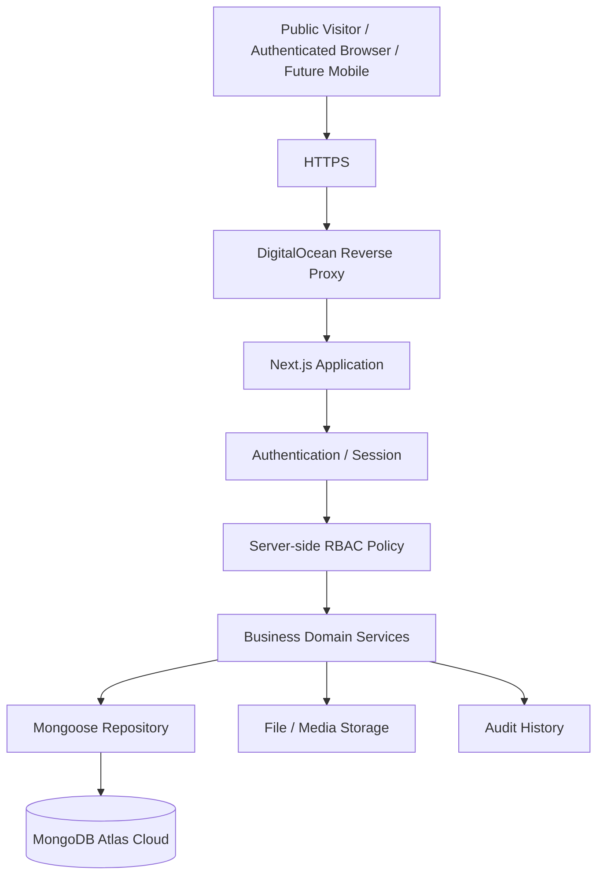

# AFHomes Platform — Security Architecture

> Authoritative security architecture for the AFHomes Platform.
> Read `docs/development/architecture.md` for system architecture and `docs/business-rules/` (01–13) for authoritative business behavior.
> This document is documentation only; no security implementation is performed here.

---

## 1. Purpose and Scope

This document defines the complete security architecture for the AFHomes Platform, covering identity, authentication, sessions, account lifecycle, staff/Sales Network approval, RBAC, record-level authorization, genealogy privacy, Finance/commission security, customer privacy, public verification, API security, input validation, XSS/CSRF/CORS/SSRF, rate limiting, fraud prevention, file uploads, secrets, local MongoDB/Atlas security, DigitalOcean/Docker/HTTPS, audit integrity, logging, feature flags, backup/incident response, security testing, and implementation phases.

AFHomes business rules are current approved operating policies and may change through authorized management decisions. Security implementation must support controlled policy changes without compromising historical transactions, signed contract rights, financial accountability, account identity, authorization records, audit integrity, or customer privacy.

---

## 2. Source-of-Truth References

- `docs/development/architecture.md` — system topology.
- `docs/development/frontend.md` — client-side security responsibilities.
- `docs/development/backend.md` — server-side enforcement.
- `docs/development/database.md` — MongoDB security.
- `docs/development/testing.md` — verification.
- `docs/development/deployment.md` — production infrastructure security.
- `docs/development/implementation.md` — phased implementation.
- `docs/business-rules/01–13` — authoritative business authorization rules.

---

## 3. Approved Security Architecture

Layered protection model. Security enforced across: (1) Frontend presentation; (2) Authentication; (3) Session management; (4) Account eligibility; (5) Role and permission evaluation; (6) Record-level authorization; (7) Business-domain authorization; (8) API request validation; (9) Database access; (10) File storage; (11) Audit history; (12) Application infrastructure; (13) Operational monitoring.

Core principles: Secure by default; Least privilege; Deny by default; Separation of duties; Verified identity; Server-authoritative authorization; Data minimization; Historical accountability; Confidentiality; Integrity; Availability; Safe failure behavior; Defense in depth.

Frontend navigation is not a security boundary. Hidden buttons or disabled controls do not prevent unauthorized backend requests.

---

## 4. System Trust Boundaries

Include browser trust boundary, server trust boundary, database trust boundary, file storage boundary, external integration boundary, audit/monitoring responsibility. Future mobile application must use authorized API and never connect directly to MongoDB Atlas.

### 4.1 Browser is untrusted

Never trust client-submitted role names, permission names, staff identities, Finance approval authority, customer ownership, team membership, verified payment flags, membership activation flags, commission approval flags. Backend derives authoritative access context from verified server-side information.

### 4.2 Server trust boundary

Protected services enforce authentication, account eligibility, effective permissions, record-level scope, business state transitions, data validation, financial authority.

### 4.3 Database trust boundary

Database connection is server-only. No browser component may directly access MongoDB. Database credentials never enter public frontend bundles.

---

## 5. Threat Model

| Threat | Security concern |
|---|---|
| Credential theft | Unauthorized account access |
| Brute-force login | Account compromise |
| Session theft | Unauthorized session reuse |
| Privilege escalation | Unauthorized role or Admin access |
| IDOR/BOLA | Access to another customer's or seller's records |
| Broken business authorization | Unauthorized Finance or commission operations |
| API abuse | Automated public enumeration or resource exhaustion |
| Injection | Database or application compromise |
| XSS | Session and data exposure |
| CSRF | Unauthorized browser-originated state changes |
| SSRF | Unauthorized server network access |
| File upload abuse | Malicious content or private-file disclosure |
| Duplicate financial requests | Duplicate verification, payout or credit |
| Race conditions | Conflicting balances or identifier allocation |
| Audit tampering | Loss of accountability |
| Secret exposure | Unauthorized infrastructure or database access |
| Database breach | Exposure or manipulation of customer and financial records |
| Backup compromise | Disclosure of stored production information |
| Supply-chain compromise | Malicious dependencies or build artifacts |
| Insecure deployment | Production host compromise |

For each significant threat, consider attack surface, potential impact, required control, responsible architecture layer, verification approach. Do not claim a threat is already mitigated merely because it appears in documentation.

---

## 6. Centralized User Identity

Distinguish Authentication Identity, Staff or Sales Network Profile, Role Assignments, Accreditation, Customer Identity. Do not automatically treat these as interchangeable database records.

### 6.1 Identity requirements

Stable user identity; unique account references; controlled account creation; verified account linkage; account lifecycle; appropriate login identifiers; controlled role assignments; security audit records.

### 6.2 No duplicate independent identity systems

Do not create separate unrelated authentication engines for Admin, Finance, IST, OST, Customer. Different portals may have different access scopes, but authentication should follow a centralized architecture unless a separately approved security requirement establishes an exception.

---

## 7. Account Lifecycle

Current statuses: Pending, Active, Suspended, Deactivated. Also account for relevant archived, rejected or expired business states where established by authoritative documents. Do not invent one universal enum that erases differences between Staff account status, IST/OST account status, Accreditation status, VIP Membership status.

### 7.1 Pending

An account awaiting required approval must not receive permissions reserved for approved active accounts.

### 7.2 Active

An account is eligible for authentication and operations only within its effective permissions and applicable business restrictions.

### 7.3 Suspended

A suspended account loses applicable effective access.

### 7.4 Deactivated

A deactivated account must not remain operational through an existing session.

### 7.5 Reactivation

Reactivation must follow the authorized approval rules. Do not allow automatic reactivation when separate business approval is required.

### 7.6 Session effects

Sensitive account status changes must affect active sessions according to the approved session invalidation strategy. Document reliable revocation or revalidation requirements. Do not rely entirely on frontend logout behavior.

---

## 8. Staff Account Approval

Read `docs/business-rules/01-roles-and-permissions.md`. The existing security document states: "Manual approval for Organization Management employee accounts. Admin/Super Admin may approve self-created accounts." This is a security-sensitive rule.

### Mandatory verification

Determine exactly what the authoritative business-rule document approves. Distinguish Staff registration, Staff creation by an authorized Admin, Pending approval, Self-created account approval, Creation on behalf of another user, Authorized approval of another person's account. Do not assume that self-registration grants self-approval authority. If self-created account approval is explicitly approved, document the precise authorization boundaries and abuse safeguards. If the rule is ambiguous or conflicts with another authoritative requirement, flag it as a material business/security decision. Do not silently replace the business rule.

### Security controls

Document: Approved actor; Approval eligibility; Account being approved; Effective status; Permission activation; Audit trail; Notification where applicable; Prevention of unauthorized privilege escalation.

---

## 9. Sales Network Account Approval

Read documents 01–03 carefully. The existing security document states: "Sales Network accounts activate immediately after authorized creation." However, AFHomes business rules may distinguish direct authorized IST account creation from OST sponsor-approved registration.

### Mandatory reconciliation

Explicitly distinguish: (1) Authorized creation of internal Sales Network personnel; (2) OST self-registration; (3) OST sponsor selection; (4) Applicable upline approval; (5) Account activation; (6) Accreditation status; (7) Login eligibility. Do not apply a blanket immediate-activation rule to an OST registration that must remain Pending until sponsor approval. If direct authorized account creation has an exception, document that exception clearly. If the canonical documents disagree, report the exact conflict rather than inventing a resolution.

### Security requirements

No unauthorized sponsor assignment; no forged upperline approval; no bypass of registration approval; no unauthorized accreditation issuance; no login before required approval; correct genealogy linkage; auditable approval decision.

---

## 10. Authentication Architecture

Target authentication direction: Better Auth. Compatibility must be verified before implementation. Relevant checks: selected Next.js version, supported Node.js runtime, MongoDB integration, authentication adapter, session storage, session revocation, password handling, cookie security, deployment compatibility, future mobile authentication requirements.

Do not claim Better Auth is already installed. Do not silently replace Better Auth with another authentication framework.

### 10.1 Authentication capabilities

Login, logout, session creation, session verification, session expiration, session revocation, account status checking, authentication failure handling, secure recovery workflow when authorized.

### 10.2 Password security

The selected authentication framework must use appropriate password security practices. Do not store plaintext passwords; use reversible password encryption as password hashing; log password values; return password hashes to clients. Password hashing and verification must use a suitable vetted authentication implementation.

### 10.3 Account recovery

Document security considerations for password reset, recovery token validity, single-use recovery where supported, account enumeration prevention, recovery audit, session invalidation where appropriate. Do not claim a particular email provider is selected.

### 10.4 Multifactor authentication

Describe MFA as a potential security control for sensitive roles and operations. Do not falsely claim MFA is currently mandatory for all accounts if no such business decision has been approved. Identify appropriate approval or implementation prerequisites.

---

## 11. Session Security

Document secure sessions comprehensively. Required topics: session identifiers, session cookies, HTTP-only cookies where applicable, Secure cookie attributes, SameSite protections, session expiration, session renewal, session revocation, logout, device/session invalidation where supported, account status revalidation, permission-change revalidation, suspicious session activity, session fixation prevention.

### 11.1 Status changes

If an account is Suspended, Deactivated, Rejected, or no longer eligible for access, existing sessions must not continue granting effective access. Document appropriate server-side revocation or revalidation.

### 11.2 Role changes

A previously authorized session must not continue granting permissions after those permissions have been revoked.

### 11.3 Frontend caching

On logout or identity changes, permission-sensitive frontend caches must be cleared or isolated. Do not expose a previous user's data to a subsequent user.

---

## 12. Multiple Roles

The existing approved model allows eligible users to hold multiple active roles. The current document states: "Effective permissions are the union of active assigned roles." Preserve this rule where supported by document 01.

Important limits: union of permissions must not override account suspension, accreditation restrictions, record-level visibility, module-specific authorization, sensitive business-operation requirements, feature flags, security-based explicit restrictions. Archived or inactive roles grant no effective permissions.

### 12.1 Permission evaluation

Conceptual evaluation: (1) Verify authenticated account; (2) Check account eligibility; (3) Resolve active assigned roles; (4) Resolve applicable module permissions; (5) Apply record-level scope; (6) Apply business-operation restrictions; (7) Apply feature availability; (8) Permit or deny the operation. Do not invent a conflicting standalone role engine.

---

## 13. Dynamic Roles and Bounded Delegation

AFHomes supports authorized dynamic role management. Document role creation, role assignment, role modification, role deactivation, permission changes, role hierarchy considerations, authorized delegation, restricted sensitive actions, audit history.

Prevent privilege escalation: an actor must not grant privileges beyond their authorized delegation scope. Do not allow an ordinary role manager to grant unrestricted Super Administrator access unless explicitly authorized.

Super Administrator protection: document protected role assignment, unauthorized removal prevention, preservation of essential administrative access, audit of privileged changes, prevention of unauthorized escalation. Do not invent a role matrix inconsistent with the approved business rules.

---

## 14. Module Permissions

The existing security document states: "Module-level access includes all supported functions of that module. No per-action CRUD toggles." Preserve the approved model as established by document 01.

Critical distinction: module access does not override record visibility, account eligibility, financial separation of duties, specific approval authority, business state restrictions, disabled feature flags, sensitive administrative controls. For example, a Sales Network member with Sales module access does not automatically gain Finance payment-verification authority; a user with Customer module access does not automatically gain access to all customer records. Do not introduce an entirely different per-action CRUD toggle configuration system without authorization. However, business-operation safeguards must still be enforced. Document the separation between configurable module access and mandatory sensitive-operation authorization.

---

## 15. Record-Level Authorization

The target security model supports `own`, `team`, `all`. These represent conceptual visibility scopes. They do not replace module-specific business rules.

### 15.1 Authorization requirements

For every protected record request, evaluate verified actor, active account status, effective permissions, requested module, target record, business relationship, relevant date or historical relationship, applicable privacy rules.

### 15.2 Read security

Apply access controls to single-record lookup, lists, search, pagination totals, autocomplete, related records, exports, reports, aggregations. Do not leak restricted records through counts or indirect response fields.

### 15.3 Write security

Prevent users from modifying records outside their permitted scope. Changing a customer ID, staff ID, seller ID or payment ID in an API request must not bypass authorization.

### 15.4 Field-level disclosure

Even when a user may access a record, they may not be authorized to view every field. Use safe response shaping. Do not return private identification images or payment documents unnecessarily.

---

## 16. Genealogy Security

Use `docs/business-rules/02-sales-network-and-genealogy.md`. The established structure includes SVD → SSM → SM → OST. An OST may directly report to an authorized SVD, SSM or SM. Do not fabricate intermediate positions.

### 16.1 Visibility

Document permitted visibility for SVD, SSM, SM, OST, Admin, Super Admin. Use the exact business-rule permissions.

### 16.2 Upline information

Restricted roles may see permitted upline names without gaining unrestricted access to upline profiles.

### 16.3 Downline access

Managers may access only permitted descendant information. Do not expose unrelated branches.

### 16.4 Historical attribution

Transfers must preserve historical sales attribution. Do not authorize access based only on a newly changed genealogy relationship when the record's business rules require historical attribution.

### 16.5 Genealogy changes

Transfers and conversions must require authorized actors and be auditable. Prevent unauthorized parent changes, invalid hierarchical links, circular relationships, forged sponsor approval, unapproved designation changes.

---

## 17. IST/OST Accreditation Security

Accreditation is a distinct business authorization. It must not be confused with application role assignment or VIP Membership status.

### 17.1 Accreditation controls

Document official accreditation identity, approval, validity, renewal, expiration, suspension, deactivation, reactivation, account conversion.

### 17.2 Login eligibility

The existing security document states that expired accreditation blocks login. Verify this behavior against the current accreditation business rules. Preserve the approved restriction accurately. If an approved account type has a permitted limited-access renewal workflow, document it only when supported by the authoritative rules. Do not invent a universal exception.

### 17.3 Sales activity

An accreditation or account status that prohibits sales activity must be enforced by the backend. Do not rely only on hiding the Sales page.

### 17.4 Public verification

Public accreditation search must not reveal restricted private information. Preserve approved AAI/AAO presentation differences.

---

## 18. Administrator Security

Document the distinction between Super Administrator, Administrator, other privileged staff, Finance, Sales Network managers. Do not assume every Admin has all Super Administrator capabilities.

### 18.1 Sensitive administrative actions

Examples: role assignment, permission modification, staff approval, account deactivation, business configuration, VIP product changes, historical record corrections, audit access, data export. Every action must follow its authorized business boundary.

### 18.2 Configuration changes

A configurable setting must not automatically become editable by every Admin. Respect approved ownership and authorization.

### 18.3 Privileged audit

Record sensitive administrative changes. Preserve previous and resulting configuration where safe and appropriate.

---

## 19. Finance Separation of Duties

Finance authority is a critical security boundary. Use `docs/business-rules/07-finance-and-payments.md`. The approved rules distinguish payment submission from Finance verification.

### 19.1 Payment submission

Authorized users may submit payment information according to their module permissions. Submitting evidence does not mean payment was verified.

### 19.2 Payment verification

Only authorized Finance personnel verify actual payment receipt.

### 19.3 Refunds and reversals

Authorized Finance personnel control refunds and reversals according to the approved workflow. Do not invent a mandatory separate Admin approval where the business rules do not require it.

### 19.4 Prevent forged state transitions

An attacker must not be able to mark payment verified by modifying request body, frontend state, status field, user-supplied role, API route parameters. The backend must verify actor authority and permitted state transition.

### 19.5 Financial security

Document transaction integrity, idempotency, duplicate prevention, state validation, audit history, reconciliation, concurrency control, safe failure behavior.

---

## 20. Commission Security

Use `docs/business-rules/08-commission-management.md`. The backend must protect commission recipient selection, manual percentage assignment, approved commission amount, Finance approval, commission Holds, payout authorization, actual disbursement confirmation, recovery history.

### 20.1 Manual Finance authority

A Confirmed Sale does not automatically create a Finance-approved commission.

### 20.2 Payout security

Approved is not Paid. Paid requires the authorized confirmed-disbursement event.

### 20.3 Prevent unauthorized changes

An IST or OST account must not be able to alter its own approved commission percentage or payout status unless a specific approved business rule grants a particular action.

### 20.4 Historical eligibility

Commission authorization must preserve historical sale attribution. Current genealogy changes must not silently rewrite older commission eligibility.

---

## 21. Customer Data Privacy

Use `docs/business-rules/04-customer-management.md`. The database contains private customer information. Protect names, contact details, addresses, government identification, uploaded ID images, private membership details, payment records, financial balances, contract documents, personal transaction history.

### 21.1 Data minimization

Only collect, return, log and store personal information needed for authorized purposes.

### 21.2 Internal customer access

Staff and sellers can view only customer information within their approved operational scope.

### 21.3 Private identity documents

Government ID images and similar private files require controlled access. Do not expose unrestricted links.

### 21.4 Export controls

Customer data exports must require authorization and audit. Do not allow a low-privilege account to export organization-wide customer information.

### 21.5 Applicable privacy obligations

The architecture should acknowledge applicable Philippine privacy requirements, including the Data Privacy Act, without inventing legal retention periods or claiming complete legal compliance merely from documentation. Identify matters requiring company/legal approval.

---

## 22. Public Customer Lookup Security

Read document 04 and reconcile the current approved public lookup rules. The existing security document specifies exact official identifier, Active results only, no name-based discovery, generic not-found behavior. Verify the actual approved lookup identifier and disclosure rules. Do not conflate customer lookup with accreditation search.

### 22.1 Public eligibility

Only approved active and eligible membership records may be publicly verifiable.

### 22.2 Restricted disclosure

Return only the approved public information, such as authorized masked identity and membership status details. Do not return complete private addresses, government IDs, customer account credentials, private payment records, unrestricted financial data.

### 22.3 Enumeration prevention

Public lookup must resist unnecessary bulk discovery. Document input restrictions, appropriate rate limiting, safe errors, no unauthorized search suggestions, privacy-preserving response behavior.

---

## 23. Public Accreditation Verification

Use document 03. The public accreditation search has distinct rules from Customer Lookup. Relevant controls include official AA identifier validation, eligible active accreditation, approved identity fields, AAI/AAO distinctions, generic safe errors, rate limiting, no unauthorized private details. Preserve the approved IST versus OST validity-date display behavior. Do not expose unauthorized private profiles through public verification endpoints.

---

## 24. API Authentication and Authorization

The backend REST API uses `/api/v1`. Every protected operation must enforce the appropriate security requirements.

### 24.1 API security pipeline

1. Request acceptance; 2. Transport security; 3. Request size limits; 4. Input parsing; 5. Authentication; 6. Session/account eligibility; 7. Validation; 8. Authorization; 9. Business-state validation; 10. Execution; 11. Audit and safe response. Do not treat this conceptual order as an inflexible framework implementation detail.

### 24.2 Direct API access

Do not assume frontend navigation restrictions prevent direct API invocation. Every protected route must independently enforce security.

### 24.3 IDOR/BOLA protection

A user changing an identifier in an API request must not gain access to another user's record.

### 24.4 Error behavior

Use safe error codes, non-sensitive messages, appropriate HTTP statuses, request correlation, privacy-preserving responses. Do not expose internal implementation details.

---

## 25. Input Validation

Zod is the selected validation approach. Document validation at request parameters, query strings, JSON bodies, file metadata, pagination, filters, dates, monetary inputs, official identifiers, status transitions.

### 25.1 Layer distinction

Frontend validation improves user experience. Backend validation is authoritative. Domain services validate business invariants. Database constraints provide further integrity protection.

### 25.2 Injection prevention

Use appropriate safe database APIs and validation. Do not allow untrusted MongoDB query operators, unrestricted dynamic field paths or client-supplied database filters to bypass approved searches.

### 25.3 Output security

Avoid reflecting untrusted content in executable contexts. Document safe rendering and serialization behavior.

---

## 26. XSS, CSRF, CORS and SSRF

### 26.1 XSS

Describe safe React rendering, avoidance of unsafe HTML rendering, sanitization for approved rich content, Content Security Policy where appropriate, secure treatment of CMS content, safe URLs.

### 26.2 CSRF

Document protection for cookie-authenticated state-changing requests where applicable. Do not assume CORS configuration alone prevents CSRF.

### 26.3 CORS

The web frontend and backend operate within one Next.js application. Use appropriately restrictive cross-origin access. Do not permit unrestricted origins with credentials. Future mobile or external clients require explicit authentication and access design.

### 26.4 SSRF

Protect server-side operations that fetch remote resources. Relevant examples: remote image import, URL previews, external integration callbacks, uploaded media processing. Do not allow arbitrary client-provided URLs to access private infrastructure endpoints.

---

## 27. Rate Limiting and Abuse Prevention

Document rate limiting for login, password recovery, public accreditation search, Public Customer Lookup, sensitive API operations, file uploads, potential high-cost search/report endpoints.

### 27.1 Design considerations

Per-identity limits where appropriate, per-network/source limits where appropriate, trusted proxy configuration, response behavior, logging and monitoring, avoiding easy bypass, avoiding unnecessary denial of service to legitimate users.

### 27.2 Distributed enforcement

If the production deployment later has multiple application processes or instances, rate limiting must be reliable across the relevant execution topology. Do not assume an in-memory counter in one process provides global protection across multiple instances.

### 27.3 CAPTCHA

CAPTCHA or challenge mechanisms may be used for appropriate high-risk public workflows. Do not claim a specific provider is already approved unless the repository or business decisions establish it. Do not automatically require CAPTCHA for every internal operation.

---

## 28. Financial Fraud and Replay Protection

Document security risks related to duplicate payment verification, repeated refund requests, duplicate sale confirmation, duplicate commission payout, repeated VIP activation, duplicate points earning, replayed import requests.

### 28.1 Idempotency

Sensitive operations must not produce duplicate effects on retry.

### 28.2 Concurrency

Concurrent requests must not bypass business-state checks.

### 28.3 Database integrity

Use the appropriate transaction and unique-index strategies defined in `database.md`.

### 28.4 Audit

Preserve traceability of both successful actions and relevant rejected or suspicious attempts. Do not rely solely on disabling frontend buttons.

---

## 29. Secure File Uploads and Downloads

AFHomes handles sensitive uploaded files. Examples: payment evidence, government ID images, customer documents, contracts, accreditation photographs.

Document authorization, file-size restrictions, allowed file types, server-side content validation, safe file naming, malicious content risk reduction, private storage, secure download, time-limited access where appropriate, audit logging, retention, deletion procedures.

Do not rely only on a browser-supplied MIME type or filename. Do not place private identification documents in unrestricted public directories.

### 29.1 Public media

Public website images have different disclosure requirements from private customer documents. Separate their storage and access rules conceptually.

### 29.2 Storage provider

Do not claim a specific provider is selected if it has not been approved. Describe required security characteristics.

---

## 30. Secrets Management

Document server-only secret handling. Examples: MongoDB connection credentials, Better Auth secrets, external API keys, file storage credentials, email/SMS provider credentials, backup credentials, deployment tokens.

Secrets must not appear in Git-tracked source code, client-side bundles, public environment variables, application error messages, request logs, screenshots of diagnostic output, public documentation.

### 30.1 Environment separation

Production secrets must not be reused as ordinary local development credentials.

### 30.2 Rotation

Document authorized access, secure distribution, credential rotation, revocation, incident handling.

### 30.3 Frontend environment variables

Never expose server secrets through `NEXT_PUBLIC_` variables.

---

## 31. Database Security

The database architecture uses Local MongoDB for development and MongoDB Atlas Cloud for production. Mongoose for server-side persistence.

### 31.1 Local MongoDB

Document localhost binding, appropriate authentication, nonproduction credentials, secure local files, avoidance of unnecessary public network exposure, separation from production, synthetic test data.

### 31.2 MongoDB Atlas

Document TLS, database users, least-privilege roles, network access restrictions, connection-string protection, production database separation, monitoring, backup protection, credential rotation.

### 31.3 Server-only access

Only authorized server infrastructure accesses MongoDB. No browser or mobile client connects directly to the database.

### 31.4 Database privilege separation

Distinguish normal application database identity, authorized schema/index maintenance identity, administrative database identity, read-only operational access where applicable. Do not give the application unrestricted Atlas administrative privileges.

---

## 32. Audit Log Security

Use `docs/business-rules/12-audit-logs-and-governance.md`. Document the planned centralized audit model.

### 32.1 Append-only normal history

Ordinary application roles cannot silently rewrite or delete historical audit events. Corrections are recorded as new events.

### 32.2 Security-sensitive events

Potential audit events include login/security events, account approval, role changes, permission changes, account suspension, accreditation changes, genealogy transfers, contract approval, Finance verification, refunds/reversals, commission approval, commission payout, membership activation, points adjustments, policy changes, audit export.

### 32.3 Actor attribution

Distinguish human actor, automated system action, originating workflow, relevant business entity.

### 32.4 Sensitive data protection

Audit entries must not contain raw passwords, session tokens, API secrets or unnecessary private identity documents.

### 32.5 Tamper resistance

Document the need for protected storage and restricted mutation permissions. Potential stronger tamper-evidence technologies may require future approval. Do not claim cryptographic WORM storage or immutable infrastructure already exists.

### 32.6 Retention

Audit retention and exceptional lawful deletion must follow authorized legal/company policies. Do not invent a universal retention period.

---

## 33. Application Logging Security

Separate application diagnostic logs from business audit records. Application logs may contain request correlation identifier, safe error code, operation, duration, HTTP status, dependency failure, security event category. Avoid raw credentials, authentication tokens, full private request bodies, government ID images, unnecessary personal information, sensitive payment attachments. Document log access restrictions and retention-policy dependencies.

---

## 34. Production Infrastructure Security

The approved production topology is DigitalOcean Droplet → Next.js Application → MongoDB Atlas Cloud. The application is deployed using Docker Compose and HTTPS.

### 34.1 Droplet

Restricted SSH, strong administrative authentication, limited authorized users, operating-system patching, firewall, process isolation, security monitoring, restricted management access.

### 34.2 Docker

Appropriate container isolation, minimal images, non-root execution where practical, safe volumes, resource limits, secure environment configuration, controlled container updates, no unnecessary privileged containers.

### 34.3 Reverse proxy

HTTPS, TLS certificate management, safe proxy headers, request limits, access logging, correct forwarded-client-address trust configuration, restrictive exposure of internal services.

### 34.4 Atlas connectivity

Restricted database network access, TLS, protected credentials, least privilege, monitoring.

### 34.5 Production feature exposure

Do not expose development-only mock login, demo identity switching, debug endpoints, internal database administration, unrestricted logs, unprotected health details.

---

## 35. Feature Flag Security

Redemption and Services remain disabled under the current MongoDB project scope. Security must apply both to the frontend and backend.

### 35.1 Frontend

Hide disabled modules from user-facing navigation.

### 35.2 Backend

Reject attempts to invoke disabled workflows.

### 35.3 Direct routes

Direct access to routes must not bypass the feature flag.

### 35.4 Configuration

Feature flags should use secure defaults.

### 35.5 Future activation

Activation requires separate authorization. Do not turn a feature flag into a means for ordinary users to activate restricted business modules. Do not enable Redemption or Services during this documentation task.

---

## 36. Background Job Security

AFHomes may use scheduled tasks for accreditation expiry, overdue installment evaluation, membership expiry, authorized notifications, reconciliation, other approved lifecycle processing.

Document service identity, execution authorization, secure scheduling, job idempotency, duplicate prevention, safe retries, logging, audit, secret access, failure handling. Automated processes must not gain unrestricted human Admin authority merely because they execute on the server. Use appropriately scoped service privileges.

---

## 37. Backup and Restore Security

Document security for local development backups, MongoDB Atlas backups, application configuration backups, sensitive uploaded files, authorized restoration, disaster recovery.

### 37.1 Backup protection

Access controls, appropriate encryption, secure storage, secret separation, environment labeling, authorized restoration, retention according to policy.

### 37.2 Restore security

Prevent ordinary users from restoring arbitrary database snapshots or overwriting production business records.

### 37.3 Recovery testing

Recovery procedures should be rehearsed in a safe environment before relying on them for production.

### 37.4 Data exposure

Do not automatically restore real production customer data into ordinary developer environments.

---

## 38. Security Incident Response

The security architecture must include an operational incident-response framework. Relevant incident categories: account compromise, credential exposure, unauthorized data access, suspicious role changes, financial fraud, audit tampering, database compromise, backup compromise, production host compromise, service outage.

### 38.1 Response lifecycle

Conceptual steps: (1) Detect; (2) Assess; (3) Contain; (4) Preserve evidence; (5) Investigate; (6) Remediate; (7) Restore services; (8) Review; (9) Apply required reporting/notification obligations. Do not invent specific legal notification deadlines. Refer privacy-related notification obligations to applicable law and authorized company policy.

### 38.2 Evidence protection

Preserve relevant audit, application and infrastructure evidence under appropriate access controls. Do not recommend destroying historical records to hide an incident.

---

## 39. Security Testing

Use `docs/development/testing.md`. The final security document must identify required testing coverage.

### 39.1 Authentication tests

Invalid credentials, account enumeration resistance, session expiration, logout, session revocation, account suspension, deactivation, password recovery, role-change effects.

### 39.2 Authorization tests

Unauthorized module access, unauthorized API calls, record-level scope, horizontal privilege escalation, vertical privilege escalation, Super Administrator protection, multiple-role evaluation, genealogy access, Finance authority, customer privacy.

### 39.3 Public API tests

Accreditation enumeration protection, customer lookup privacy, rate limiting, invalid identifiers, safe errors, public data restrictions.

### 39.4 Financial security tests

Repeated payment verification, concurrent payment verification, unauthorized refund, duplicate commission payout, membership activation replay, points ledger manipulation, transaction rollback.

### 39.5 Technical security tests

XSS, CSRF, CORS, SSRF, injection, file upload abuse, secret exposure, dependency security, database network access, container and deployment security.

### 39.6 Production readiness

Manual testing alone is not sufficient for production release. Automated critical security tests must be introduced before production approval. Do not claim that any test has already passed.

---

## 40. Security Implementation Phases

Align with `docs/development/implementation.md`.

- **Phase 0 — Documentation:** security architecture and approved business rules.
- **Phase 1 — Frontend Foundation:** development-only mock identities, permission-aware UI and safe synthetic data. Do not implement production authentication merely by documenting it.
- **Phase 2 — Local MongoDB:** secure local database setup, database access design and test isolation.
- **Phase 3 — Backend Foundation:** authentication, session management, RBAC, record-level policies, input validation and security infrastructure.
- **Phase 4 — Business Modules:** module-specific authorization, Finance controls, genealogy visibility, points integrity and auditing.
- **Phase 5 — Integration:** connect the frontend with real authenticated backend services.
- **Phase 6 — Security Testing:** automated authorization, financial-security, API and database tests.
- **Phase 7 — Production Deployment:** Droplet hardening, HTTPS, secrets, Atlas network controls, monitoring and secure release verification.
- **Phase 8 — Operations:** monitoring, credential rotation, incident handling, patching and controlled updates.

All implementation phases require separate authorization. Do not begin coding during this documentation task.

---

## 41. Critical Security Invariants

1. Single centralized authentication direction.
2. Server-authoritative sessions.
3. Server-side authorization.
4. Module access and record visibility are separate.
5. Multiple roles follow the approved effective-permission model.
6. Inactive roles grant no permissions.
7. Suspended accounts cannot retain unauthorized access.
8. Deactivated accounts cannot retain unauthorized access.
9. Staff approval follows authorized business rules.
10. OST sponsor approval cannot be bypassed where required.
11. Sales Network account creation follows its approved exceptions.
12. Accreditation restrictions are enforced.
13. No unauthorized Super Administrator creation.
14. No unauthorized privilege escalation.
15. No user-supplied role or ID is inherently trusted.
16. Genealogy access follows the authorized hierarchy.
17. Historical sale attribution is preserved.
18. Finance verification remains Finance-controlled.
19. Refunds and reversals follow Finance authority.
20. Commission approval remains Finance-controlled.
21. Paid commission requires verified disbursement.
22. VIP Membership activation follows approved eligibility.
23. Official identifiers cannot be arbitrarily manipulated.
24. Stay Points cannot be credited or consumed by unauthorized users.
25. Public customer information is limited.
26. Public accreditation information is limited.
27. Private ID documents remain protected.
28. API access is independently secured.
29. Browser navigation is not a security boundary.
30. Local MongoDB remains isolated from production.
31. MongoDB Atlas credentials remain server-only.
32. Production secrets do not enter frontend bundles.
33. Sensitive data is excluded from ordinary logs unless specifically justified.
34. Audit history preserves accountability.
35. Financial corrections do not silently erase history.
36. Sensitive requests require appropriate idempotency.
37. Concurrent requests must not bypass business invariants.
38. File access is authorized and validated.
39. Security monitoring is part of production readiness.
40. Backups are protected.
41. Restore operations require authorization.
42. Security incidents require controlled response.
43. Redemption remains disabled.
44. Services remains disabled.
45. Future mobile clients use secured APIs.
46. Historical customer and financial data remains protected.
47. Security policies may evolve through authorized decisions.
48. No implementation is authorized by this document.

---

## 42. Material Decisions Requiring Verification

Do not invent answers to major unresolved security questions. Verify or flag the following where relevant:

### Authentication
- Better Auth/MongoDB compatibility.
- Production session configuration.
- MFA policy for privileged roles if not yet approved.
- Password recovery provider/configuration.

### Account Approval
- Exact circumstances under which an Admin may approve a self-created account.
- Direct Sales Network creation versus OST sponsor approval.
- Exact accreditation login restrictions and any authorized renewal-access exceptions.

### Authorization
- Effective role union and any explicit restrictions.
- Protected Super Administrator delegation rules.
- Approved module access versus sensitive-operation authority.

### Privacy
- Formal data retention periods.
- Audit retention.
- Export authority.
- Exceptional lawful deletion procedures.
- Specific privacy notification obligations.

### Infrastructure
- Selected reverse proxy.
- Cloud network topology.
- Approved object-storage provider.
- Selected CAPTCHA/challenge provider if applicable.
- Monitoring/security tooling.

Keep these items concise. Do not make every minor engineering detail a project-owner question. Technical implementation choices can be evaluated during the appropriate future phase.

---

## 43. Required Final security.md Structure

Produce a complete, professional Markdown document. Recommended major sections: Purpose and Scope; Source-of-Truth References; Approved Security Architecture; Current Versus Target Implementation; Security Principles; Threat Model; Trust Boundaries; User Identity; Account Lifecycle; Staff Approval; Sales Network Approval; Authentication; Credential Security; Session Security; Multiple Roles; Dynamic Role Management; Module Permissions; Record-Level Authorization; Genealogy Visibility; IST/OST Accreditation Restrictions; Administrative Security; Finance Separation of Duties; Commission Security; VIP Membership and Points Protection; Customer Privacy; Public Customer Lookup; Public Accreditation Verification; API Security; Input Validation; XSS/CSRF/CORS/SSRF; Rate Limiting and Abuse Prevention; Financial Fraud and Replay Protection; File Upload and Download Security; Secrets Management; Database Security; Audit Integrity; Application Logging; Production Infrastructure Security; Feature Flag Security; Background Job Security; Backup and Restore Security; Incident Response; Security Testing; Implementation Phases; Security Invariants; Critical Dependencies; References and Acceptance Criteria. You may reorganize or consolidate headings to improve readability. Do not add filler simply to reach a particular heading count. However, all major security subjects must be thoroughly covered.

---

## 44. Documentation Quality Requirements

The final `security.md` must use clear English, be specific to AFHomes, be understandable to developers and AI coding agents, distinguish current implementation from target architecture, use correct Markdown, include relevant Mermaid diagrams, include practical security examples, clearly define authorization boundaries, preserve business rules, distinguish policy from technical implementation, avoid duplicate security engines, avoid obsolete project-version labels, avoid unsupported claims of compliance, avoid invented legal requirements, avoid unsupported authentication guarantees, avoid unapproved business-rule changes, provide actionable implementation requirements. Do not merely expand the existing 34 short sections into longer generic statements. Write a real security-engineering specification.

---

## 45. Validation Checklist

### Authentication and Identity
- [ ] Centralized identity model.
- [ ] Better Auth target direction.
- [ ] Compatibility verification requirements.
- [ ] Account lifecycle.
- [ ] Staff approval.
- [ ] Sales Network approval.
- [ ] OST sponsor approval distinction.
- [ ] Session expiration and revocation.
- [ ] Credential protection.

### Authorization
- [ ] Multiple roles.
- [ ] Effective permission evaluation.
- [ ] Dynamic role management.
- [ ] Module permission policy.
- [ ] Record-level authorization.
- [ ] Genealogy visibility.
- [ ] Super Administrator protection.
- [ ] Finance separation.

### Business Security
- [ ] Customer privacy.
- [ ] Public Customer Lookup.
- [ ] Public accreditation verification.
- [ ] Contract protection.
- [ ] Payment verification.
- [ ] Commission approval.
- [ ] Membership activation.
- [ ] Stay Points integrity.
- [ ] Audit history.

### API and Application Security
- [ ] Server-side validation.
- [ ] API authorization.
- [ ] IDOR/BOLA protection.
- [ ] XSS.
- [ ] CSRF.
- [ ] CORS.
- [ ] SSRF.
- [ ] Rate limiting.
- [ ] Abuse prevention.
- [ ] File security.
- [ ] Idempotency.

### Infrastructure and Data Security
- [ ] Local MongoDB protection.
- [ ] MongoDB Atlas security.
- [ ] Server-only credentials.
- [ ] DigitalOcean security.
- [ ] Docker security.
- [ ] HTTPS.
- [ ] Secrets management.
- [ ] Logging.
- [ ] Monitoring.
- [ ] Backup protection.
- [ ] Incident response.

### Architecture Alignment
- [ ] Next.js modular monolith.
- [ ] Local MongoDB-first development.
- [ ] MongoDB Atlas production.
- [ ] Better Auth verification.
- [ ] Correct business-module authority.
- [ ] Redemption disabled.
- [ ] Services disabled.
- [ ] Future mobile security.
- [ ] No unsupported completed-implementation claims.

Only mark these as covered if actually documented. Documentation coverage does not mean the security system is implemented or verified.

---

## 46. Strict Modification Scope

This task authorizes modification of `docs/development/security.md` only. Do not modify README.md, architecture.md, frontend.md, database.md, backend.md, testing.md, implementation.md, deployment.md, docs/project.md, docs/business-rules/. Do not create extra Markdown documents. The development directory must continue to contain exactly nine approved files. Do not modify application code, authentication logic, role assignments, account records, API middleware, database schemas, Docker configuration, environment files, cloud infrastructure, Git configuration. Do not run production security operations. Do not install dependencies. Do not implement or deploy anything. If another document contains an outdated security rule, report the discrepancy in the final completion report rather than editing the other file.

---

## 47. Final Verification

After updating `security.md`: re-read the entire document; confirm authentication architecture; confirm account-lifecycle distinctions; confirm staff approval; confirm OST approval reconciliation; confirm accreditation restrictions; confirm multiple-role behavior; confirm module permission design; confirm record-level authorization; confirm genealogy visibility; confirm Finance separation; confirm commission authority; confirm customer privacy; confirm public search restrictions; confirm API protection; confirm MongoDB security; confirm Atlas connectivity security; confirm deployment security; confirm audit protections; confirm feature flags; confirm incident response; confirm testing coverage; compare with architecture.md; compare with backend.md; compare with database.md; compare with business-rules 01–13; validate Markdown links and diagrams; confirm only security.md changed; inspect the final Git diff. Use read-only commands: `git status --short`, `git diff --stat`, `git diff --check`. Inspect untracked documentation separately where necessary. Do not stage, commit or push.

---

## 48. Completion Report

### A. Repository Verification
- Actual repository: `afhomes-platform`; branch: `develop`; initial working tree untracked docs/workflow files preserved. Documentation-only repository.

### B. Security Document Finalization
- `docs/development/security.md` (comprehensively rewritten/expanded).

### C. Authentication and Identity
Better Auth target direction, account lifecycle, staff approval, Sales Network approval, session protection.

### D. Roles and Authorization
Multiple roles, role assignment, module permissions, record-level authorization, genealogy visibility, Super Administrator protection.

### E. Business Security
Finance verification, refunds and reversals, commission approval, membership activation, Stay Points, customer privacy, public verification.

### F. Application and API Security
Input validation, IDOR/BOLA, XSS, CSRF, CORS, SSRF, rate limiting, secure file handling, idempotency.

### G. Infrastructure Security
Local MongoDB, MongoDB Atlas, DigitalOcean Droplet, Docker, HTTPS, secrets, monitoring, backups, incident response.

### H. Cross-Document Consistency
Aligned with architecture, frontend, backend, database, testing, deployment, implementation, business rules 01–13. No material inconsistencies.

### I. Unresolved Critical Decisions
Better Auth/MongoDB compatibility; production session configuration; MFA policy for privileged roles if not yet approved; password recovery provider/configuration; exact circumstances under which an Admin may approve a self-created account; direct Sales Network creation versus OST sponsor approval; exact accreditation login restrictions; effective role union and explicit restrictions; protected Super Administrator delegation rules; approved module access versus sensitive-operation authority; formal data retention periods; audit retention; export authority; exceptional lawful deletion procedures; specific privacy notification obligations; selected reverse proxy; cloud network topology; approved object-storage provider; selected CAPTCHA/challenge provider if applicable; monitoring/security tooling.

### J. Validation Results
Markdown formatting, link validation, diagram validation, cross-document consistency, git diff verification performed.

### K. Execution Safety
- Application code modified: No.
- Authentication implemented: No.
- RBAC implemented: No.
- Account data modified: No.
- Database modified: No.
- MongoDB Atlas configured: No.
- Security middleware created: No.
- Docker configuration modified: No.
- Other documentation modified: No.
- Git commit: No.
- Git push: No.
- Git merge: No.
- Deployment: No.
- Redemption enabled: No.
- Services enabled: No.
- Production data migrated: No.

STOP — awaiting explicit project-owner authorization before security implementation, database operations, Git changes or deployment.