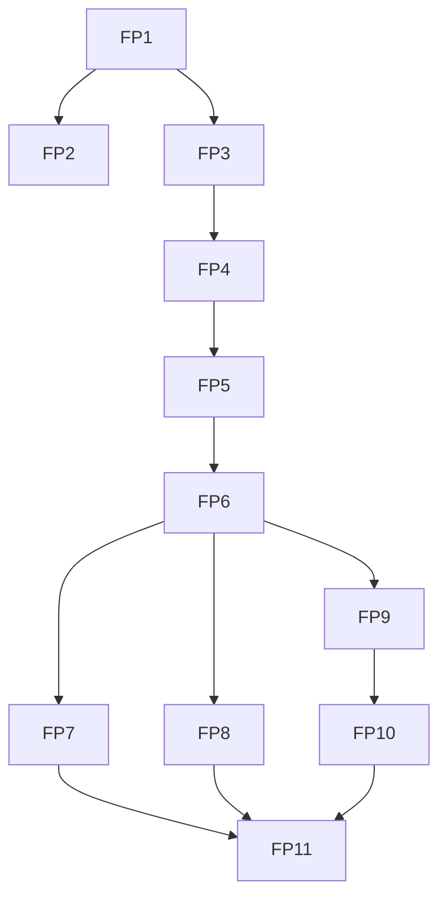
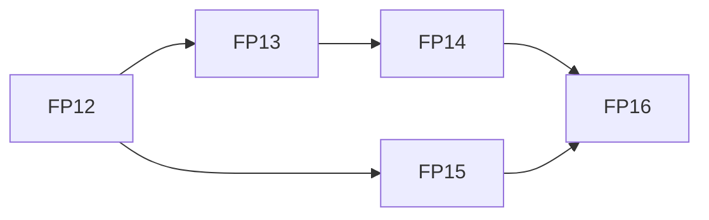

# Feature-by-Feature Implementation Plan

Atlas version: `2026-11-13.1`
Historical atlas baseline: `develop @ a0cba09 · reviewed working copy · 13 Nov 2026`
Historical docs baseline: `develop @ a0cba09` plus local changes, with owner rulings R1 to R13 and answers A1 to A8.
Status refresh: 2026-11-18 against `develop @ ff41c1f`; feature statuses and current-state text were updated. The atlas baseline above is historical.

## Prototype working-copy update (2026-11-13)

Reviewed against `develop @ a0cba09` plus the local working copy. The atlas version above identifies the last built viewer.

| Milestone | Prototype status |
|---|---|
| M5 | Separate sale approval, 25/40/100 receipt milestones, 90-day default review, month close, receipt exceptions, unified VIP Number and card claim are implemented. The receipt exceptions tab handles posted receipts with possible matches or approval/reference issues. Unmatched receipt intake remains open. |
| M6 | Issuance freezes the approved seller/referrer rates. Payout lists, hold resolution, recovery tracking and workbook-based allowance reviews exist. Automatic deductions await signed terms. Full automatic allowance input assembly and payroll reconciliation remain open. |
| M7 | Annual Welcome Gift, resort bill review, refund, waiver, Redemption check-in, and card servicing use the mock store. The points-per-night table still uses sample rows. |
| M8 | IGP intake, shared receipts, JA&D accreditation, Series Number and reissue, staged commission and Grant checklist exist. Grant benefits and prices over ₱9 million remain restricted by doc 14. |
| M10–M11 | Period close snapshots preserve sales, collections, commissions and saved allowance review totals in browser memory. Sales Performance includes IGP. Reconciliation and historical receipt import remain available. Final role-by-role browser sign-off and workbook comparison with official period totals are pending. |

This folder turns the AFHomes Workflow Atlas into an implementation roadmap. It lists what exists, what is missing and what is blocked, one feature at a time, grouped into feature phases.

It does not authorize any work. Per `AGENTS.md` section 7, every feature still needs explicit project-owner authorization before implementation starts.

## Folder layout

- `README.md` — this roadmap index.
- `decisions-and-gaps.md` — the decision register; not prototype-only.
- `prototype/` — all FP1–FP16 phase records, the admin UI-state audit, and the customer-portal plan. These are frontend-mock prototype records; backend, database and live-service work still require separate authorization.

## Source and authority

- The Workflow Atlas is an offline viewer built by Codex: `C:/Users/SSD-ORLANDO/.codex/visualizations/2026/11/13/01a1d2c4-6803-75d2-b0f7-ecc65baa94f1/afhomes-viewer/dist/index.html`. The previous viewer is preserved in its original folder.
- The atlas is evidence, not authority. Canonical business rules in `docs/business-rules/` win. Where the atlas and a rule differ, the feature card cites both and points to the decision item. It never resolves the difference.
- Atlas coverage: 10 modules, 16 roles, 60 indexed routes, 12 journeys (J01 to J12), 12 decisions (G01 to G12), 13 scenario gaps (U01 to U13). Each journey has four views: AS-IS Manual, AS-IS System, TO-BE Proposed and Changes.
- The atlas was refreshed to `b784e30` on 2026-11-12 (version `2026-11-12.3`): G01 to G12 and U01 to U13 now carry the R1 to R13 rulings, and the text of 11 journeys (all but J03), three diagram lines and five flow-node texts were updated. The earlier build was at `a0bdcef`. Commit `fc060bb` changed commission release and payout rules, stay-point rules and instant navigation. Cards that these changes affect say so.

## Not the same as the technical phases

`docs/development/implementation.md` defines technical Phases 0 to 8 (documentation, frontend foundation, MongoDB, backend, business modules, integration, validation, deployment). This folder indexes **feature phases FP1 to FP16**, recorded under `prototype/`. A feature phase groups the features of one business area. Its features move through the technical phases: frontend mock first, then backend and database only when separately authorized.

## Feature phases

The order follows the dependency order of subphases 4A to 4L in `docs/development/implementation.md`: access first, reports last.

| Phase | File | Atlas journeys | Business rules |
|---|---|---|---|
| FP1 Organization and access | [01-organization-and-access.md](prototype/01-organization-and-access.md) | J03 | 01 |
| FP2 Public entry and sign-in | [02-public-entry-and-sign-in.md](prototype/02-public-entry-and-sign-in.md) | J01 | 01 |
| FP3 Sales network and accreditation | [03-sales-network-and-accreditation.md](prototype/03-sales-network-and-accreditation.md) | J04, J02 | 02, 03 |
| FP4 Customer applications | [04-customer-applications.md](prototype/04-customer-applications.md) | J05 | 04 |
| FP5 Products, contracts and sales | [05-products-contracts-and-sales.md](prototype/05-products-contracts-and-sales.md) | J06 | 05, 06, 13, 14 |
| FP6 Payments and verification | [06-payments-and-verification.md](prototype/06-payments-and-verification.md) | J07 | 07, 13 |
| FP7 Adjustments, cancellations and holds | [07-adjustments-cancellations-and-holds.md](prototype/07-adjustments-cancellations-and-holds.md) | J08 | 07, 08 |
| FP8 Commissions and payouts | [08-commissions-and-payouts.md](prototype/08-commissions-and-payouts.md) | J09 | 08 |
| FP9 Membership and cards | [09-membership-and-cards.md](prototype/09-membership-and-cards.md) | J10 | 06, 07, 09 |
| FP10 Stay points and services | [10-stay-points-and-services.md](prototype/10-stay-points-and-services.md) | J11 | 09, 10 |
| FP11 Reports, audit and close | [11-reports-audit-and-close.md](prototype/11-reports-audit-and-close.md) | J12 | 11, 12, 13, 14 |

Decisions and gaps: [decisions-and-gaps.md](decisions-and-gaps.md).

## UI state hardening phases (FP12 to FP16)

These phases cover loading, empty, error and busy states across the existing public site, both login pages and the admin site. They are interface-hardening phases, not new business feature phases, and they do not authorize implementation.

The public site is mock content today but will become CMS-driven. The skeletons are shaped like the real pages so they can be reused when content becomes dynamic. The login pages and the future CMS routes share the same state contract.

| Phase | File | Goal | Depends on |
|---|---|---|---|
| FP12 State foundations | [12-state-foundations.md](prototype/12-state-foundations.md) | Clarification protocol, `EmptyState`, `ErrorState`, `QueryState` retry, public skeleton compositions | none |
| FP13 Public layout and route loading | [13-public-layout-and-route-loading.md](prototype/13-public-layout-and-route-loading.md) | `(public)` route group, shared layout, route `loading.tsx`, login loading files | FP12 |
| FP14 Public empty, error and login states | [14-public-empty-and-error-states.md](prototype/14-public-empty-and-error-states.md) | FAQ/blog/Verify/OST states, login submit spinner, async-button audit | FP12, FP13 |
| FP15 Admin state audit | [15-admin-state-audit.md](prototype/15-admin-state-audit.md) | Route-by-route admin state audit and Phase 2 batch order | FP12 |
| FP16 State verification | [16-state-verification.md](prototype/16-state-verification.md) | Typecheck, lint, tests, build, browser, reduced motion, no JavaScript, final report | FP12 to FP15 |

Supporting prototype records:

- [Admin UI state audit](prototype/admin-ui-state-audit.md)
- [Customer portal prototype plan](prototype/customer-portal-plan.md)

The public route skeletons require the route group in FP13. Without it, a route `loading.tsx` renders outside `PublicLayout` and the header/footer disappear while loading. The admin work is deliberately audit-first: FP15 changes no admin page, and any fixes require a separate approved Phase 2 plan.

**Build status (2026-11-18):** FP12–FP14 implemented, FP15 audit complete, FP16 verification complete with recorded limitations. The production build passes. The only failing test is a pre-existing admin drawer logout expectation recorded in FP16; the three full-run timeouts pass when run alone. Browser checks covered 375, 768 and 1280 px; 320/1100 px, reduced-motion and no-JavaScript checks remain open.

## November 12 rule alignment

Start by verifying the contracts list, duplicate Customer ID recovery, dashboard activity, and pagination. Then align customer registration and seller attribution, VIP number issuance and commission month close, and the Annual Welcome Gift. Verify each approved slice before the next. Use synthetic data and preserve issued numbers and paid amounts. IGP planning may cover approved sale and receipt handling and the document checklist while the signed grant terms, the definition of `SUPERSEDED` and the band code above ₱9,000,000 remain open (the numbering questions are decided in doc 14 section 5). Live Redemption stays disabled; the staff prototype is authorized under the 2026-11-17 status. See the [decision register](decisions-and-gaps.md) for the pending company, Finance, and legal inputs.

### IGP prototype build sequence

1. **Seller and sale intake.** Add separate JA&D accreditation for the closing seller and any referrer. Record buyer, project, unit or lot, property owner, contract price, cash or terms, term, and clause classification. Scope records to the AFhomes channel (`A`). Reject prices above ₱9,000,000 and ineligible seller references before allocating a number. Expired accreditation remains eligible with the documented reminder. See [IGP rules §5–6](../business-rules/14-igp-sales.md#5-igp-series-number-jad-rev-7-3-to-8-ops-42-oct-r38).
2. **Numbering and receipts.** Allocate the 16-character Series Number once when recording the reservation payment or the documented Contract to Sell alternative. Use a separate monthly sequence starting at `0001`, and keep all issued numbers in history. On the documented reissue path, mark the old record Replaced, link both numbers, move the existing receipts once, and recalculate commission under the correction rules. Keep imported `SUPERSEDED` values pending review. Reuse the approval and system-wide receipt reference checks. Freeze the sale threshold and the parties' approved IGP rates when the number is issued.
3. **Sales and month-end commission.** Count only approved collections. Track the Closed Deal at its frozen threshold (initially 10%), 40% Stage 1 and full-payment dates separately. Release 40% of the commission in the Stage 1 month and the balance at full payment. Use the first open month for receipts admitted after close. Retain cancellation, refund and clawback history. Record refund amounts supplied by the Property Owner or JA&D. Use the same payout confirmation and audit controls as VIP.
4. **Document checklist.** Track paperwork status, date and signer under the Series Number. Include the Goodwill and Formal VIP Grant documents. Membership creation and benefits wait for signed terms.
5. **Acceptance checks.** With synthetic records, verify ₱9,000,000 succeeds and ₱9,000,000.01 is rejected without consuming a number. Verify month rollover, repeat issue and reissue requests, receipt transfer without duplication, the two commission releases, and grant checklist updates without issuing a membership. Verify office and seller visibility, including own-record limits for OST.

## How to read a feature card

Each card is one feature, with ID `F<phase>.<n>` (for example `F6.3`).

| Field | Meaning |
|---|---|
| Journey | Atlas journey and the TO-BE node the feature comes from. |
| Current | What the prototype does today (AS-IS System), with routes. |
| Target | The proposed behavior (TO-BE). |
| Layer | `Frontend (mock)`: can be built now over typed in-memory data. `Owner decision`: blocked until the named G or U item is decided. `Backend`: needs separate owner authorization for backend, database or real authentication. |
| Blocked by | G and U IDs from [decisions-and-gaps.md](decisions-and-gaps.md), or "none". |
| Acceptance | Concrete checks: validation, permissions, lifecycle, tests. |
| Status | `Exists` (frontend mock works), `Partial`, `Missing`, `Blocked`, `Disabled`, `Decided, awaiting build authorization`, `Deferred` or `Removed from scope`. |

## What was verified, and what was not

Historical verification at `fc060bb` while writing (the removal of the 7-day commission wait, the My Sales and HR account changes and other later changes came after that commit). Current status is in the phase docs and the 2026-11-18 refresh:
- All route folders listed in the atlas exist under `src/app/`, including the `(public)` group, `/verify` and `/register/ost`.
- U06 was open at `fc060bb`: `payment-actions.tsx` had no submitter control. The Fix and Resend control now exists in `src/panels/admin/components/payment-actions.tsx`; `payment-repository.ts` supports resubmitting a Returned payment.
- At `fc060bb` there was no Redemption or Services route under `src/app/`. The authorized staff Redemption prototype now exists at `/admin/redemption`; Services remains without a route.
- The changes between `a0bdcef` and `fc060bb` touch `src/modules/commissions/rules.ts`, `src/data/mock/commission-repository.ts`, `src/modules/finance/milestones.ts`, `src/modules/stay-points/engine.ts` and a few panel files.

Taken from the atlas and not re-checked in code: every other AS-IS statement. Treat those statuses as "per atlas `2026-11-12.3`" until the feature is picked up. Tests, lint and build were not run, because this is documentation only.

## Rules that apply to every feature

- Frontend first, typed in-memory mock data, no persisted business records (`AGENTS.md` section 4).
- UI follows `AGENTS.md` section 8: shadcn/ui on Base UI, Tailwind CSS 4, no new Ant Design usage.
- Business rules are referenced by path and section, never copied. No prices, rates or policies are invented. Unresolved items stay unresolved.
- Live Redemption and Services stay disabled; the staff Redemption prototype is authorized.
- Only the owner stages, commits and pushes.
