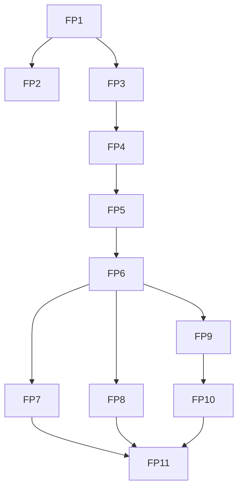

# Feature-by-Feature Implementation Plan

Atlas version: `2026-11-12.1`
Atlas baseline: `develop @ a0bdcef · reviewed working copy · 12 Nov 2026`
Docs written against: `develop @ fc060bb`

This folder turns the AFHomes Workflow Atlas into an implementation roadmap. It lists what exists, what is missing and what is blocked, one feature at a time, grouped into feature phases.

It does not authorize any work. Per `AGENTS.md` section 7, every feature still needs explicit project-owner authorization before implementation starts.

## Source and authority

- The Workflow Atlas is an offline viewer built by Codex: `C:/Users/SSD-ORLANDO/.codex/visualizations/2026/11/12/01a1cd9b-0453-7c43-bed7-0f196ed66259/afhomes-viewer/dist/index.html`. It is the project's workflow memory. The command `/update-workflow-atlas` keeps it current (see `workflow/update-workflow-atlas.md`).
- The atlas is evidence, not authority. Canonical business rules in `docs/business-rules/` win. Where the atlas and a rule differ, the feature card cites both and points to the decision item. It never resolves the difference.
- Atlas coverage: 10 modules, 16 roles, 53 routes, 12 journeys (J01 to J12), 12 decisions (G01 to G12), 13 scenario gaps (U01 to U13). Each journey has four views: AS-IS Manual, AS-IS System, TO-BE Proposed and Changes.
- The atlas was built at `a0bdcef`. Commit `fc060bb` changed commission release and payout rules, stay-point rules and instant navigation. Cards that these changes affect say so.

## Not the same as the technical phases

`docs/development/implementation.md` defines technical Phases 0 to 8 (documentation, frontend foundation, MongoDB, backend, business modules, integration, validation, deployment). This folder defines **feature phases FP1 to FP11**. A feature phase groups the features of one business area. Its features move through the technical phases: frontend mock first, then backend and database only when separately authorized.

## Feature phases

The order follows the dependency order of subphases 4A to 4L in `docs/development/implementation.md`: access first, reports last.

| Phase | File | Atlas journeys | Business rules |
|---|---|---|---|
| FP1 Organization and access | [phase-01-organization-and-access.md](phase-01-organization-and-access.md) | J03 | 01 |
| FP2 Public entry and sign-in | [phase-02-public-entry-and-sign-in.md](phase-02-public-entry-and-sign-in.md) | J01 | 01 |
| FP3 Sales network and accreditation | [phase-03-sales-network-and-accreditation.md](phase-03-sales-network-and-accreditation.md) | J04, J02 | 02, 03 |
| FP4 Customer applications | [phase-04-customer-applications.md](phase-04-customer-applications.md) | J05 | 04 |
| FP5 Products, contracts and sales | [phase-05-products-contracts-and-sales.md](phase-05-products-contracts-and-sales.md) | J06 | 05, 06, 13 |
| FP6 Payments and verification | [phase-06-payments-and-verification.md](phase-06-payments-and-verification.md) | J07 | 07, 13 |
| FP7 Adjustments, cancellations and holds | [phase-07-adjustments-cancellations-and-holds.md](phase-07-adjustments-cancellations-and-holds.md) | J08 | 07, 08 |
| FP8 Commissions and payouts | [phase-08-commissions-and-payouts.md](phase-08-commissions-and-payouts.md) | J09 | 08 |
| FP9 Membership and cards | [phase-09-membership-and-cards.md](phase-09-membership-and-cards.md) | J10 | 06, 07, 09 |
| FP10 Stay points and services | [phase-10-stay-points-and-services.md](phase-10-stay-points-and-services.md) | J11 | 09, 10 |
| FP11 Reports, audit and close | [phase-11-reports-audit-and-close.md](phase-11-reports-audit-and-close.md) | J12 | 11, 12, 13 |

Decisions and gaps: [decisions-and-gaps.md](decisions-and-gaps.md).

## How to read a feature card

Each card is one feature, with ID `F<phase>.<n>` (for example `F6.3`).

| Field | Meaning |
|---|---|
| Journey | Atlas journey and the TO-BE node the feature comes from. |
| Current | What the prototype does today (AS-IS System), with routes. |
| Target | The proposed behavior (TO-BE). |
| Layer | `Frontend (mock)`: can be built now over typed in-memory data. `Owner decision`: blocked until the named G or U item is decided. `Backend`: needs separate owner authorization for backend, database or real authentication. |
| Blocked by | G and U IDs from [decisions-and-gaps.md](decisions-and-gaps.md), or "none". |
| Acceptance | Concrete checks: validation, permissions, lifecycle, tests. |
| Status | `Exists` (frontend mock works), `Partial`, `Missing`, `Blocked` or `Disabled`. |

## What was verified, and what was not

Verified against the code at `fc060bb` while writing:
- All route folders listed in the atlas exist under `src/app/`, including `/verify` and `/register/ost`.
- U06 is real: `src/panels/admin/components/payment-actions.tsx` only mentions resubmission in dialog text. No submitter control exists, while `src/data/mock/payment-repository.ts` supports resubmitting a Returned payment.
- There is no Redemption or Services route under `src/app/`.
- The changes between `a0bdcef` and `fc060bb` touch `src/modules/commissions/rules.ts`, `src/data/mock/commission-repository.ts`, `src/modules/finance/milestones.ts`, `src/modules/stay-points/engine.ts` and a few panel files.

Taken from the atlas and not re-checked in code: every other AS-IS statement. Treat those statuses as "per atlas at `a0bdcef`" until the feature is picked up. Tests, lint and build were not run, because this is documentation only.

## Rules that apply to every feature

- Frontend first, typed in-memory mock data, no persisted business records (`AGENTS.md` section 4).
- UI follows `AGENTS.md` section 8: shadcn/ui on Base UI, Tailwind CSS 4, no new Ant Design usage.
- Business rules are referenced by path and section, never copied. No prices, rates or policies are invented. Unresolved items stay unresolved.
- Redemption and Services stay disabled.
- Only the owner stages, commits and pushes.
